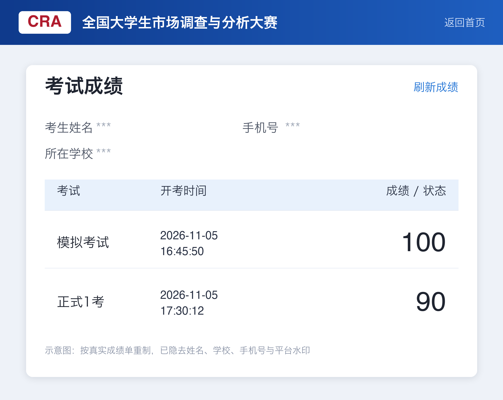
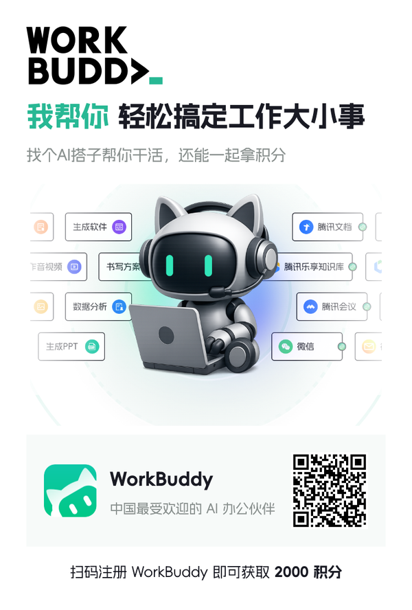

# 市调大赛 AI 知识库

[](#题库覆盖)
[](#快速开始)
[](https://www.workbuddy.cn/events/invite?inviteCode=08foyuwog)

面向 **全国大学生市场调查与分析大赛（市调大赛）理论网考** 的本地知识库：610 道历年模拟题可检索，18 章知识卡片可复习，开卷时按题干秒定位原题与答案依据。

> 第一次用？直接看 [快速开始](#快速开始)。想了解怎么复习、怎么答题，看 [`使用指南.md`](使用指南.md)。

---

## 学术诚信声明

本项目是**个人复习与开卷检索工具**，不是作弊工具。使用即表示你已了解并同意以下各点：

**1. 以赛事规则为准。** 网考是否允许查阅资料、允许查阅什么范围，一律以大赛官方通知与本校组委会规定为准。规则不允许，就不要在考试中使用。

**2. 禁止代考与替考。** 不得将本工具或其中答案用于代人答题、多人共用账号、考中传递答案等任何形式的作弊。

**3. 与官方无关。** 本仓库与大赛组委会无任何隶属或授权关系。题库、解析、知识卡片均为个人整理，**不代表官方答案**。

**4. 答案可能有误。** 题库答案取自原始模拟卷面，尚未逐题对照教材核验，已知 11 条存疑（见 [`答案存疑.md`](市调大赛AI知识库/40_质量/答案存疑.md)）。请当作参考，不要当作标准答案。

**5. 工具不能替代理解。** 它的价值是帮你更快找到题、看懂考点，而不是让你跳过学习本身。

因使用方式不当造成的违纪、成绩作废或其他后果，由使用者自行承担。

---

## 这个仓库有什么用

### 四个真实场景

| 场景 | 你的痛点 | 它怎么解决 |
|---|---|---|
| **开卷答题** | 100 分钟 85 题，翻 PDF 找题根本来不及 | 输关键词 → 10 秒内出题号、答案、章节、来源 |
| **系统复习** | 不知道 10 章从哪下手、哪些是重点 | 按题量权重排好优先级，每章告诉你高频题和易错题在哪 |
| **错题复盘** | 错了只记答案，下次换个说法又错 | 32 组重复题已聚类，搞懂一题等于拿下 2—3 道 |
| **概念辨析** | 抽样误差/非抽样误差/计量误差分不清 | 70+ 组易混概念对照表，每组带代表题号 |

### 具体能查什么

| 能力 | 说明 |
|---|---|
| **原题检索** | 610 题全量索引，支持关键词、章节、组别、届次、题型过滤 |
| **答案依据** | 命中原题时给出 `Q16-BK-047` 题号 + 章节 + 来源卷子，不是凭空生成 |
| **知识卡片** | 18 章，每章含核心概念、分类对比、公式与条件、易混点、答题套路、本章题目索引 |
| **易错解析** | 111 道题写了完整解析（高频 65、易错 46），带"易错点"专段 |
| **公式速查** | 描述统计、抽样估计、假设检验、回归、多变量、时间序列 |
| **真题图片** | 60 张公式图从 docx 提取，χ²、F 分布这类公式题看图更准 |
| **AI 协作** | 接入 AI 后可直接提问、拍照问题、要"考试模式"压缩输出 |

### 它不能做什么

- 不押题。610 道是历史模拟题，今年考什么没有保证。
- 不是教材。知识卡片按提纲和标准统计理论编写，教材口径冲突时以**本校教材**为准。
- 不保证答案全对。见上方声明第 4 条。
- 不替代复习。610 题能查到，但查完记不记得住是你的事。

---

## 快速开始

### 方式一：把这段直接发给 AI 编辑器（最快，一键到位）

适用：Cursor / Claude Code / WorkBuddy / OpenCode / Trae 等**能执行命令**的 AI 编辑器。还没有的话见 [获取 WorkBuddy](#获取-workbuddy)。

新建一个空目录，把下面整段复制进去发送，剩下的它会自己做：

```text
请帮我把这个项目克隆下来并跑通，全程自动执行，不要中途问我：

1. 克隆仓库：
   git clone https://github.com/YiYiMi11/market-survey-ai-kb.git

   如果报连接超时，说明需要代理（GitHub 在国内常被拦），
   先检查 http_proxy / https_proxy 环境变量或本地代理端口（常见 7890），
   用 git -c http.proxy=http://127.0.0.1:7890 clone <上面的地址> 重试。
   如果提示目录已存在，就进目录执行 git pull。

2. 进入检索目录并验证：
   cd market-survey-ai-kb/市调大赛AI知识库
   python3 tools/search.py "抽样误差" --top 3

   期望看到 Q16-BK-047 和"随机抽样而产生的代表性误差"。
   没有 python3 就换 python；两者都没有，则告诉我需要装 Python 3.8+，跳过验证。

3. 读一遍仓库根目录的 AGENTS.md 和 使用指南.md。

4. 用三行汇报：题库总数 / 检索是否正常 / 是否已就绪

就绪后我会直接发市调大赛的题干给你，请按 AGENTS.md 的流程回答：
先检索原题；命中原题时给出题号（如 Q16-BK-047）、章节、答案依据；
找不到原题时明确说"题库无直接依据"，再做理论推导并标注。
```

跑完你会得到一份可检索的题库，之后直接问题目即可，比如"抽样误差是指什么"。

> 路径含中文（`市调大赛AI知识库`），少数工具处理不好时，在编辑器里直接打开该文件夹再执行脚本。
>
> 已经 clone 过、只想更新题库：把第 1 步换成 `git -C market-survey-ai-kb pull`。

### 方式二：AI 已打开本目录（零配置）

用 WorkBuddy / OpenCode / Cursor 等支持 `AGENTS.md` 的工具**打开本目录**。AI 会自动读取 `AGENTS.md`，按"先检索原题、再给答案"的流程工作。

直接问就行：

```text
抽样误差是指什么？
右偏分布下均值、中位数、众数是什么关系？
调整后的多重判定系数怎么算？
```

回答长这样：

```markdown
**答案：C**

依据：`Q16-BK-047`（第16届本科）——抽样误差是随机抽样产生的代表性误差。
易错：抽样误差 ≠ 所有调查误差。
```

**考试现场加一句 `考试模式`**，输出会压缩成两行，只留答案和题号依据，不浪费时间。

**拍照/截图也能问**：把题目截图丢进去，说"这是第 73 题，直接给答案和依据"。

### 方式三：命令行检索

```bash
cd 市调大赛AI知识库

# 关键词检索
python3 tools/search.py "抽样误差" --top 5

# 加过滤：章节 / 组别 / 题型
python3 tools/search.py "量表 绝对零点" --chapter U04 --top 3
python3 tools/search.py "列联表 自由度" --group 本科 --top 3

# 按题号精确查
python3 tools/search.py --id Q16-BK-056

# JSON 输出，方便接自己的脚本
python3 tools/search.py "Logistic 优势比" --json
```

脚本内置同义词归一（平均数→均值、离散系数→变异系数、等距尺度→定距尺度、双重抽样→二重抽样等）和字符 n-gram IDF，**纯标准库，Python 3.8+ 直接跑，不装任何依赖**。

### 方式四：不装任何东西，直接读

所有内容都是 Markdown，用编辑器打开 + `Cmd+F` 搜索即可：

| 想做什么 | 打开 |
|---|---|
| 一题一行扫题 | `市调大赛AI知识库/30_速查/题干索引.md` |
| 按关键词反查 | `市调大赛AI知识库/30_速查/关键词索引.md` |
| 系统学一章 | `市调大赛AI知识库/20_知识/本科/` 或 `专科/` |
| 看高频题解析 | `市调大赛AI知识库/30_速查/高频题解析.md` |
| 看易错题解析 | `市调大赛AI知识库/30_速查/易错题解析.md` |
| 分不清两个概念 | `市调大赛AI知识库/30_速查/易混概念.md` |
| 计算题卡住 | `市调大赛AI知识库/30_速查/公式表.md` |
| 判断题专练 | `市调大赛AI知识库/30_速查/判断题陷阱.md` |
| 多选题防漏选 | `市调大赛AI知识库/30_速查/多选题清单.md` |

> 完整用法（含关键词怎么选、AI 提问模板、七天冲刺计划）见 [`使用指南.md`](使用指南.md)。

---

## 实测结果

2026-11-05 用本知识库备考后参加的官方网考，同一天连考两场：



| 场次 | 开考时间 | 成绩 |
|---|---|---:|
| 模拟考试 | 2026-11-05 16:45:50 | **100** |
| 正式 1 考 | 2026-11-05 17:30:12 | **90** |

两场均为满分 100 分制，合格线 60 分。

**实际体感**：

- 开卷检索的价值在「**秒定位原题**」——610 题里能直接命中的，基本 10 秒出答案，不用翻 PDF
- 真正卡住的是**题库没有的题**（如"非线性回归线性化""探索性研究是否必不可少"），这类要靠知识卡片推理论，工具会明确标"理论推导，非题库原答案"
- 判断题最容易翻车：绝对化措辞（"完全""只有""必须"）十有八九是错项，但也有例外（如"邮寄调查可完全避免调查员偏差"就是对的，因为限定词锁定了范围）

> ⚠️ **说明**：这是**单人、单次**实测，且正式考有 2 次机会取高分，不构成任何分数承诺。能否提分取决于你是否真的用它复习，而不是把它当答案抄。

---

## 题库覆盖

| 届次 | 组别 | 题量 |
|---|---|---:|
| 第 12 届 | 本科 | 85 |
| 第 13 届 | 本科 | 85 |
| 第 14 届 | 本科 | 85 |
| 第 15 届 | 本科 | 85 |
| 第 16 届 | 本科 | 85 |
| 第 17 届 | 本科 | 85 |
| 第 17 届 | 专科 | 100 |
| **合计** |  | **610** |

- 重复题聚类：**32 组、65 题**（历年复用明显）
- 已写解析：**111 题**（高频 65、易错 46，有重叠）
- 章节：本科 10 章（U01—U10）+ 专科 8 章（Z01—Z08）
- 图片：60 张（从 docx 提取；第 12 届有 3 题源文件未嵌入图片，无法显示）

### 考试规则速记

| 项目 | 内容 |
|---|---|
| 形式 | 个人在线考试，100 分钟，满分 100 |
| 本科题型 | 判断题 1 分 + 单选题 1 分 + 多选题 2 分，共 85 题 |
| 专科题型 | 判断题 + 单选题，共 100 题 |
| 合格线 | 60 分通过，院校通过率不低于 70% |
| 模拟考 | 2026-10-20 ~ 11-10（1 次） |
| 正式考 | 2026-11-01 ~ 11-20（2 次，取高分） |
| 报名截止 | 专 / 本科 2026-10-31；研究生 / 在华留学生 2026-11-15 |
| 报名费 | 30 元 / 人（专、本科） |

---

## 目录结构

```text
市场调研1013/
├── README.md                     # 本文件
├── 使用指南.md                    # ★ 新手先读：三种用法 + 检索技巧 + 冲刺计划
├── AGENTS.md                     # AI 入口（只保留入口与硬规则）
├── README_FOR_AI.md              # 给 AI 的详细执行说明
├── assets/                       # README 配图
│
└── 市调大赛AI知识库/              # ★ 主体
    ├── AGENTS.md                 # 完整规范：答题流程 / 数据字段 / 维护规则
    ├── 10_题库/
    │   ├── questions.jsonl       # 610 题主数据（字段最全）
    │   ├── questions.csv         # Excel 可读
    │   ├── 按届/                 # 按届次分卷
    │   ├── 按章节/               # 本科 U01—U10、专科 Z01—Z08
    │   └── assets/               # 公式与图片（60 张）
    ├── 20_知识/                  # 18 章知识卡片（本科 10 + 专科 8）
    ├── 30_速查/                  # 索引、解析、易混概念、公式、判断题、多选题
    ├── 40_质量/                  # 统计、存疑、重复题聚类、答案冲突
    ├── 50_评测/                  # 40 条基准查询与评测报告
    └── tools/                    # 构建、检索、评测脚本
```

题库答案来自原始模拟卷面，**未逐题对照教材核验**（`verified=false` 即表示未核验）。

---

## 检索评测

`市调大赛AI知识库/50_评测/` 内置 40 条换述 / 易错 / 公式图片 / 专科查询，覆盖 18 章。

| 指标 | 数值 |
|---|---:|
| Recall@1 | 95.0%（38/40） |
| Recall@5 | 100.0%（40/40） |
| MRR | 0.975 |
| 首位答案一致率 | 95.0%（38/40） |

复跑：

```bash
cd 市调大赛AI知识库 && python3 tools/evaluate.py
```

---

## 维护与重建

改了解析、标签或知识卡片后：

```bash
cd 市调大赛AI知识库

python3 tools/build_kb.py        # 重新解析原始 docx/xlsx，生成题库与质量报告
python3 tools/build_indexes.py   # 重新生成速查索引、统计、解析
python3 tools/build_knowledge.py # 重新生成 18 章知识卡片
python3 tools/evaluate.py        # 回归评测
```

**改动位置约定**

| 要改什么 | 改哪里 |
|---|---|
| 高频 / 易错解析 | `tools/explanations.py` |
| 检索标签（公式图片题、换述题） | `tools/annotations.py` |
| 知识卡片正文 | `tools/cards_ug_1.py`、`cards_ug_2.py`、`cards_zk.py` |

> 不要手动改 `questions.jsonl` 后再跑 `build_kb.py`，会被覆盖。
>
> 重建脚本需要原始赛题 docx/xlsx（本仓库未分发原始卷面），clone 后**检索与评测可用，重建不可用**。要重建请自备赛题原件，按 `tools/build_kb.py` 中 `SOURCES` 的路径放置。

---

## 已知存疑

`40_质量/答案存疑.md` 当前记录 **11 条**，主要包括：

| 题号 | 争议点 |
|---|---|
| `Q17-BK-006` | 气温资料，题库答"比率尺度"，标准理论多为"定距尺度" |
| `Q13-BK-015` | 实施力控制最低，题库答"入户面访"，常见教材认为"邮寄调查"最低 |
| `Q14-BK-023` | 前后两次测量，题库答"内部一致性"，标准理论为"再测信度" |
| `Q15-BK-024` | 品牌排序，题库答"比较法"，也可能为"排序法" |
| `Q13-BK-073` | Wilks Λ，题库含"值越大越显著"，标准口径为"越小越显著" |
| `Q15-BK-038` | 总体变异程度取 0.25（方差）还是 0.5（比例），取决于题干口径 |
| `Q16-BK-085` | 对应分析是否适合小样本，教材有争议 |
| `Q16-BK-056` | 题干未明示自变量个数，调整 R² 反推 k=5 |
| `Q12-BK-033/042/049` | 第 12 届原 Excel 未嵌入图片，无法显示 |

考试时**先按题库答案作答**；若本校教材口径不同，以教材为准，并在答题时说明依据。

---

## 获取 WorkBuddy

本知识库的「方式一 / 方式二」需要一个能读 `AGENTS.md`、能执行命令的 AI 客户端。[WorkBuddy](https://www.workbuddy.cn) 是其中一个选择：打开文件夹就会自动读取 `AGENTS.md`，直接跑 `tools/search.py`，不用手工配置。

还没有的话，扫码或点邀请链接注册：

<p align="center">
  <a href="https://www.workbuddy.cn/events/invite?inviteCode=08foyuwog">
    
  </a>
</p>

**邀请链接**：https://www.workbuddy.cn/events/invite?inviteCode=08foyuwog
（通过该链接注册可得 2000 积分，活动规则以官方页面为准）

<details>
<summary>展开邀请海报</summary>
<p align="center">
  
</p>
</details>

> 用 Cursor、Claude Code、OpenCode、Trae 等其它客户端一样可以，本项目**不绑定任何工具**。若只想用命令行或直接读 Markdown，完全不需要安装任何 AI 客户端（见快速开始的「方式三 / 方式四」）。

---

## 说明

- 参考教材：徐映梅《市场调查理论与方法（第二版）》高等教育出版社 2023；《市场调查方法与技术》第 5 版。
- 知识卡片按第 17 届提纲与标准统计理论编写，对不确定内容已标"待核对"。
- 题库完整保留原始题干与答案，本项目只做检索整理，不改题、不删题。
- 如需引用或转载，请保留出处，并注明"非官方答案"。
