# 第13届市调大赛本科模拟题

> 共 85 题

## 第1题 · 单选题

> `Q13-BK-001` ｜ 01 市场调查概述 / 研究类型 ｜ 答案 **B**

**题目**：当我们需要了解刚出现的无人超市这一零售模式的需求意愿时合适的研究方法是（ ）。

**选项**：

- A. 描述性调查
- B. 探索性调查
- C. 预测性调查
- D. 因果性调查

## 第2题 · 单选题

> `Q13-BK-002` ｜ 01 市场调查概述 / 综合 ｜ 答案 **B**

**题目**：将市场调查分为批发市场调查和零售市场调查，其分类的依据是（）。

**选项**：

- A. 购买目的
- B. 流通环节
- C. 产品层次
- D. 空间层次

## 第3题 · 单选题

> `Q13-BK-003` ｜ 02 数据收集 / 调查员管理 ｜ 答案 **A**

**题目**：当调查员认识到答案没能满足问题的意图时常常使用的一种技巧是（）。

**选项**：

- A. 追问
- B. 重复
- C. 改述
- D. 适当的停顿

## 第4题 · 单选题

> `Q13-BK-004` ｜ 02 数据收集 / 定性调查 ｜ 答案 **B**

**题目**：访谈调查法可以分为定量调查方法和定性调查方法，下列不属于定量调查方法的是（ ）。

**选项**：

- A. 访问调查
- B. 座谈会
- C. 电脑辅助调查
- D. 邮寄调查

## 第5题 · 单选题

> `Q13-BK-005` ｜ 02 数据收集 / 网络调查 ｜ 答案 **D**

**题目**：网络调查的突出优点是（ ）。

**选项**：

- A. 调查对象范围较广
- B. 不存在系统误差
- C. 调查过程易于控制
- D. 成本较低、传播迅速

## 第6题 · 单选题

> `Q13-BK-006` ｜ 02 数据收集 / 面访调查 ｜ 答案 **A**

**题目**：面访调查的主要优点在于（ ）。

**选项**：

- A. 能取得较高的回答率
- B. 可进行单一内容的调查
- C. 可节省调查费用
- D. 容易管理

## 第7题 · 单选题

> `Q13-BK-007` ｜ 02 数据收集 / 投影技法 ｜ 答案 **A**

**题目**：如果想获取“拥有或使用某产品对消费者的影响”的相关信息，合适的调查方法是（）。

**选项**：

- A. 投影技法
- B. 电话调查
- C. 深度访谈法
- D. 小组座谈法

## 第8题 · 单选题

> `Q13-BK-008` ｜ 02 数据收集 / 实验法 ｜ 答案 **A**

**题目**：市场实验设计中控制因实验单位之间差别造成影响的方法是（）。

**选项**：

- A. 实验设计方法
- B. 随机抽样方法
- C. 排除因素方法
- D. 固定变量方法

## 第9题 · 单选题

> `Q13-BK-009` ｜ 01 市场调查概述 / 应用范围 ｜ 答案 **A**

**题目**：如果欲获得产品的渗透水平和渗透深度、产品使用者和购买者的人口统计特征、消费者的使用习惯和购买习惯，则需进行（ ）。

**选项**：

- A. 消费者使用与态度调研
- B. 产品概念测试
- C. 品牌名称定量测试
- D. 包装测试

**解析**：消费者使用与态度研究（U&A）专门覆盖产品渗透水平与渗透深度、使用者/购买者人口统计特征、使用习惯和购买习惯。产品概念测试、品牌名称测试、包装测试只覆盖特定环节。

**易错点**：“渗透水平+使用习惯+购买者特征”是 U&A 的典型组合，不要误选概念测试。

## 第10题 · 单选题

> `Q13-BK-010` ｜ 04 问卷与量表 / 测量尺度 ｜ 答案 **A**

**题目**：问卷选项中的“性别：1. □男 2. □ 女”属于哪一种测量尺度。（）

**选项**：

- A. 定类尺度
- B. 顺序尺度
- C. 等距尺度
- D. 比率尺度

## 第11题 · 单选题

> `Q13-BK-011` ｜ 02 数据收集 / 调查员管理 ｜ 答案 **B**

**题目**：以下哪种调查方法可以较好的实现对调查员的质量控制？（ ）

**选项**：

- A. 入户调查
- B. 电话调查
- C. 邮寄调查
- D. 街头拦访调查

## 第12题 · 单选题

> `Q13-BK-012` ｜ 01 市场调查概述 / 综合 ｜ 答案 **D**

**题目**：以下属于市场调研问题的是（ ）。

**选项**：

- A. 是否应该市场细分
- B. 是否增加促销预算
- C. 怎样挽回已经失去的市场份额
- D. 什么信息是需要的

## 第13题 · 单选题

> `Q13-BK-013` ｜ 02 数据收集 / 观察法 ｜ 答案 **B**

**题目**：前期观察对后期观察可能产生的影响称为（ ）。

**选项**：

- A. 次效应
- B. 主效应
- C. 强化效应
- D. 弱化效应

**解析**：前期观察对后期观察产生的影响称为主效应（也称测验效应/练习效应），属于实验或重复测量中的顺序效应。

**易错点**：主效应不是“主要效果”的意思；次效应、强化效应、弱化效应都不是该定义的术语。

## 第14题 · 单选题

> `Q13-BK-014` ｜ 02 数据收集 / 调查员管理 ｜ 答案 **A**

**题目**：调查员访谈结束后整理记录遵循的原则是（）。

**选项**：

- A. 实事求是，客观记录
- B. 可按照自己的理解记录
- C. 可根据自己的回忆补充记录
- D. 遇到模糊的记录就删除

## 第15题 · 单选题

> `Q13-BK-015` ｜ 02 数据收集 / 调查方法比较 ｜ 答案 **A**

**题目**：下列调查中，实施力控制程度最低的是（ ）。

**选项**：

- A. 入户面访
- B. 电话调查
- C. 邮寄调查
- D. 拦截面访

**待核对**：题库答案将“实施力控制程度最低”判为入户面访（A）。常见教材表述中，邮寄调查的现场实施控制程度通常最低。考试以题库答案为准，建议结合本校教材核对。

## 第16题 · 单选题

> `Q13-BK-016` ｜ 02 数据收集 / 调查员管理 ｜ 答案 **D**

**题目**：下列调查中，调查员不与被调查对象直接接触的是（ ）。

**选项**：

- A. 街头拦截调查
- B. 面访调查
- C. 深度访谈调查
- D. 直接观察法

## 第17题 · 单选题

> `Q13-BK-017` ｜ 02 数据收集 / 电话调查 ｜ 答案 **A**

**题目**：下列调查项目中，属于电话调查应用范围的是（ ）。

**选项**：

- A. 热点问题或突发性问题的快速调查
- B. 居民能源消费调查
- C. 制造业PMI调查
- D. 需要进行深层访谈的调查

## 第18题 · 单选题

> `Q13-BK-018` ｜ 07 抽样估计 / 无回答 ｜ 答案 **A**

**题目**：无回答的类型是指（）。

**选项**：

- A. 单元无回答与项目无回答
- B. 单指单元无回答
- C. 单指项目无回答
- D. 对象无回答

## 第19题 · 单选题

> `Q13-BK-019` ｜ 06 单变量分析 / 假设检验 ｜ 答案 **C**

**题目**：在假设检验中，不拒绝零假设意味着（）。

**选项**：

- A. 零假设肯定是正确的
- B. 零假设肯定是错误的
- C. 没有证据证明零假设是错误的
- D. 没有证据证明零假设是正确的

## 第20题 · 单选题

> `Q13-BK-020` ｜ 03 调查设计 / 调查设计 ｜ 答案 **A**

**题目**：确定调查方式要做的工作包括（ ）。

**选项**：

- A. 调查的组织方式
- B. 数据采集方法
- C. 数据处理方法
- D. 数据分析方法

## 第21题 · 单选题

> `Q13-BK-021` ｜ 04 问卷与量表 / 问卷设计 ｜ 答案 **B**

**题目**：关于问卷中问题的排列，下列说法中错误的是（ ）。

**选项**：

- A. 问题排列应具有逻辑性
- B. 所有问题必须随机排列
- C. 问题的排列要避免顺序效应
- D. 问题的排列要考虑时间要素

## 第22题 · 单选题

> `Q13-BK-022` ｜ 04 问卷与量表 / 量表 ｜ 答案 **D**

**题目**：如果一个变量存在绝对零点，则对其测量最合适的量表是（ ）。

**选项**：

- A. 定类量表
- B. 定序量表
- C. 定距量表
- D. 定比量表

**解析**：存在绝对零点的变量可以进行乘除运算，最适合用定比量表测量。

**易错点**：定距量表有相等单位但没有绝对零点；绝对零点是定比的关键。

## 第23题 · 单选题

> `Q13-BK-023` ｜ 04 问卷与量表 / 量表 ｜ 答案 **D**

**题目**：如果一个量表的测量结果适用于任何统计分析方法，则该量表应该是()。

**选项**：

- A. 定类量表
- B. 定序量表
- C. 定距量表
- D. 定比量表

## 第24题 · 单选题

> `Q13-BK-024` ｜ 04 问卷与量表 / 量表 ｜ 答案 **A**

**题目**：语义差别量表中所涉及的“评价因素”针对商品而言是指（）。

**选项**：

- A. 商品的品质、等级
- B. 商品的尺寸、体积
- C. 商品广告
- D. 商品的销售网络

## 第25题 · 单选题

> `Q13-BK-025` ｜ 04 问卷与量表 / 问题设计 ｜ 答案 **C**

**题目**：“您经常在超市购物吗？”这一问句存在的主要问题是（）。

**选项**：

- A. 表述不准确
- B. 时间限定周期较长
- C. 表述不清晰明了
- D. 表述太简洁

## 第26题 · 单选题

> `Q13-BK-026` ｜ 08 双变量关联分析 / 相关分析 ｜ 答案 **B**

**题目**：常用的测度变量之间相关关系的直观方法有（ ）。

**选项**：

- A. 直方图法
- B. 散点图法
- C. 折线图法
- D. 饼状图法

## 第27题 · 单选题

> `Q13-BK-027` ｜ 05 数据处理与报告 / 数据整理 ｜ 答案 **A**

**题目**：对数据分类或分组前所做的必要处理，这项工作常称为（ ）。

**选项**：

- A. 预处理
- B. 统计分析
- C. 汇总
- D. 排序

**解析**：对数据分类或分组之前所做的审核、编码、清理等必要处理称为预处理。统计分析和汇总都发生在预处理之后。

**易错点**：“排序”只是整理的一种操作，不能概括分类分组前的全部处理。

## 第28题 · 单选题

> `Q13-BK-028` ｜ 05 数据处理与报告 / 缺失值插补 ｜ 答案 **C**

**题目**：采用同一个数据集或同一次调查数据进行插补的方法称为（）

**选项**：

- A. 冷卡插补
- B. 同层插补
- C. 热卡插补
- D. 并行插补

**解析**：热卡插补是在同一个数据集或同一次调查中，为缺失单元寻找相似单元进行插补；冷卡插补使用历史数据或外部数据。

**易错点**：“同一数据集/同一次调查”是热卡的关键词；“同层插补”不是这个定义的名称。

## 第29题 · 单选题

> `Q13-BK-029` ｜ 05 数据处理与报告 / 调查报告 ｜ 答案 **A**

**题目**：下列内容不包含在市场调查报告正文部分的是（ ）。

**选项**：

- A. 参考书目与附录
- B. 调查对象与调查方法
- C. 调查结论和建议
- D. 调查背景说明

**解析**：市场调查报告正文一般包括调查背景、调查对象与方法、调查结果、结论与建议。参考书目和附录属于报告结尾或附录部分，不属于正文。

**易错点**：附录、参考书目、致谢都不算正文；正文要放“结论和建议”。

## 第30题 · 单选题

> `Q13-BK-030` ｜ 05 数据处理与报告 / 调查报告 ｜ 答案 **A**

**题目**：调查报告的附录中应包含的内容是（）。

**选项**：

- A. 参考书目、调查问卷、数据表等
- B. 只有调查问卷
- C. 只有数据汇总表
- D. 内容摘要、数据表等

## 第31题 · 单选题

> `Q13-BK-031` ｜ 06 单变量分析 / 离散程度 ｜ 答案 **B**

**题目**：两组数据的均值不等，但标准差相同，则（ ）。

**选项**：

- A. 两组数据的差异程度相同
- B. 均值小的差异程度大
- C. 均值大的差异程度大
- D. 无法判断

**解析**：标准差相同说明两组数据的绝对离散程度相同，但均值不同时，相对离散程度要用变异系数（标准差/均值）比较。均值越小，变异系数越大，相对差异越大。

**易错点**：题目问“差异程度”时要区分绝对离散（标准差）和相对离散（变异系数）。

## 第32题 · 单选题

> `Q13-BK-032` ｜ 04 问卷与量表 / 测量尺度 ｜ 答案 **C**

**题目**：下列可以反映定类数据的位置集中趋势是（ ）。

**选项**：

- A. 算术平均数
- B. 调和平均数
- C. 众数
- D. 几何平均数

## 第33题 · 单选题

> `Q13-BK-033` ｜ 06 单变量分析 / 集中趋势 ｜ 答案 **B**

**题目**：在右偏态分布条件下算术平均数、中位数和众数的关系表现为().

**选项**：

- A. 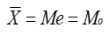
- B. 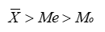
- C. 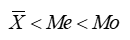
- D. 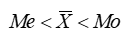

**解析**：右偏（正偏）分布中，极端大值把均值拉向右侧，一般有均值 > 中位数 > 众数。

**易错点**：右偏是“尾巴在右”，不是“众数在右”；记“均值追尾巴”。

## 第34题 · 单选题

> `Q13-BK-034` ｜ 07 抽样估计 / 抽样基础 ｜ 答案 **A**

**题目**：下列图形中，更适用于比较研究两个或多个样本或总体的结构性问题的是（ ）。

**选项**：

- A. 环形图
- B. 饼图
- C. 直方图
- D. 茎叶图

## 第35题 · 单选题

> `Q13-BK-035` ｜ 06 单变量分析 / 离散程度 ｜ 答案 **A**

**题目**：在离散程度的测度中，不容易受极端值影响的是（ ）。

**选项**：

- A. 四分位差
- B. 平均差
- C. 标准差
- D. 离散系数

## 第36题 · 单选题

> `Q13-BK-036` ｜ 07 抽样估计 / 标准误 ｜ 答案 **C**

**题目**：根据抽样调查资料，某企业工人生产定额平均完成率105%，抽样标准误差为1%，置信度为0.9545（t＝2）时，可以估计该企业生产定额平均完成率（ ）。

**选项**：

- A. 大于107%
- B. 在104%和106%之间
- C. 在103%和107%之间
- D. 小于103%

## 第37题 · 单选题

> `Q13-BK-037` ｜ 07 抽样估计 / 标准误 ｜ 答案 **C**

**题目**：为了研究儿童的成长发育状况，随机抽取了36名儿童，测得平均身高为120CM，标准差为9，抽样标准误差为1.5，则下列各项中正确的是（ ）。

**选项**：

- A. 抽样标准误差是总体数据的标准差
- B. 抽样标准误差是样本数据的标准差
- C. 抽样标准误差是样本均值的标准差
- D. 抽样标准误差是抽样产生的实际误差

## 第38题 · 单选题

> `Q13-BK-038` ｜ 07 抽样估计 / 抽样调查 ｜ 答案 **B**

**题目**：抽样调查的精度是指（ ）

**选项**：

- A. 估计量的抽样误差与待估的参数之比
- B. 估计量的抽样标准误差与待估的参数之比
- C. 估计量的抽样误差与方差之比
- D. 估计量的抽样标准误差与方差之比

## 第39题 · 单选题

> `Q13-BK-039` ｜ 07 抽样估计 / 样本量 ｜ 答案 **A**

**题目**：当抽样方式与样本容量不变的条件下，置信区间越大则使（ ）。

**选项**：

- A. 可靠性越大
- B. 可靠性越小
- C. 估计的误差越小
- D. 可靠性及估计误差均越小

**解析**：在抽样方式和样本容量不变时，置信区间越宽，对应的置信度（可靠性）越高，但估计精度越低。

**易错点**：区间宽=更可靠但更不精确；不要选“误差越小”。

## 第40题 · 单选题

> `Q13-BK-040` ｜ 07 抽样估计 / 抽样方法 ｜ 答案 **A**

**题目**：某校高三年级学生共l000人参加考试，将1000份试卷编好号码后，从中随机抽取30份计算平均成绩，此种抽样方法为（ ）。

**选项**：

- A. 简单随机抽样
- B. 系统随机抽样
- C. 分层抽样
- D. 整群抽样

## 第41题 · 单选题

> `Q13-BK-041` ｜ 07 抽样估计 / 简单随机抽样 ｜ 答案 **B**

**题目**：与简单随机抽样相比，复杂抽样设计的估计值的精确程度（）。

**选项**：

- A. 一定高
- B. 不一定高
- C. 一定低
- D. 不能比

## 第42题 · 单选题

> `Q13-BK-042` ｜ 07 抽样估计 / 抽样调查 ｜ 答案 **D**

**题目**：某社区想对社区内患有高血压的人群进行抽样调查，先抽取一个比较大的样本，从中筛查出高血压人群，然后再从这些人群中抽取一个小的样本进行详细医疗检查。这样的抽样组织形式是（）。

**选项**：

- A. 分层抽样
- B. 整群抽样
- C. 二阶抽样
- D. 二重抽样

**解析**：先抽取一个较大样本筛查出稀有子群，再从中抽取较小样本做详细调查，属于二重抽样。二阶抽样是把同一总体分阶段逐级抽取抽样单元。

**易错点**：二重抽样是“两次抽取、两次筛选”；二阶抽样是“分阶段抽单位”，不要混淆。

## 第43题 · 单选题

> `Q13-BK-043` ｜ 07 抽样估计 / 非抽样误差 ｜ 答案 **C**

**题目**：以下哪项调查会出现计量误差（）。

**选项**：

- A. 根据一份旧名单来抽取部分职工进行民意调查
- B. 随机抽取100名同学进行上网时间调查，仅70名同学进行了回答
- C. 在工业企业抽样调查中，不少企业隐瞒了产值或销售收入资料
- D. 通过对我校校内的学生宿舍进行随机抽样，推断全校学生学习情况

## 第44题 · 单选题

> `Q13-BK-044` ｜ 07 抽样估计 / 抽样框 ｜ 答案 **C**

**题目**：以下哪项调查会出现抽样框误差（）。

**选项**：

- A. 利用了不够准确的辅助信息进行分层
- B. 随机抽取100名同学进行上网时间调查，仅80名同学进行了回答
- C. 根据一份旧名单来抽取部分职工进行民意调查
- D. 在工业企业抽样调查中，不少企业隐瞒了产值或销售收入资料

## 第45题 · 单选题

> `Q13-BK-045` ｜ 07 抽样估计 / 样本量 ｜ 答案 **C**

**题目**：在计算样本量时，需要考虑的两个基本因素是（）。

**选项**：

- A. 总体规模大小和抽样方式
- B. 调查经费限制和时间限制
- C. 总体变异度和调查精度要求
- D. 回答率

**解析**：计算样本量时最基本的两个因素是总体变异程度和调查精度要求；总体规模、经费、回答率会影响实际实施，但不是公式中的两个基本决定因素。

**易错点**：总体规模在简单随机抽样样本量公式中通常不直接出现。

## 第46题 · 单选题

> `Q13-BK-046` ｜ 02 数据收集 / 固定样本 ｜ 答案 **B**

**题目**：关于固定样本调查的描述错误的是（）。

**选项**：

- A. 从长期来看节约了调查费用和资源
- B. 对总体推断更加准确
- C. 可以利用各期的调查信息作为辅助信息
- D. 回答负担会加重

## 第47题 · 单选题

> `Q13-BK-047` ｜ 07 抽样估计 / 辅助变量 ｜ 答案 **D**

**题目**：关于辅助变量信息的描述，正确的是（ ）。

**选项**：

- A. 辅助变量信息只能用于抽样设计环节
- B. 辅助变量信息只能用于抽样估计环节
- C. 辅助变量与调查变量之间要存在因果性关系
- D. 辅助变量与调查变量之间要存在相关性

**解析**：辅助变量需要与研究变量存在相关性，才能在抽样设计和估计中提供信息；不要求二者存在因果关系。辅助变量既可用于设计阶段，也可用于估计阶段。

**易错点**：“相关”不等于“因果”；辅助变量不是只能用于某一个阶段。

## 第48题 · 单选题

> `Q13-BK-048` ｜ 07 抽样估计 / 辅助变量 ｜ 答案 **C**

**题目**：在抽样设计环节，可以利用辅助变量信息进行（）

**选项**：

- A. 比率估计
- B. 回归估计
- C. 分层
- D. 事后分层

**解析**：在抽样设计环节，可以利用辅助变量进行分层，使层内同质、层间异质。比率估计和回归估计属于抽样估计阶段的方法。

**易错点**：题目问“抽样设计环节”，不要选比率估计/回归估计。

## 第49题 · 单选题

> `Q13-BK-049` ｜ 07 抽样估计 / 估计量 ｜ 答案 **A**

**题目**：样本估计量的概率分布称为（）。

**选项**：

- A. 抽样分布
- B. 总体分布
- C. 样本分布
- D. 统计分布

**解析**：样本估计量的概率分布称为抽样分布；总体分布描述总体，样本分布描述样本观测值。

**易错点**：抽样分布的对象是“估计量”，不是单个样本观测值。

## 第50题 · 单选题

> `Q13-BK-050` ｜ 07 抽样估计 / 样本量 ｜ 答案 **B**

**题目**：如果总体目标参数是总体比例，且对于总体比例的大小一无所知，此时为确保达到调查要求的精度，在计算样本量时，可将总体比例的取值设定为（）。

**选项**：

- A. 0
- B. 0.5
- C. 0.25
- D. 1

**解析**：总体比例未知时，取 p=0.5 使 p(1-p) 最大，从而得到最保守（最大）的样本量，确保达到精度要求。

**易错点**：比例取 0.5，对应的方差是 0.25，两个数字不要混。

## 第51题 · 单选题

> `Q13-BK-051` ｜ 08 双变量关联分析 / 回归分析 ｜ 答案 **A**

**题目**：已知某工厂甲产品产量和生产成本有直线关系，在这条直线上，当产量为1000时，其生产成本为32000元，其中不随产量变化的成本为8000元，则成本总额对产量的回归方程是（ ）。

**选项**：

- A. ŷ=8000+24x
- B. ŷ=6+0.24x
- C. ŷ=24000+6x
- D. ŷ=24+6000x

## 第52题 · 单选题

> `Q13-BK-052` ｜ 08 双变量关联分析 / 回归分析 ｜ 答案 **C**

**题目**：在回归直线方程y=a+bx中，b称为回归系数，其含义不包括以下哪一项（）。

**选项**：

- A. 确定两变量之间因果的数量关系
- B. 确定两变量的相关方向
- C. 确定因变量的实际值与估计值的变异程度
- D. 确定当自变量增加一个单位时，因变量的平均增加量

## 第53题 · 单选题

> `Q13-BK-053` ｜ 08 双变量关联分析 / 回归分析 ｜ 答案 **B**

**题目**：如果y关于x的回归方程为ŷ＝3－2x，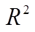＝0.81，则x与y之间的相关系数是（ ）。

**选项**：

- A. 0.9
- B. -0.9
- C. 0.8
- D. -0.8

**解析**：回归方程为 ŷ=3-2x，斜率 -2 表示负相关；R²=0.81，所以 |r|=0.9，结合负斜率得 r=-0.9。

**易错点**：R² 开方只给绝对值，符号必须由回归系数决定。

## 第54题 · 单选题

> `Q13-BK-054` ｜ 08 双变量关联分析 / 列联分析 ｜ 答案 **A**

**题目**：当|φ|＝1时，2×2列联表中的两个变量（ ）。

**选项**：

- A. 完全相关
- B. 相互独立
- C. 存在正相关关系
- D. 存在负相关关系

**解析**：2×2 列联表中 |φ|=1 表示两个变量完全相关，φ 的符号表示相关方向。

**易错点**：φ=0 才是相互独立；|φ|=1 是完全相关。

## 第55题 · 单选题

> `Q13-BK-055` ｜ 09 多变量分析（一） / 方差分析 ｜ 答案 **C**

**题目**：用方差分析对多个总体的参数进行检验时，统计量MSA/MSE服从的分布是（　　）。

**选项**：

- A. 分布
- B. 正态分布
- C. F分布
- D. t分布

**解析**：方差分析中检验统计量 MSA/MSE 服从 F 分布，自由度为 (k-1, n-k)。

**易错点**：不要选 t 分布；t 检验用于两组均值，方差分析用于多组均值。

## 第56题 · 单选题

> `Q13-BK-056` ｜ 08 双变量关联分析 / 回归诊断 ｜ 答案 **D**

**题目**：关于回归模型中的DW统计量，以下说法中错误的是（ ）。

**选项**：

- A. DW值越接近于2，表明相关系数越接近于0
- B. DW值介于0到4之间
- C. 当DW值越接近于4时，表明相关系数越接近于-1
- D. 当DW值越接近于0时，表明相关系数越接近于-1

**解析**：DW 统计量取值 0—4：接近 2 表示无自相关；接近 0 表示正自相关（ρ≈1）；接近 4 表示负自相关（ρ≈-1）。因此“DW 接近 0 表示负相关”是错误的。

**易错点**：DW 接近 0 是正自相关，不是负自相关。

## 第57题 · 单选题

> `Q13-BK-057` ｜ 07 抽样估计 / 样本量 ｜ 答案 **C**

**题目**：多元线性回归模型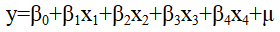中，估计的残差平方和为900，样本容量为50，则随机误差项μ的方差估计量为（）。

**选项**：

- A. 18
- B. 19.57
- C. 20
- D. 20.93

## 第58题 · 单选题

> `Q13-BK-058` ｜ 10 多变量分析（二） / 聚类分析 ｜ 答案 **B**

**题目**：聚类分析中，（）也叫做快速聚类法。

**选项**：

- A. 系统聚类
- B. K均值聚类
- C. FCM聚类
- D. 密度聚类

## 第59题 · 单选题

> `Q13-BK-059` ｜ 10 多变量分析（二） / 综合评价 ｜ 答案 **C**

**题目**：评价指标体系的构建原则不包括（）。

**选项**：

- A. 系统全面性
- B. 稳定可比性
- C. 简单节约性
- D. 灵活可操性

## 第60题 · 多选题

> `Q13-BK-060` ｜ 01 市场调查概述 / 应用范围 ｜ 答案 **ABCD**

**题目**：下列属于市场研究内容的是（ ）。

**选项**：

- A. 估计产品市场的现有规模
- B. 估计产品市场的潜在规模
- C. 估计市场占有率
- D. 分析产品销售渠道
- E. 研究购买决策

## 第61题 · 多选题

> `Q13-BK-061` ｜ 02 数据收集 / 二手数据 ｜ 答案 **ABCDE**

**题目**：按照检索功能划分，计算机检索可分为（）。

**选项**：

- A. 通配检索
- B. 邻词检索
- C. 范围检索
- D. 字段检索
- E. 跨字段逻辑组配检索

## 第62题 · 多选题

> `Q13-BK-062` ｜ 07 抽样估计 / 调查分类 ｜ 答案 **BCDE**

**题目**：下列说法正确的是（ ）。

**选项**：

- A. 从调查单位中选取少数重点单位进行调查的方法是典型调查
- B. 典型调查的目的是描述和揭示事物的本质和规律
- C. 重点调查的结果不能用于推断总体
- D. 典型调查的结果不能用于推断总体
- E. 普查是为特定目的所专门组织的非经常性全面调查

## 第63题 · 多选题

> `Q13-BK-063` ｜ 02 数据收集 / 面访调查 ｜ 答案 **BD**

**题目**：面访中不正确使用的提问方式有（ ）。

**选项**：

- A. 重复提问
- B. 用诱导性语言提问
- C. 启发性地帮助被调查者回忆
- D. 不按照问卷顺序提问
- E. 鼓励被调查者使他们放心回答

## 第64题 · 多选题

> `Q13-BK-064` ｜ 02 数据收集 / 统计报表 ｜ 答案 **CDE**

**题目**：不适合采用统计报表调查的场景有（）。

**选项**：

- A. 规上企业联网直报
- B. 限额以上进出口统计
- C. 民营企业景气调查
- D. 消费者信心调查
- E. 采购经理人指数编制调查

## 第65题 · 多选题

> `Q13-BK-065` ｜ 01 市场调查概述 / 调查行业 ｜ 答案 **ABCE**

**题目**：下列属于调查提供者责任的有（）。

**选项**：

- A. 与委托人进行充分的交流
- B. 就经费问题与委托方磋商
- C. 回答委托人的咨询
- D. 说明项目完成的时间要求
- E. 为调查结果保密

## 第66题 · 多选题

> `Q13-BK-066` ｜ 04 问卷与量表 / 量表 ｜ 答案 **ADE**

**题目**：下列关于量表的说法正确的有（ ）

**选项**：

- A. 高计量层次的量表可转化为低层次的量表
- B. 排列式量表与分等式量表并无本质差异
- C. 低计量层次的量表可上升为高层次量表
- D. 平衡量表不易产生回答偏差
- E. 表式量表有利于提高回答效率

## 第67题 · 多选题

> `Q13-BK-067` ｜ 05 数据处理与报告 / 问卷检查 ｜ 答案 **ACDE**

**题目**：关于问卷的接受与检查表述正确的是（ ）。

**选项**：

- A. 这是完成每一份问卷都需要做的工作
- B. 只是在调查活动完成后统一做的工作
- C. 需要认真细致，规范操作
- D. 需要边实施边发现问题边纠正或改进
- E. 一般需要设计一套工作系统进行管理

## 第68题 · 多选题

> `Q13-BK-068` ｜ 06 单变量分析 / 概率基础 ｜ 答案 **BD**

**题目**：设A、B为任意两事件，则下列关系成立的有（　　）

**选项**：

- A. 
- B. 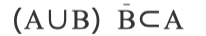
- C. 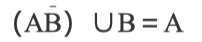
- D. 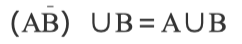
- E. 

## 第69题 · 多选题

> `Q13-BK-069` ｜ 07 抽样估计 / 抽样估计 ｜ 答案 **ABCDE**

**题目**：在已知相关信息的条件下，进行分层抽样的区间估计的步骤依次为（）。

**选项**：

- A. 以各层权数进行加权平均计算总平均数
- B. 采用简单算术平均方法，计算各层样本平均数。
- C. 计算层间方差与标准差
- D. 计算各层抽样方差
- E. 根据显著性水平构造估计区间

## 第70题 · 多选题

> `Q13-BK-070` ｜ 07 抽样估计 / 多阶段抽样 ｜ 答案 **ABC**

**题目**：在实际的多阶抽样中，为保证调查的顺利实施，各阶段抽样单元的划分一般可考虑以下一些方法（）。

**选项**：

- A. 按行政区划
- B. 按地理位置归属
- C. 按自然形成的群体
- D. 按居民收入高低划分
- E. 按照总体单元的规模大小

## 第71题 · 多选题

> `Q13-BK-071` ｜ 08 双变量关联分析 / 回归分析 ｜ 答案 **ACE**

**题目**：某研究员通过最小二乘法估计销售收入y与广告投入费用x的线性回归关系，其线性回归模型为：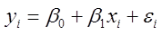，并进行显著性检验，则下列符合误差项假定的是（ ）。

**选项**：

- A. 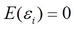
- B. 
- C. 对于不同的x值，的方差相同
- D. 对于不同的x值，的分布不同
- E. 对于不同的x值，之间相互独立

## 第72题 · 多选题

> `Q13-BK-072` ｜ 08 双变量关联分析 / 回归分析 ｜ 答案 **CE**

**题目**：设Y为被解释变量，X为解释变量，用最小二乘法拟合回归方程时，其基本原理是使（ ）。

**选项**：

- A.  最小
- B. 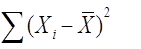最小
- C. 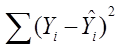最小
- D. 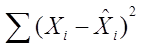最小
- E. 各观测值到回归直线的纵向距离平方和最小

**解析**：最小二乘法的基本原理是使残差平方和最小，也就是各观测值到回归直线的纵向距离平方和最小。

**易错点**：是最小化“纵向距离平方和”，不是横向距离，也不是绝对距离之和。

## 第73题 · 多选题

> `Q13-BK-073` ｜ 09 多变量分析（一） / 多变量方差分析 ｜ 答案 **BCE**

**题目**：以下对Wilks Λ统计量的理解中，正确的是（ ）。

**选项**：

- A. 其值介于0到4之间
- B. 其值介于0到1之间
- C. 它可以用于多变量方差分析的显著性检验
- D. 其值越小，表明控制变量对观测变量的影响越显著
- E. 其值越大，表明控制变量对观测变量的影响越显著

**待核对**：题库答案 BCE 中，E“Wilks Λ 值越大越显著”与标准口径相反：Wilks Λ 取值 0—1，通常越小越显著。B、C 无争议；考试以本校教材为准。

## 第74题 · 多选题

> `Q13-BK-074` ｜ 10 多变量分析（二） / 综合评价 ｜ 答案 **BCDE**

**题目**：进行多变量综合评价时，无量纲指标评价方法有（ ）。

**选项**：

- A. 总分评定法
- B. 标准化变换方法
- C. 归一化变换方法
- D. 功效系数变换方法
- E. 指数化变换方法

## 第75题 · 判断题

> `Q13-BK-075` ｜ 01 市场调查概述 / 调查项目 ｜ 答案 **B**

**题目**：为了节省费用，X公司将三个调查项目整合为一个大项目进行实施是可行的。

**选项**：

- A. 对
- B. 错

## 第76题 · 判断题

> `Q13-BK-076` ｜ 02 数据收集 / 邮寄调查 ｜ 答案 **A**

**题目**：一般情况下，入户面访比邮寄调查在数据收集的灵活性上更具优势。

**选项**：

- A. 对
- B. 错

**解析**：入户面访可以当面追问、展示卡片、观察反应并控制访问过程，因此数据收集的灵活性通常高于邮寄调查。

**易错点**：邮寄调查的优势是低成本、适合敏感问题、时效要求不高，不是灵活性。

## 第77题 · 判断题

> `Q13-BK-077` ｜ 03 调查设计 / 操作定义 ｜ 答案 **A**

**题目**：调查设计中的操作定义是指把构想转化为市场调查问题的设计过程。

**选项**：

- A. 对
- B. 错

## 第78题 · 判断题

> `Q13-BK-078` ｜ 04 问卷与量表 / 测量尺度 ｜ 答案 **A**

**题目**：等级法可以用于表示事物大小、多少之类的定距与定比问题的答案设计。

**选项**：

- A. 对
- B. 错

## 第79题 · 判断题

> `Q13-BK-079` ｜ 01 市场调查概述 / 综合 ｜ 答案 **A**

**题目**：在市场调查实施中，被调查者的安全和隐私保护一般包含在督导手册中。

**选项**：

- A. 对
- B. 错

## 第80题 · 判断题

> `Q13-BK-080` ｜ 06 单变量分析 / 统计基础 ｜ 答案 **B**

**题目**：用来描述总体的特征的概括性数字度量，称为统计量。（　　）

**选项**：

- A. 对
- B. 错

**解析**：描述总体特征的概括性数字度量称为参数；描述样本特征的才是统计量。

**易错点**：参数对应总体，统计量对应样本，方向不能反。

## 第81题 · 判断题

> `Q13-BK-081` ｜ 07 抽样估计 / 滚雪球抽样 ｜ 答案 **A**

**题目**：滚雪球抽样适用于特征稀少的群体的调查。

**选项**：

- A. 对
- B. 错

## 第82题 · 判断题

> `Q13-BK-082` ｜ 07 抽样估计 / 样本量 ｜ 答案 **B**

**题目**：样本量取决于调查估计值所要求的精度。精度越高，样本量越小。

**选项**：

- A. 对
- B. 错

## 第83题 · 判断题

> `Q13-BK-083` ｜ 08 双变量关联分析 / 列联分析 ｜ 答案 **B**

**题目**：若列联表的行数为3，列数为2，则检验的自由度为6。

**选项**：

- A. 对
- B. 错

**解析**：列联表 χ² 检验的自由度为 (r-1)(c-1)=(3-1)(2-1)=2，不是 6。

**易错点**：不是 r×c，也不是 r+c-2；自由度是 (r-1)(c-1)。

## 第84题 · 判断题

> `Q13-BK-084` ｜ 09 多变量分析（一） / 多变量概述 ｜ 答案 **A**

**题目**：多元统计分析研究的是多个随机变量及其相互关系的统计总体。

**选项**：

- A. 对
- B. 错

## 第85题 · 判断题

> `Q13-BK-085` ｜ 10 多变量分析（二） / 因子分析 ｜ 答案 **B**

**题目**：确定评价指标的权数的方法有：德尔菲法、层次分析法、强制打分法、主成分分析法、因子分析法和相关系数构权法等，其中最常用的是主成分分析法和层次分析法。

**选项**：

- A. 对
- B. 错

