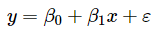
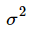
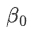
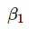

# 第14届市调大赛本科模拟题

> 共 85 题

## 第1题 · 单选题

> `Q14-BK-001` ｜ 02 数据收集 / 普查 ｜ 答案 **A**

**题目**：我国进行的第七次人口普查适合的研究是（）。

**选项**：

- A. 描述性研究
- B. 探索性研究
- C. 预测性研究
- D. 因果性研究

## 第2题 · 单选题

> `Q14-BK-002` ｜ 01 市场调查概述 / 调查程序 ｜ 答案 **C**

**题目**：挑选和培训调查员的相关内容体现在调查基本程序的环节是（）。

**选项**：

- A. 确定调查问题
- B. 拟定调查方案
- C. 实施调查计划
- D. 报告调查结果

## 第3题 · 单选题

> `Q14-BK-003` ｜ 02 数据收集 / 德尔菲法 ｜ 答案 **C**

**题目**：德尔菲法的优点不包括（ ）。

**选项**：

- A. 匿名性
- B. 反馈性
- C. 客观性
- D. 量化性

## 第4题 · 单选题

> `Q14-BK-004` ｜ 07 抽样估计 / 重点调查 ｜ 答案 **B**

**题目**：适合对棉花、茶叶等集中产区的农作物生长情况进行调查的方式是（ ）。

**选项**：

- A. 市场普查
- B. 重点市场调查
- C. 典型市场调查
- D. 随机市场调查

## 第5题 · 单选题

> `Q14-BK-005` ｜ 02 数据收集 / 访问技巧 ｜ 答案 **D**

**题目**：访员对受访者的引导不包括（ ）。

**选项**：

- A. 当受访者离题太远时将话题引导到所提问题上
- B. 当受访者对所问问题答案记不清时帮助受访者进行回忆
- C. 通过追问启发受访者回答得更详细
- D. 通过旁敲侧击诱导受访者答出访员希望的回答

## 第6题 · 单选题

> `Q14-BK-006` ｜ 02 数据收集 / 调查员管理 ｜ 答案 **D**

**题目**：调查员手册作为一种工作指南，其服务对象是（ ）。

**选项**：

- A. 督导员
- B. 被调查者
- C. 调查设计者
- D. 调查员

## 第7题 · 单选题

> `Q14-BK-007` ｜ 07 抽样估计 / 普查 ｜ 答案 **A**

**题目**：为某一特定目的而专门组织的一次性全面调查，称为（ ）。

**选项**：

- A. 普查
- B. 抽样调查
- C. 统计报表
- D. 访问调查

**解析**：为某一特定目的专门组织的一次性全面调查称为普查。抽样调查只调查部分单位，统计报表是经常性上报，访问调查是具体采集方式。

**易错点**：“一次性、全面、专门组织”是普查的三个关键词。

## 第8题 · 单选题

> `Q14-BK-008` ｜ 02 数据收集 / 焦点小组 ｜ 答案 **A**

**题目**：我们在对座谈成员进行选择时，应该保证参加座谈的成员具有（ ）。

**选项**：

- A. 同质性
- B. 异质性
- C. 专业性
- D. 客观性

## 第9题 · 单选题

> `Q14-BK-009` ｜ 02 数据收集 / 邮寄调查 ｜ 答案 **D**

**题目**：下列调查项目中，不适合采用邮寄调查的是（ ）。

**选项**：

- A. 比较敏感的调查
- B. 调查经费紧缺的调查
- C. 时效性要求不高的调查
- D. 突发性事件的调查

## 第10题 · 单选题

> `Q14-BK-010` ｜ 02 数据收集 / 文案调查 ｜ 答案 **D**

**题目**：下列不适合采用文案调查法的情形是（ ）。

**选项**：

- A. 市场供求趋势分析
- B. 市场覆盖率分析
- C. 相关和回归分析
- D. 顾客满意度分析

## 第11题 · 单选题

> `Q14-BK-011` ｜ 01 市场调查概述 / 应用范围 ｜ 答案 **A**

**题目**：下列属于竞争情报内部来源信息的有（ ）。

**选项**：

- A. 顾客订货单
- B. 专家和顾问
- C. 行业出版物
- D. 供应商

## 第12题 · 单选题

> `Q14-BK-012` ｜ 02 数据收集 / 实验效度 ｜ 答案 **B**

**题目**：市场实验中测试的交互效应会影响实验的（）。

**选项**：

- A. 内部有效性
- B. 外部有效性
- C. 回归效应
- D. 主效应

## 第13题 · 单选题

> `Q14-BK-013` ｜ 01 市场调查概述 / 调查程序 ｜ 答案 **A**

**题目**：对市场调查流程表述正确的是（ ）。

**选项**：

- A. 调查准备、调查实施、调查结果处理三个阶段
- B. 调查问卷设计、调查访问、提交调查报告三个阶段
- C. 调查访问、调查数据整理分析、撰写调查报告三个阶段
- D. 调查问卷设计、调查访问、调查数据整理分析、提交报告四个阶段

## 第14题 · 单选题

> `Q14-BK-014` ｜ 02 数据收集 / 普查 ｜ 答案 **C**

**题目**：我国第七次人口普查收集数据采用的方法是（ ）。

**选项**：

- A. 电话调查
- B. 计算机辅助电话调查
- C. 在线调查+入户面访
- D. 邮寄调查

## 第15题 · 单选题

> `Q14-BK-015` ｜ 02 数据收集 / 调查员管理 ｜ 答案 **A**

**题目**：没有调查员偏差的调查方法是（ ）。

**选项**：

- A. 邮寄调查
- B. 定点访问
- C. 焦点座谈
- D. 观察法

## 第16题 · 单选题

> `Q14-BK-016` ｜ 02 数据收集 / 遥感调查 ｜ 答案 **B**

**题目**：通过遥感技术获取农作物种植种类和种植面积估计的调查属于（ ）。

**选项**：

- A. 市场实验法
- B. 观察法
- C. 拍摄法
- D. 物理技术法

## 第17题 · 单选题

> `Q14-BK-017` ｜ 02 数据收集 / 统计报表 ｜ 答案 **B**

**题目**：我国大中型企业联网直报调查属于（ ）。

**选项**：

- A. 实验法
- B. 报告法
- C. 询问调查法
- D. 网上调查法

## 第18题 · 单选题

> `Q14-BK-018` ｜ 03 调查设计 / 调查时间 ｜ 答案 **A**

**题目**：根据调查研究的目的，恰当地确定调查对象、调查内容、选择合适的调查方法、确定调查时间、预算调查经费，并制定具体的调查组织计划。这一过程被称为（）。

**选项**：

- A. 调查方案设计
- B. 调查问卷设计
- C. 抽样方案设计
- D. 开展实地调查

## 第19题 · 单选题

> `Q14-BK-019` ｜ 04 问卷与量表 / 量表 ｜ 答案 **C**

**题目**：在一项连锁超市的形象调查研究中，量表设计正确的是（ ）。

**选项**：

- A. 设计配对比较量表比较某产品的偏爱程度
- B. 设计等级顺序量表研究某产品的偏好程度
- C. 设计语义差异量表度量公司形象的各组成因素
- D. 设计类型量表减轻被调查者的回答负担

## 第20题 · 单选题

> `Q14-BK-020` ｜ 03 调查设计 / 调查时间 ｜ 答案 **C**

**题目**：调查时间的确切含义是指（）。

**选项**：

- A. 调查实施的时间
- B. 抽样方式确定的时间
- C. 调查资料所属的时间
- D. 数据处理的时间

## 第21题 · 单选题

> `Q14-BK-021` ｜ 04 问卷与量表 / 量表 ｜ 答案 **B**

**题目**：当被调查者不愿意给予被评价的客体很高或很低的评价时，列举评比量表就可能产生（ ）。

**选项**：

- A. 仁慈误差
- B. 中间倾向误差
- C. 晕轮效应
- D. 调查员误差

## 第22题 · 单选题

> `Q14-BK-022` ｜ 02 数据收集 / 电话调查 ｜ 答案 **A**

**题目**：在电话调查中，比较适合采用的量表是（ ）。

**选项**：

- A. 列举评比量表
- B. Q分类量表
- C. 瑟斯顿量表
- D. 李克特量表

## 第23题 · 单选题

> `Q14-BK-023` ｜ 04 问卷与量表 / 量表 ｜ 答案 **D**

**题目**：对同一组人员进行前后两次测量，所得两组测量结果之间的相关系数，反映了量表的（ ）。

**选项**：

- A. 再测效信度
- B. 复本信度
- C. 分半信度
- D. 内部一致性信度

**待核对**：题干描述“同一组人员前后两次测量，两组结果的相关系数”，按标准测量理论应为再测信度。题库答案给内部一致性信度（D），且选项 A 写作“再测效信度”（疑为“再测信度”笔误）。考试以题库答案为准。

## 第24题 · 单选题

> `Q14-BK-024` ｜ 04 问卷与量表 / 问卷设计 ｜ 答案 **C**

**题目**：不适合安排在问卷的说明词部分内容是（）。

**选项**：

- A. 致被调查者词
- B. 问卷填答说明
- C. 问卷编码规则
- D. 被调查者基本情况

## 第25题 · 单选题

> `Q14-BK-025` ｜ 03 调查设计 / 操作定义 ｜ 答案 **C**

**题目**：下列关于调查概念与调查变量之间关系的说法正确的是（）。

**选项**：

- A. 调查概念就是调查变量
- B. 调查概念不能成为调查变量
- C. 调查概念可能就是调查变量
- D. 调查概念都要进行操作化处理

## 第26题 · 单选题

> `Q14-BK-026` ｜ 05 数据处理与报告 / 数据整理 ｜ 答案 **D**

**题目**：对原始数据重新分类时，不需要满足的条件是（ ）。

**选项**：

- A. 所有的情况都包含在新的类别中
- B. 各个类别之间无交叉或重叠
- C. 类别间的差异大于类别内的差异
- D. 各类别的方差必须相等

**解析**：对原始数据重新分类要求类别穷尽、互斥，并尽量使类间差异大于类内差异。各类别方差相等是方差分析的前提之一，不是重新分类的必要条件。

**易错点**：看到“方差相等”不要条件反射选它，分类和方差齐性是两件事。

## 第27题 · 单选题

> `Q14-BK-027` ｜ 02 数据收集 / 二手数据 ｜ 答案 **A**

**题目**：二手数据审核应包括数据（） 。

**选项**：

- A. 适用性与时效性
- B. 完整性与准确性
- C. 完整性与时效性
- D. 适用性与准确性

## 第28题 · 单选题

> `Q14-BK-028` ｜ 05 数据处理与报告 / 调查报告 ｜ 答案 **A**

**题目**：在撰写书面调查报告时可行的指导建议是（）。

**选项**：

- A. 措辞简洁清楚
- B. 尽可能使用缩略语
- C. 尽可能阐明主观看法
- D. 尽可能使用文学语言

## 第29题 · 单选题

> `Q14-BK-029` ｜ 05 数据处理与报告 / 统计图 ｜ 答案 **A**

**题目**：常用来反映现象分布特征的统计图是（ ）。

**选项**：

- A. 直方图
- B. 饼形图
- C. 条形图
- D. 折线图

## 第30题 · 单选题

> `Q14-BK-030` ｜ 05 数据处理与报告 / 调查报告 ｜ 答案 **D**

**题目**：市场调查报告要运用大量数据反映发展变化时常用的写作技巧的是（）。

**选项**：

- A. 叙述
- B. 论述
- C. 议论
- D. 说明

## 第31题 · 单选题

> `Q14-BK-031` ｜ 06 单变量分析 / 集中趋势 ｜ 答案 **A**

**题目**：当数据中存在极端数值或分布的倾斜程度很大时，以下表述正确的是（ ）。

**选项**：

- A. 选用众数和中位数描述数据集中趋势的准确性要优于平均数
- B. 选用众数和平均数描述数据集中趋势的准确性要优于中位数
- C. 选用平均数和中位数描述数据集中趋势的准确性要优于众数
- D. 选用众数、中位数和平均数描述数据集中趋势的准确性无明显差异

**解析**：均值会受极端值明显影响；中位数和众数对极端值稳健。因此数据存在极端值或分布严重偏斜时，用众数、中位数描述集中趋势更准确。

**易错点**：标准差相同不代表均值代表性相同；偏态分布优先看中位数。

## 第32题 · 单选题

> `Q14-BK-032` ｜ 06 单变量分析 / 离散程度 ｜ 答案 **A**

**题目**：离散程度是指 （） 。

**选项**：

- A. 变量值的变异范围
- B. 变量值的平均水平
- C. 变量值的分布
- D. 变量值的大小

## 第33题 · 单选题

> `Q14-BK-033` ｜ 06 单变量分析 / 离散程度 ｜ 答案 **A**

**题目**：若两组数据的计量单位不同，在比较它们离散程度大小时，应采用（ ）。

**选项**：

- A. 标准差系数
- B. 平均差
- C. 标准差
- D. 全距

## 第34题 · 单选题

> `Q14-BK-034` ｜ 06 单变量分析 / 集中趋势 ｜ 答案 **B**

**题目**：对于某一门课程中80名学生的成绩，有展示四分之一分位数、中位数与四分之三分位数的图形是（ ）。

**选项**：

- A. 直方图
- B. 箱线图
- C. 饼图
- D. 散点图

## 第35题 · 单选题

> `Q14-BK-035` ｜ 06 单变量分析 / 估计量性质 ｜ 答案 **C**

**题目**：样本均值是总体均值的无偏估计的条件是（ ）。

**选项**：

- A. 样本容量必须充分大
- B. 总体必须服从正态分布
- C. 样本必须是随机抽取的
- D. 总体方差必须已知

## 第36题 · 单选题

> `Q14-BK-036` ｜ 06 单变量分析 / 统计指数 ｜ 答案 **C**

**题目**：某种商品销售额增长了5%，商品零售价格增长2%，则商品销售量增长（ ）。

**选项**：

- A. 0.07
- B. 0.1
- C. 0.0294
- D. 0.03

## 第37题 · 单选题

> `Q14-BK-037` ｜ 07 抽样估计 / 权数 ｜ 答案 **A**

**题目**：设计权数是样本单元入样概率的（）。

**选项**：

- A. 倒数
- B. 平方
- C. 平方根
- D. 相关系数

## 第38题 · 单选题

> `Q14-BK-038` ｜ 07 抽样估计 / 权数 ｜ 答案 **D**

**题目**：所有样本单元的设计权数都相同的抽样设计称为（）。

**选项**：

- A. 等权设计
- B. 加权设计
- C. 自加权设计
- D. 含权设计

## 第39题 · 单选题

> `Q14-BK-039` ｜ 07 抽样估计 / 辅助变量 ｜ 答案 **D**

**题目**：要保证使用辅助信息进行分层的效率以及用于样本分配的精确性，就要求调查变量和所用的辅助变量之间存在（）。

**选项**：

- A. 低度相关
- B. 变异性
- C. 相互独立
- D. 高度相关

## 第40题 · 单选题

> `Q14-BK-040` ｜ 07 抽样估计 / 样本量 ｜ 答案 **A**

**题目**：在其他条件不变的情况下，随着调查总体中所研究指标的实际变异程度的增加，样本量（）。

**选项**：

- A. 必须随之增大
- B. 按比例增加
- C. 按相应的公式计算
- D. 可以保持不变

## 第41题 · 单选题

> `Q14-BK-041` ｜ 07 抽样估计 / 概率抽样 ｜ 答案 **A**

**题目**：在选择概率抽样方法时，目标是使那些最重要的调查指标估计量（）。

**选项**：

- A. 抽样误差最小
- B. 无偏
- C. 与总体真值一致
- D. 容易计算

## 第42题 · 单选题

> `Q14-BK-042` ｜ 07 抽样估计 / 概率抽样 ｜ 答案 **A**

**题目**：福利彩票中奖号码的产生属于（ ）。

**选项**：

- A. 概率抽样
- B. 判断抽样
- C. 随意抽样
- D. 定额抽样

## 第43题 · 单选题

> `Q14-BK-043` ｜ 06 单变量分析 / 集中趋势 ｜ 答案 **B**

**题目**：样本平均数和总体平均数（ ）。

**选项**：

- A. 前者是一个确定值，后者是随机变量
- B. 前者是随机变量，后者是一个确定值
- C. 两者都是随机变量
- D. 两者都是确定值

## 第44题 · 单选题

> `Q14-BK-044` ｜ 07 抽样估计 / 抽样 ｜ 答案 **C**

**题目**：当总体内部差异比较大时，比较适合的抽样组织方式是（ ）。

**选项**：

- A. 简单随机抽样
- B. 整群抽样
- C. 分层抽样
- D. 多阶抽样

**解析**：总体内部差异较大时，分层抽样把总体分成层内同质、层间异质的层，可显著提高估计精度，因此比简单随机抽样更合适。

**易错点**：整群抽样适合群内差异大、群间差异小；与分层抽样的条件正好相反。

## 第45题 · 单选题

> `Q14-BK-045` ｜ 07 抽样估计 / 抽样误差 ｜ 答案 **C**

**题目**：抽样误差是指（）。

**选项**：

- A. 在调查过程中由于观察、测量等差错所引起的误差
- B. 在调查中违反随机原则出现的系统误差
- C. 随机抽样而产生的代表性误差
- D. 人为原因所造成的误差

**解析**：抽样误差是随机抽样产生的代表性误差，即样本统计量与总体参数之间的随机差异。观察、测量差错、人为原因、违反随机原则属于非抽样误差或系统误差。

**易错点**：不要把“抽样误差”理解成所有调查误差；抽样误差只针对概率抽样。

## 第46题 · 单选题

> `Q14-BK-046` ｜ 06 单变量分析 / 参数估计 ｜ 答案 **D**

**题目**：下列有关参数估计的说法错误的是（ ）。

**选项**：

- A. 参数估计就是利用样本统计量的值来对总体的参数进行估计
- B. 参数估计有点估计和区间估计等形式
- C. 区间估计必须有相应的置信度作为保证
- D. 区间估计的宽度越大说明估计的精确度越高

## 第47题 · 单选题

> `Q14-BK-047` ｜ 06 单变量分析 / 假设检验 ｜ 答案 **C**

**题目**：在假设检验中，第∏类错误是指（）。

**选项**：

- A. 当原假设正确时拒绝原假设
- B. 当备择假设不正确时未拒绝备择假设
- C. 当原假设错误时不拒绝原假设
- D. 当备择假设正确时拒绝备择假设

**解析**：第二类错误是原假设错误时没有拒绝原假设，即“取伪”。

**易错点**：第一类错误是“弃真”，第二类错误是“取伪”。

## 第48题 · 单选题

> `Q14-BK-048` ｜ 07 抽样估计 / 多阶段抽样 ｜ 答案 **D**

**题目**：以某校为总体的多阶抽样中，第一阶抽样一般是从学校抽学院。下列哪种抽样方案既可行又高效（ ）。

**选项**：

- A. 简单随机抽样
- B. 系统抽样
- C. 二重抽样
- D. 不等概率抽样

## 第49题 · 单选题

> `Q14-BK-049` ｜ 07 抽样估计 / 辅助变量 ｜ 答案 **D**

**题目**：关于辅助变量信息的描述，正确的是（ ）。

**选项**：

- A. 辅助变量信息只能用于抽样设计环节
- B. 辅助变量信息只能用于抽样估计环节
- C. 辅助变量与调查变量之间要存在因果性关系
- D. 辅助变量与调查变量之间要存在相关性

**解析**：辅助变量需要与研究变量存在相关性，才能在抽样设计和估计中提供信息；不要求二者存在因果关系。辅助变量既可用于设计阶段，也可用于估计阶段。

**易错点**：“相关”不等于“因果”；辅助变量不是只能用于某一个阶段。

## 第50题 · 单选题

> `Q14-BK-050` ｜ 07 抽样估计 / 辅助变量 ｜ 答案 **C**

**题目**：在抽样设计环节，可以利用辅助变量信息进行（）

**选项**：

- A. 比率估计
- B. 回归估计
- C. 分层
- D. 事后分层

**解析**：在抽样设计环节，可以利用辅助变量进行分层，使层内同质、层间异质。比率估计和回归估计属于抽样估计阶段的方法。

**易错点**：题目问“抽样设计环节”，不要选比率估计/回归估计。

## 第51题 · 单选题

> `Q14-BK-051` ｜ 08 双变量关联分析 / 回归分析 ｜ 答案 **A**

**题目**：下列说法中错误的是（）。

**选项**：

- A. 回归方程的显著性检验的目的是检验回归方程的截距项是否显著为0
- B. 若回归方程在一定的显著性水平下通过了F检验，就可以运用该回归方程进行统计预测
- C. 回归方程的预测包括点估计和区间估计两种
- D. 残差分析是分析模型假定正确与否的基本方法

## 第52题 · 单选题

> `Q14-BK-052` ｜ 08 双变量关联分析 / 相关分析 ｜ 答案 **D**

**题目**：根据样本数据计算得到变量X和Y的样本相关系数r＝0.32，对于总体的变量X和Y的关系可以认为（ ）。

**选项**：

- A. 因r＞0，可以认为X和Y存在正相关关系
- B. X和Y具有因果关系
- C. X和Y具有较强的相关关系
- D. 不能确定X和Y是否相关，因为不知道n的大小

**解析**：样本相关系数 r=0.32 只是样本结果，是否说明总体相关需要做显著性检验，而检验需要样本容量 n。n 未知时不能判断总体是否相关，更不能说因果或强相关。

**易错点**：相关系数绝对值大小要结合检验判断；“相关”也不等于“因果”。

## 第53题 · 单选题

> `Q14-BK-053` ｜ 09 多变量分析（一） / 方差分析 ｜ 答案 **D**

**题目**：单因素方差分析的备择假设是（ ）。

**选项**：

- A. 两组均数相同
- B. 多组均数全相同
- C. 两组均数不相同
- D. 多组均数不全相同

**解析**：单因素方差分析的备择假设是多个总体的均值不全相同，而不是两两都不相同。

**易错点**：“不全相同”只要有一个不同即可，不等于“全不相同”。

## 第54题 · 单选题

> `Q14-BK-054` ｜ 08 双变量关联分析 / 回归分析 ｜ 答案 **A**

**题目**：在使用样本数据估计回归模型中，如果SSE=100，样本量n=27，则回归模型误差项ε的方差的无偏估计量为（）。

**选项**：

- A. 4
- B. 4.17
- C. 4.25
- D. 5

## 第55题 · 单选题

> `Q14-BK-055` ｜ 09 多变量分析（一） / 方差分析 ｜ 答案 **C**

**题目**：用方差分析对多个总体的参数进行检验时，统计量MSA/MSE服从的分布是（　　）。

**选项**：

- A. 分布
- B. 正态分布
- C. F分布
- D. t分布

**解析**：方差分析中检验统计量 MSA/MSE 服从 F 分布，自由度为 (k-1, n-k)。

**易错点**：不要选 t 分布；t 检验用于两组均值，方差分析用于多组均值。

## 第56题 · 单选题

> `Q14-BK-056` ｜ 09 多变量分析（一） / 方差分析 ｜ 答案 **C**

**题目**：在单因素多变量方差分析中，已知组内平方和的自由度为12，组间平方和的自由度为5，总平方和的自由度为（）。

**选项**：

- A. 60
- B. 59
- C. 17
- D. 16

## 第57题 · 单选题

> `Q14-BK-057` ｜ 09 多变量分析（一） / 方差分析 ｜ 答案 **D**

**题目**：单因素方差分析中，所涉及的两个变量（）。

**选项**：

- A. 都为数值型变量
- B. 都为分类型变量
- C. 分别是数值型自变量与分类型因变量
- D. 分别是分类型自变量与数值型因变量

## 第58题 · 单选题

> `Q14-BK-058` ｜ 09 多变量分析（一） / 判别分析 ｜ 答案 **C**

**题目**：判别分析方法经常与以下哪类多元分析方法联合使用（ ）。

**选项**：

- A. 因子分析
- B. 主成分分析
- C. 聚类分析
- D. 典型相关分析

## 第59题 · 单选题

> `Q14-BK-059` ｜ 09 多变量分析（一） / 结构方程 ｜ 答案 **A**

**题目**：结构方程模型主要用来处理（）。

**选项**：

- A. 潜在变量
- B. 可观测变量
- C. 代理变量
- D. 因变量

## 第60题 · 多选题

> `Q14-BK-060` ｜ 01 市场调查概述 / 应用范围 ｜ 答案 **ABCD**

**题目**：下列属于广告研究内容的是（ ）。

**选项**：

- A. 广告主题调查
- B. 广告媒体调查
- C. 广告投放监测
- D. 广告接受效果调查
- E. 消费者形态研究

**解析**：广告研究通常包括广告主题调查、广告媒体调查、广告投放监测和广告接受效果调查。消费者形态研究属于消费者研究或市场细分，不是广告研究内容。

**易错点**：“消费者形态”容易混入，但它不是广告研究四类内容之一。

## 第61题 · 多选题

> `Q14-BK-061` ｜ 01 市场调查概述 / 应用范围 ｜ 答案 **ACDE**

**题目**：下列选项中，属于顾客满意特性的是（）。

**选项**：

- A. 主观性
- B. 客观性
- C. 相对性
- D. 阶段性
- E. 层次性

## 第62题 · 多选题

> `Q14-BK-062` ｜ 07 抽样估计 / 抽样方法 ｜ 答案 **ABCE**

**题目**：下列适合采用抽样方法收集数据的情形有（）。

**选项**：

- A. 居民家计调查
- B. 农产品产量调查
- C. 电视节目收视率调查
- D. 统计基本单位调查
- E. 人口变动调查

## 第63题 · 多选题

> `Q14-BK-063` ｜ 02 数据收集 / 邮寄调查 ｜ 答案 **ABC**

**题目**：关于固定样本邮寄调查表述正确的是（）。

**选项**：

- A. 被调查者是事先抽取的一个概率样本
- B. 被调查者同意参加定期邮寄调查
- C. 需要定期调整更新样本
- D. 被调查者是主观抽取的一个非概率样本
- E. 一般不需要样本轮换

## 第64题 · 多选题

> `Q14-BK-064` ｜ 07 抽样估计 / 普查 ｜ 答案 **AE**

**题目**：下列适合采用非全面调查的情形是（ ）。

**选项**：

- A. 预算费用较低
- B. 需要许多小区域的估计
- C. 被调查的总体比较小
- D. 调查总体比例时，总体中具有某种属性的单元很少
- E. 对时效性要求比较高

## 第65题 · 多选题

> `Q14-BK-065` ｜ 06 单变量分析 / 假设检验 ｜ 答案 **ABCD**

**题目**：提出假设的正确做法包括（）。

**选项**：

- A. 明确需要检验的内容
- B. 合理建立零假设与备择假设
- C. 构建一个可解释的调查问题分析框架
- D. 掌握假设检验的分析技术
- E. 利用样本数据进行检验

## 第66题 · 多选题

> `Q14-BK-066` ｜ 04 问卷与量表 / 量表 ｜ 答案 **ABC**

**题目**：从测量工具的形式看，测量被调查者的态度时，可采用的量表有（）

**选项**：

- A. 文字式量表
- B. 图示量表
- C. 表式量表
- D. 直接量表
- E. 分等式量表

## 第67题 · 多选题

> `Q14-BK-067` ｜ 05 数据处理与报告 / 统计表 ｜ 答案 **CDE**

**题目**：通常情况下，设计统计表要求（ ）。

**选项**：

- A. 没有数字的单元格应空白
- B. 左右两边应封口
- C. 表中数据一般是右对齐
- D. 列标题之间一般用竖线隔开
- E. 行标题之间不必用横线隔开

## 第68题 · 多选题

> `Q14-BK-068` ｜ 06 单变量分析 / 统计推断 ｜ 答案 **BCE**

**题目**：以下关于统计推断的描述中，正确的有（）。

**选项**：

- A. 统计推断是研究如何收集和描述数据的统计方法
- B. 统计推断是研究如何利用样本数据来推断总体特征的统计方法
- C. 统计推断包括参数估计和假设检验等内容
- D. 统计推断的结论是确定的
- E. 统计推断的结论是不确定的

## 第69题 · 多选题

> `Q14-BK-069` ｜ 07 抽样估计 / 概率抽样 ｜ 答案 **ABE**

**题目**：下列关于几种概率抽样方法设计效应deff的说法中，通常情况下正确的有（）。

**选项**：

- A. 简单随机抽样的deff=1
- B. 分层随机抽样的deff<1
- C. 整群随机抽样的deff<1
- D. 系统随机抽样的deff>1
- E. 多阶段随机抽样的deff>1

## 第70题 · 多选题

> `Q14-BK-070` ｜ 07 抽样估计 / 抽样基础 ｜ 答案 **ACDE**

**题目**：在下列实际调查中，抽样总体和目标总体不一致的是（）。

**选项**：

- A. 通过随机抽取在公园晨练的老人，调查广州市老龄人的身体状况
- B. 我校网络中心通过IP账号列表随机抽取账号，调查我校网络状况
- C. 通过微信投票方式开展调查，评选出中国人最喜爱的篮球明星
- D. 放学时在小学门口利用等距抽样抽取小学生，调查小学生视力状况
- E. 在学校食堂门口发放问卷调查我校本科生学习情况

## 第71题 · 多选题

> `Q14-BK-071` ｜ 08 双变量关联分析 / 回归分析 ｜ 答案 **DE**

**题目**：在一元线性回归分析中，如果估计标准误差为0，则意味着（）。

**选项**：

- A. 回归系数为0
- B. 回归系数为1
- C. 相关系数为0
- D. 相关系数绝对值为1
- E. 解释变量能解释被解释变量的所有变动

## 第72题 · 多选题

> `Q14-BK-072` ｜ 08 双变量关联分析 / 一元回归 ｜ 答案 **AE**

**题目**：在一元线性回归模型中，属于随机变量的是（）。

**选项**：

- A. y
- B. 
- C. x
- D. 
- E. ε

## 第73题 · 多选题

> `Q14-BK-073` ｜ 09 多变量分析（一） / 多变量方差分析 ｜ 答案 **BE**

**题目**：下列关于WilksΛ统计量与Wald统计量的说法中，正确的是（ ）。

**选项**：

- A. Wilks统计量可以用于单因素多变量方差分析的显著性检验，Wald统计量则用于一般线性回归的显著性检验
- B. Wilks统计量可以用于单因素多变量方差分析的显著性检验，Wald统计量则用于Logistic模型的显著性检验
- C. Wilks统计量可以用于一般线性回归模型的显著性检验，Wald统计量则用于线性回归的显著性检验
- D. 单个解释变量的Wald统计量服从正态分布
- E. Wilks统计量服从威尔克斯分布

## 第74题 · 多选题

> `Q14-BK-074` ｜ 10 多变量分析（二） / 聚类分析 ｜ 答案 **ABCDE**

**题目**：在聚类分析中需要对原始数据进行处理，下列属于数据变换方法的有（）。

**选项**：

- A. 平移变换
- B. 极差变换
- C. 标准化变换
- D. 对数变换
- E. 平方根变换

## 第75题 · 判断题

> `Q14-BK-075` ｜ 01 市场调查概述 / 综合 ｜ 答案 **A**

**题目**：市场调查的系统性强调调查全过程的环环相扣、相互影响。

**选项**：

- A. 对
- B. 错

## 第76题 · 判断题

> `Q14-BK-076` ｜ 02 数据收集 / 电话调查 ｜ 答案 **A**

**题目**：电话调查中的随机拨号方法是根据随机抽样的原理设计的。

**选项**：

- A. 对
- B. 错

## 第77题 · 判断题

> `Q14-BK-077` ｜ 07 抽样估计 / 概率抽样 ｜ 答案 **B**

**题目**：无论概率抽样还是非概率抽样都可以计算抽样误差，并能根据需要进行控制。

**选项**：

- A. 对
- B. 错

**解析**：非概率抽样无法计算抽样误差，因为不知道入样概率；抽样误差是概率抽样特有的概念。

**易错点**：非概率抽样可以调查，但不能计算抽样误差。

## 第78题 · 判断题

> `Q14-BK-078` ｜ 04 问卷与量表 / 问题类型 ｜ 答案 **B**

**题目**：封闭式问题回答方式中的多项选择法就是从备选答案中选出多个答案。

**选项**：

- A. 对
- B. 错

## 第79题 · 判断题

> `Q14-BK-079` ｜ 02 数据收集 / 调查员管理 ｜ 答案 **B**

**题目**：调查员手册包括被调查者应如何客观真实地回答问题。

**选项**：

- A. 对
- B. 错

## 第80题 · 判断题

> `Q14-BK-080` ｜ 07 抽样估计 / 概率抽样 ｜ 答案 **A**

**题目**：抽样调查中只有采用概率抽样方法获取的样本数据才能用来推断总体信息，非概率抽样不能用于推断总体。

**选项**：

- A. 对
- B. 错

**解析**：按教材表述，只有概率抽样才能基于抽样分布对总体进行概率推断；非概率抽样不能用于这种推断。

**易错点**：非概率抽样可用于探索性研究，但不能计算抽样误差和概率推断。

## 第81题 · 判断题

> `Q14-BK-081` ｜ 07 抽样估计 / 无回答 ｜ 答案 **A**

**题目**：无回答调整因子是原样本单元的权数之和与给出回答的单元权数之和的比值。

**选项**：

- A. 对
- B. 错

**解析**：无回答调整因子等于原样本单元的权数之和除以给出回答的单元权数之和，用于把回答样本的权数放大到原样本规模。

**易错点**：分子是原样本权数和，分母是回答单元权数和。

## 第82题 · 判断题

> `Q14-BK-082` ｜ 07 抽样估计 / 比率估计 ｜ 答案 **A**

**题目**：比率估计量可以看成是回归估计量的一种特例。

**选项**：

- A. 对
- B. 错

## 第83题 · 判断题

> `Q14-BK-083` ｜ 08 双变量关联分析 / 列联分析 ｜ 答案 **B**

**题目**：列联分析是用于研究两个数值型变量的关系。

**选项**：

- A. 对
- B. 错

## 第84题 · 判断题

> `Q14-BK-084` ｜ 09 多变量分析（一） / 多元回归 ｜ 答案 **B**

**题目**：多元线性回归模型中，多重判定系数同时考虑了样本量个数和自变量个数。

**选项**：

- A. 对
- B. 错

## 第85题 · 判断题

> `Q14-BK-085` ｜ 10 多变量分析（二） / 因子分析 ｜ 答案 **A**

**题目**：因子分析中，公共因子方差和特殊因子方差之和是1。

**选项**：

- A. 对
- B. 错

