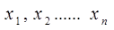
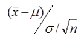
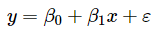
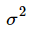
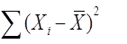
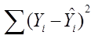
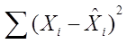

# 第15届市调大赛本科模拟题

> 共 85 题

## 第1题 · 单选题

> `Q15-BK-001` ｜ 01 市场调查概述 / 调查程序 ｜ 答案 **D**

**题目**：确定调查对象和调查范围相关内容体现在调查基本程序的环节是（ ）。

**选项**：

- A. 报告调查结果
- B. 拟定调查方案
- C. 实施调查计划
- D. 确定调查问题

**解析**：确定调查对象和调查范围属于调查基本程序中的“确定调查问题/明确调查目的”环节，而不是拟定方案、实施或报告阶段。

**易错点**：“调查对象和范围”听起来像方案，但教材把它归在确定调查问题阶段。

## 第2题 · 单选题

> `Q15-BK-002` ｜ 01 市场调查概述 / 调查程序 ｜ 答案 **B**

**题目**：统计预处理和制表、制图的相关内容体现在调查基本程序的环节是（ ）。

**选项**：

- A. 拟定调查方案
- B. 处理与分析调查数据
- C. 报告调查结果
- D. 确定调查问题

## 第3题 · 单选题

> `Q15-BK-003` ｜ 04 问卷与量表 / 问卷设计 ｜ 答案 **B**

**题目**：“在本次有效问卷为1050份的调查样本中，对于本单位服务态度有420位即40% 的受访者回答不满意”。关于上面这句话下列的说明最恰当的是（）。

**选项**：

- A. 是在说明普查的结果
- B. 是一种描述统计
- C. 是一种推论统计
- D. 是在说明一个随机变量的概率分布

## 第4题 · 单选题

> `Q15-BK-004` ｜ 02 数据收集 / 实验法 ｜ 答案 **C**

**题目**：当需要研究在其他条件如产品质量和营销环境保持不变的条件下，价格对销售量的影响时，合适的调查方法是（）。

**选项**：

- A. 投影技法
- B. 观察法
- C. 实验法
- D. 文案调查法

## 第5题 · 单选题

> `Q15-BK-005` ｜ 01 市场调查概述 / 应用范围 ｜ 答案 **C**

**题目**：满意的顾客有可能转为忠诚的顾客，其前提条件是（ ）。

**选项**：

- A. 感知高于期望
- B. 感知低于期望
- C. 感知远远超过期望
- D. 感知与期望相等

## 第6题 · 单选题

> `Q15-BK-006` ｜ 02 数据收集 / 焦点小组 ｜ 答案 **C**

**题目**：焦点小组访谈源于（ ）。

**选项**：

- A. 生物学的社会群体激励
- B. 生物学的社会群体疗法
- C. 精神病医生所用的群体疗法
- D. 精神病医生所用的个人激励

**解析**：焦点小组访谈源于精神病医生所用的群体疗法，后来被引入市场研究，用于小组互动和定性探索。

**易错点**：不要选“生物学的社会群体疗法”；这是常见干扰项。

## 第7题 · 单选题

> `Q15-BK-007` ｜ 07 抽样估计 / 重点调查 ｜ 答案 **D**

**题目**：某市为掌握商品销售情况，对占该市商品销售额80%的五个大商场进行调查，这种调查方式属于（ ）。

**选项**：

- A. 统计报表
- B. 普查
- C. 抽样调查
- D. 重点调查

## 第8题 · 单选题

> `Q15-BK-008` ｜ 07 抽样估计 / 概率抽样 ｜ 答案 **C**

**题目**：下列关于非概率抽样的叙述，错误的是（ ）。

**选项**：

- A. 非概率抽样抽取样本时不遵照随机原则
- B. 非概率抽样无法知道样本统计量的分布
- C. 非概率抽样估计结果的精确性可以用抽样误差来衡量
- D. 非概率抽样的最大特点是操作简便、时效快、成本低

## 第9题 · 单选题

> `Q15-BK-009` ｜ 02 数据收集 / 定量调查 ｜ 答案 **D**

**题目**：下列调查方法中，不属于定量调查方法的是（ ）。

**选项**：

- A. 电话调查
- B. 面访调查
- C. 邮寄调查
- D. 焦点小组访谈

## 第10题 · 单选题

> `Q15-BK-010` ｜ 02 数据收集 / 访谈调查 ｜ 答案 **C**

**题目**：相对于焦点小组访谈法来说，深层访谈法的优点是（ ）。

**选项**：

- A. 可以产生受访者之间的观点的相互碰撞
- B. 不易受调查员自身素质高低的影响
- C. 便于对一些保密、敏感问题进行调查
- D. 结构化问题使得访谈结果更易于解释和分析

## 第11题 · 单选题

> `Q15-BK-011` ｜ 04 问卷与量表 / 问题类型 ｜ 答案 **A**

**题目**：在调查中对于开放式问题正确的记录方式是（）。

**选项**：

- A. 逐字逐句地按被调查者的原话进行记录
- B. 按被调查者的原话进行改写
- C. 对被调查者的回答进行归纳和整理
- D. 不进行记录

## 第12题 · 单选题

> `Q15-BK-012` ｜ 02 数据收集 / 现场控制 ｜ 答案 **C**

**题目**：在现场控制中，整个项目成功与否的关键是（ ）。

**选项**：

- A. 时间规划
- B. 费用预算
- C. 人员使用
- D. 过程记录

## 第13题 · 单选题

> `Q15-BK-013` ｜ 02 数据收集 / 观察法 ｜ 答案 **B**

**题目**：前期观察对后期观察可能产生的影响称为（ ）。

**选项**：

- A. 次效应
- B. 主效应
- C. 强化效应
- D. 弱化效应

**解析**：前期观察对后期观察产生的影响称为主效应（也称测验效应/练习效应），属于实验或重复测量中的顺序效应。

**易错点**：主效应不是“主要效果”的意思；次效应、强化效应、弱化效应都不是该定义的术语。

## 第14题 · 单选题

> `Q15-BK-014` ｜ 07 抽样估计 / 抽样基础 ｜ 答案 **B**

**题目**：样本控制较高、速度快、费用中等、保密性较高的调查是（ ）。

**选项**：

- A. 入户面访
- B. 电话调查
- C. 一般邮寄调查
- D. 固定样本邮寄调查

## 第15题 · 单选题

> `Q15-BK-015` ｜ 01 市场调查概述 / 调查作用 ｜ 答案 **C**

**题目**：下列对市场调查在市场营销中的作用描述正确的是（ ）。

**选项**：

- A. 管理者进行营销决策与市场调查无关
- B. 市场调查不是营销系统中必不可少的一个环节
- C. 市场调查是探索新的市场机会的基本工具
- D. 不必进行调查和研究也可以做出正确的营销决策。

## 第16题 · 单选题

> `Q15-BK-016` ｜ 02 数据收集 / 文案调查 ｜ 答案 **D**

**题目**：下列选项中，属于文案调查方法优点的是（ ）。

**选项**：

- A. 成本相对较高
- B. 资料比较难找到
- C. 收集资料所用时间相对较长
- D. 收集资料时不受时空限制

## 第17题 · 单选题

> `Q15-BK-017` ｜ 02 数据收集 / 电话调查 ｜ 答案 **D**

**题目**：我国广泛应用的行风评议调查方法是（ ）

**选项**：

- A. 面访调查
- B. 邮寄调查
- C. 网上问卷调查
- D. 电话调查

## 第18题 · 单选题

> `Q15-BK-018` ｜ 04 问卷与量表 / 问题类型 ｜ 答案 **B**

**题目**：给出固定选项，要求被调查者从中选择的题型是（ ）。

**选项**：

- A. 开放题
- B. 封闭题
- C. 量表
- D. 排序题

## 第19题 · 单选题

> `Q15-BK-019` ｜ 04 问卷与量表 / 测量 ｜ 答案 **C**

**题目**：在健康调查中测量人的身高时都是穿着鞋子测量的，这类误差属于（ ） 。

**选项**：

- A. 计算误差
- B. 无回答误差
- C. 计量误差
- D. 处理误差

**解析**：测量身高时统一穿着鞋子，测量过程本身带有系统偏差，属于计量误差。

**易错点**：不是无回答误差，也不是计算/处理误差；问题出在测量环节。

## 第20题 · 单选题

> `Q15-BK-020` ｜ 03 调查设计 / 调查方案 ｜ 答案 **A**

**题目**：在市场调查方案设计中，阐述构想与操作定义、明确构想间的相关性、建立调查问题框架，这构成的内容体现的是（）。

**选项**：

- A. 界定市场调查问题
- B. 发现营销管理问题
- C. 定义营销决策问题
- D. 实施具体调查计划

## 第21题 · 单选题

> `Q15-BK-021` ｜ 04 问卷与量表 / 问题设计 ｜ 答案 **C**

**题目**：“您如何评价购买高档消费品这种奢侈行为？”这个问句存在的主要问题是（ ）。

**选项**：

- A. 具有从众效应
- B. 具有权威效应
- C. 采用了特殊语气的措辞
- D. 表述没有礼貌

## 第22题 · 单选题

> `Q15-BK-022` ｜ 04 问卷与量表 / 问卷设计 ｜ 答案 **B**

**题目**：问卷设计中要评估问题的编排效应，确保相邻两个问题的回答是独立的，这是指问卷设计时应遵循的（）。

**选项**：

- A. 目的性原则
- B. 逻辑性原则
- C. 中立性原则
- D. 科学性原则

## 第23题 · 单选题

> `Q15-BK-023` ｜ 04 问卷与量表 / 问题设计 ｜ 答案 **D**

**题目**：“某女工的企业实行的优化组合中失去了工作。您能猜猜是什么原因使她失去了工作吗？”，该问句采用的表述方法是（ ）。

**选项**：

- A. 简单询问法
- B. 释疑法
- C. 转移法
- D. 情景法

## 第24题 · 单选题

> `Q15-BK-024` ｜ 04 问卷与量表 / 答案设计 ｜ 答案 **D**

**题目**：如果要测量消费者对4个不同品牌洗发液的偏好，并运用全部调查结果对4个品牌按偏好程度进行排序，则宜采用的答案设计方法是（）。

**选项**：

- A. 排序法
- B. 等级法
- C. 双向列联法
- D. 比较法

**待核对**：题库答案将“4 个品牌按偏好程度排序”判为比较法（D）。若题目强调直接对全部品牌排序，教材也可能给排序法（A）。按题库答案记，同时理解两种方法差别。

## 第25题 · 单选题

> `Q15-BK-025` ｜ 04 问卷与量表 / 答案设计 ｜ 答案 **A**

**题目**：封闭式问题答案设计方法中，答案选择类型最多的方法是（）。

**选项**：

- A. 多项选择法
- B. 排序法
- C. 等级法
- D. 双向列联法

## 第26题 · 单选题

> `Q15-BK-026` ｜ 05 数据处理与报告 / 频数分布 ｜ 答案 **D**

**题目**：编制频数分布表时，如果调查数据的分布状态极度倾斜，则分组时应（ ）。

**选项**：

- A. 将组数多设一些
- B. 将组数少设一些
- C. 采用等距分组法
- D. 采用异距分组法

## 第27题 · 单选题

> `Q15-BK-027` ｜ 05 数据处理与报告 / 编码 ｜ 答案 **B**

**题目**：适用于事后编码的情形是（）。

**选项**：

- A. 封闭式问题
- B. 开放式问题
- C. 背景信息
- D. 事实性问题

## 第28题 · 单选题

> `Q15-BK-028` ｜ 05 数据处理与报告 / 调查报告 ｜ 答案 **A**

**题目**：书面调查报告要做到观点和数据统一是指（）。

**选项**：

- A. 观点来自调查数据
- B. 观点和数据并列列示
- C. 数据排列后再排列观点
- D. 数据图、数据表和文字一同表述

## 第29题 · 单选题

> `Q15-BK-029` ｜ 05 数据处理与报告 / 调查报告 ｜ 答案 **A**

**题目**：下列内容不包含在市场调查报告正文部分的是（ ）。

**选项**：

- A. 参考书目与附录
- B. 调查对象与调查方法
- C. 调查结论和建议
- D. 调查背景说明

**解析**：市场调查报告正文一般包括调查背景、调查对象与方法、调查结果、结论与建议。参考书目和附录属于报告结尾或附录部分，不属于正文。

**易错点**：附录、参考书目、致谢都不算正文；正文要放“结论和建议”。

## 第30题 · 单选题

> `Q15-BK-030` ｜ 05 数据处理与报告 / 统计图 ｜ 答案 **D**

**题目**：下列关于直方图与条形图的表述正确的是（ ）。

**选项**：

- A. 条形图和直方图都用于展示分类数据
- B. 条形图用高度表示类别变化的多少，宽度可不固定，表示类别
- C. 直方图的各矩形和条形图的各条形都是连续排列的
- D. 直方图中的矩形用高度表示频数或频率，用宽度表示各组组距

**解析**：直方图用于连续型分组数据，矩形高度表示频数或频率，宽度表示组距；条形图用于分类数据，条形宽度固定且通常有间隔。

**易错点**：直方图矩形连续排列，条形图条形分开排列。

## 第31题 · 单选题

> `Q15-BK-031` ｜ 06 单变量分析 / 离散程度 ｜ 答案 **B**

**题目**：反映均值代表性大小的离散程度的统计量有（ ）。

**选项**：

- A. 异众比
- B. 方差
- C. 级差
- D. 四分位差

## 第32题 · 单选题

> `Q15-BK-032` ｜ 06 单变量分析 / 集中趋势 ｜ 答案 **C**

**题目**：已知某班学生的平均年龄为17.8岁，其中18岁的人数最多，则该分布属于（ ）。

**选项**：

- A. 正态分布
- B. 正偏分布
- C. 左偏分布
- D. 右偏分布

## 第33题 · 单选题

> `Q15-BK-033` ｜ 06 单变量分析 / 集中趋势 ｜ 答案 **D**

**题目**：某班共有30名学生，其某门课程平均分数为75分；其中20位男生的平均分数为70分，那么班上10位女生的平均分数为（）。

**选项**：

- A. 65
- B. 70
- C. 75
- D. 85

## 第34题 · 单选题

> `Q15-BK-034` ｜ 06 单变量分析 / 描述统计 ｜ 答案 **A**

**题目**：下列变量中，既可以采用适用于数值型变量的分析方法，也可以采用适用于顺序变量的分析方法的是（ ）。

**选项**：

- A. 收入
- B. 职业
- C. 性别
- D. 所在地区

## 第35题 · 单选题

> `Q15-BK-035` ｜ 06 单变量分析 / 离散程度 ｜ 答案 **D**

**题目**：某数列变量值平方的平均数等于9，而变量值平均数的平方等于5，则标准差为（ ）。

**选项**：

- A. 1.8
- B. 4
- C. 3
- D. 2

## 第36题 · 单选题

> `Q15-BK-036` ｜ 06 单变量分析 / 参数估计 ｜ 答案 **C**

**题目**：与点估计相比，区间估计的主要优点是（ ）。

**选项**：

- A. 指明了估计的置信度
- B. 有更高的无偏性
- C. 能提供误差的信息
- D. 能直接给出总体参数的估计值

## 第37题 · 单选题

> `Q15-BK-037` ｜ 07 抽样估计 / 抽样 ｜ 答案 **A**

**题目**：当调查总体中各单位之间差异较小，或调查对象不明，难以分组、分类时，适用的抽样技术是（ ）。

**选项**：

- A. 简单随机抽样
- B. 系统抽样
- C. 配额抽样
- D. 分层随机抽样

## 第38题 · 单选题

> `Q15-BK-038` ｜ 07 抽样估计 / 样本量 ｜ 答案 **C**

**题目**：对于二元变量，为确保达到调查要求的精度，在计算样本量时，建议对该指标的总体变异程度的取值设定为（）。

**选项**：

- A. 0
- B. 0.5
- C. 0.25
- D. 1

**解析**：二元变量的方差为 p(1-p)，在 p=0.5 时取最大值 0.25。因此若题目问“总体变异程度（方差）”，应取 0.25；若问“总体比例”，则取 0.5。

**易错点**：比例取 0.5，方差取 0.25；看清题目问的是哪一个。

**待核对**：题干“总体变异程度”与选项 0.25 对应方差；若按总体比例则应选 0.5。答案按方差口径为 C，需结合教材表述。

## 第39题 · 单选题

> `Q15-BK-039` ｜ 07 抽样估计 / 系统抽样 ｜ 答案 **D**

**题目**：连续生产的电子管厂，产品质量检验是这样安排的，在一天中，每隔半小时抽取一次产品进行检验，这是（ ）。

**选项**：

- A. 分层抽样
- B. 简单随机抽样
- C. 整群抽样
- D. 系统抽样

**解析**：在一天中每隔固定时间抽取一次产品，属于系统抽样（等距抽样）。

**易错点**：“每隔半小时”体现固定间隔，不是分层、整群或简单随机。

## 第40题 · 单选题

> `Q15-BK-040` ｜ 06 单变量分析 / 概率分布 ｜ 答案 **A**

**题目**：若随机变量，从中随机抽取样本，则服从的分布为（ ）。

**选项**：

- A. 标准正态分布
- B. 近似正态分布
- C. t分布
- D. F分布

## 第41题 · 单选题

> `Q15-BK-041` ｜ 07 抽样估计 / 设计效应 ｜ 答案 **B**

**题目**：设计效应小于1时表示（）。

**选项**：

- A. 设计方案的效率低于简单随机抽样
- B. 设计方案的效率高于简单随机抽样
- C. 简单随机抽样的效率与设计方案的效率一样
- D. 设计方案的效率高于分层抽样

**解析**：设计效应 deff = 设计方案的方差 / 简单随机抽样方差。deff<1 表示设计方案效率高于简单随机抽样。

**易错点**：deff 越小越高效；deff>1 才是效率更低。

## 第42题 · 单选题

> `Q15-BK-042` ｜ 07 抽样估计 / 抽样调查 ｜ 答案 **D**

**题目**：下面的哪一种情况适用于抽样调查方法进行调查（ ）。

**选项**：

- A. 总体规模小
- B. 研究对象特征的差异性大
- C. 抽样误差的成本大
- D. 非抽样误差的成本大

**解析**：当非抽样误差的成本很大时，抽样调查比全面调查更合适，因为全面调查涉及的单位多，非抽样误差更难控制。总体规模小、差异大、抽样误差成本大时，抽样调查未必合适。

**易错点**：不要只记“抽样调查省钱”；要看抽样误差与非抽样误差的成本比较。

## 第43题 · 单选题

> `Q15-BK-043` ｜ 07 抽样估计 / 抽样 ｜ 答案 **D**

**题目**：在纯随机重复抽样条件下，如果将样本单位数扩大为原来的4倍，则抽样平均误差（ ）。

**选项**：

- A. 扩大2倍
- B. 扩大4倍
- C. 缩小1倍
- D. 缩小1半

## 第44题 · 单选题

> `Q15-BK-044` ｜ 07 抽样估计 / 概率抽样 ｜ 答案 **D**

**题目**：以下属于随机抽样的是（）。

**选项**：

- A. 通过微信客户端进行线上问卷调查
- B. 一卡车刚刚倒下10吨小麦，堆成圆锥状。从最边沿处取一桶小麦进行淀粉含量调查
- C. 从各班选取10名成绩排名中等的同学进行英语写作能力测试
- D. 在某居民小区，每隔20户抽取一户进行住户调查

## 第45题 · 单选题

> `Q15-BK-045` ｜ 07 抽样估计 / 抽样 ｜ 答案 **C**

**题目**：某银行想知道平均每户活期存款余额和估计其总量，根据存折账号的顺序，每150本存折抽出一本登记其余额。这样的抽样组织形式是（）。

**选项**：

- A. 分层抽样
- B. 整群抽样
- C. 系统抽样
- D. 简单随机抽样

## 第46题 · 单选题

> `Q15-BK-046` ｜ 07 抽样估计 / 抽样调查 ｜ 答案 **D**

**题目**：某社区想对社区内患有高血压的人群进行抽样调查，先抽取一个比较大的样本，从中筛查出高血压人群，然后再从这些人群中抽取一个小的样本进行详细医疗检查。这样的抽样组织形式是（）。

**选项**：

- A. 分层抽样
- B. 整群抽样
- C. 二阶抽样
- D. 二重抽样

**解析**：先抽取一个较大样本筛查出稀有子群，再从中抽取较小样本做详细调查，属于二重抽样。二阶抽样是把同一总体分阶段逐级抽取抽样单元。

**易错点**：二重抽样是“两次抽取、两次筛选”；二阶抽样是“分阶段抽单位”，不要混淆。

## 第47题 · 单选题

> `Q15-BK-047` ｜ 07 抽样估计 / 抽样框 ｜ 答案 **A**

**题目**：在构建某省工业企业抽样框时，有些企业已经破产却没有及时注销，而有些企业还没有来得及去登记注册。此时，推断广东省工业总产值时会（）。

**选项**：

- A. 可能被高估，也可能被低估，要看具体情况
- B. 被低估
- C. 被高估
- D. 不会发生变化

## 第48题 · 单选题

> `Q15-BK-048` ｜ 07 抽样估计 / 抽样误差 ｜ 答案 **C**

**题目**：抽样误差是指（）。

**选项**：

- A. 在调查过程中由于观察、测量等差错所引起的误差
- B. 在调查中违反随机原则出现的系统误差
- C. 随机抽样而产生的代表性误差
- D. 人为原因所造成的误差

**解析**：抽样误差是随机抽样产生的代表性误差，即样本统计量与总体参数之间的随机差异。观察、测量差错、人为原因、违反随机原则属于非抽样误差或系统误差。

**易错点**：不要把“抽样误差”理解成所有调查误差；抽样误差只针对概率抽样。

## 第49题 · 单选题

> `Q15-BK-049` ｜ 07 抽样估计 / 简单随机抽样 ｜ 答案 **A**

**题目**：某抽样设计方案的效率高于简单随机抽样，此时的抽样设计效应应该为（ ）

**选项**：

- A. 小于1
- B. 等于1
- C. 大于1
- D. 大于0

## 第50题 · 单选题

> `Q15-BK-050` ｜ 07 抽样估计 / 抽样方法 ｜ 答案 **D**

**题目**：某调查项目将调查问卷的链接放在某网站主页上，采用有奖答问卷的形式收集数据，这种抽样方法是（ ）。

**选项**：

- A. 配额抽样
- B. 判断抽样
- C. 整群抽样
- D. 自愿抽样

**解析**：把问卷链接放在网站主页、以有奖形式吸引访问者自愿填答，属于自愿抽样（非概率抽样）。配额、判断、整群抽样都不符合“自愿上网填答”的特征。

**易错点**：“自愿”是关键词；有奖并不改变自愿抽样的性质。

## 第51题 · 单选题

> `Q15-BK-051` ｜ 08 双变量关联分析 / 列联分析 ｜ 答案 **D**

**题目**：若列联表的行数为5，列数为6，则统计量的自由度为（ ）。

**选项**：

- A. 5
- B. 11
- C. 30
- D. 20

**解析**：列联表 χ² 检验自由度为 (5-1)(6-1)=4×5=20。

**易错点**：不要算成 5×6=30 或 5+6-1=10。

## 第52题 · 单选题

> `Q15-BK-052` ｜ 08 双变量关联分析 / 回归分析 ｜ 答案 **C**

**题目**：在回归模型中，ε反映的是（ ）。

**选项**：

- A. 由于x的变化引起的y的线性变化部分
- B. 由于y的变化引起的x的线性变化部分
- C. 除x和y的线性关系之外的随机因素对y的影响
- D. 由于x和y的线性关系对y的影响

## 第53题 · 单选题

> `Q15-BK-053` ｜ 08 双变量关联分析 / 回归分析 ｜ 答案 **C**

**题目**：下列说法中错误的是（）。

**选项**：

- A. 回归分析是研究因变量对自变量依赖关系的一种统计分析方法
- B. 一元线性回归是最简单的回归形式，它反映的是因变量与一个自变量之间的回归关系
- C. 进行相关分析时，两个变量都可以是非随机变量
- D. 回归分析可以采用最小二乘法对回归方程的参数进行估计，基本思想是使误差平方和达到最小

## 第54题 · 单选题

> `Q15-BK-054` ｜ 08 双变量关联分析 / 列联分析 ｜ 答案 **D**

**题目**：拟合优度检验中，所用到的分布是（）。

**选项**：

- A. 正态分布
- B. t分布
- C. F分布
- D. 分布

## 第55题 · 单选题

> `Q15-BK-055` ｜ 08 双变量关联分析 / 回归分析 ｜ 答案 **A**

**题目**：在使用样本数据估计回归模型中，如果SSE=100，样本量n=27，则回归模型误差项ε的方差的无偏估计量为（）。

**选项**：

- A. 4
- B. 4.17
- C. 4.25
- D. 5

## 第56题 · 单选题

> `Q15-BK-056` ｜ 02 数据收集 / 实验法 ｜ 答案 **B**

**题目**：下列统计实验设计中属于非随机化实验的是（ ）。

**选项**：

- A. 随机区组设计
- B. 事后设计
- C. 拉丁方设计
- D. 正交实验设计

## 第57题 · 单选题

> `Q15-BK-057` ｜ 09 多变量分析（一） / Logistic回归 ｜ 答案 **B**

**题目**：Logistic回归模型中的Score检验结果能判断（ ）。

**选项**：

- A. 自变量间是否存在高度相关性
- B. 将自变量纳入Logistic模型并进行回归是否有意义
- C. Logistic模型中的某个自变量的回归系数是否显著
- D. 使用哪种方法估计Logistic模型的参数

## 第58题 · 单选题

> `Q15-BK-058` ｜ 09 多变量分析（一） / 判别分析 ｜ 答案 **A**

**题目**：Fisher判别法的建立思想基础为（ ）。

**选项**：

- A. 方差分析
- B. 假设检验
- C. 最小误判准则
- D. 距离最短

## 第59题 · 单选题

> `Q15-BK-059` ｜ 07 抽样估计 / 抽样基础 ｜ 答案 **D**

**题目**：（）是一种将多维空间的研究对象(样本或变量)简化到低维空间进行定位、分析和归类，同时又保留对象间原始关系的数据分析方法。

**选项**：

- A. 因子分析
- B. 主成分分析
- C. 联合分析
- D. 多维标度分析

## 第60题 · 多选题

> `Q15-BK-060` ｜ 07 抽样估计 / 普查 ｜ 答案 **BCD**

**题目**：下面适宜采用非全面调查的有（）。

**选项**：

- A. 二三产业全面发展情况的摸底调查
- B. 某型号日光灯耐用时数检查
- C. 住户收支情况调查
- D. 1%人口调查
- E. 我国人口摸底调查

## 第61题 · 多选题

> `Q15-BK-061` ｜ 03 调查设计 / 调查对象 ｜ 答案 **BC**

**题目**：按照调查对象的范围来划分，调查可以分为（ ）。

**选项**：

- A. 一次性调查
- B. 全面调查
- C. 非全面调查
- D. 经常性调查
- E. 专项调查

## 第62题 · 多选题

> `Q15-BK-062` ｜ 02 数据收集 / 访问技巧 ｜ 答案 **CD**

**题目**：访问调查中的追问（追询）一般是在以下情况时使用：（）。

**选项**：

- A. 将要提出新的问题
- B. 排除回答中的障碍
- C. 受访者明显在说谎
- D. 受访者回答有矛盾
- E. 拒绝透露隐私问题

## 第63题 · 多选题

> `Q15-BK-063` ｜ 01 市场调查概述 / 应用范围 ｜ 答案 **ABCDE**

**题目**：在顾客满意度调查中，发展研究阶段的主要任务是（）。

**选项**：

- A. 确定收集资料的种类和来源
- B. 决定收集资料的方法
- C. 准备收集资料的工具
- D. 确定抽样方案
- E. 确定调查需要时间与调研经费

## 第64题 · 多选题

> `Q15-BK-064` ｜ 02 数据收集 / 调查员管理 ｜ 答案 **ABC**

**题目**：大规模市场调查中访问员项目培训一般流程包括（）。

**选项**：

- A. 访问员签到
- B. 问卷讲解
- C. 模拟及模拟小结
- D. 试访及试访总结
- E. 签订项目协议/保密协议

## 第65题 · 多选题

> `Q15-BK-065` ｜ 07 抽样估计 / 抽样框 ｜ 答案 **ABCE**

**题目**：抽样框误差的表现有（）。

**选项**：

- A. 总体单元有遗漏
- B. 包含非目标总体单元
- C. 总体单元有重复
- D. 总体单元不重不漏
- E. 总体单元不完全

## 第66题 · 多选题

> `Q15-BK-066` ｜ 01 市场调查概述 / 综合 ｜ 答案 **ABCE**

**题目**：市场调查中的测量活动有时也会使用物理测量工具，下列属于物理测量工具的有（）

**选项**：

- A. 测量仪器
- B. 测量仪表
- C. 度量衡
- D. 量表
- E. 皮肤电流反射器

## 第67题 · 多选题

> `Q15-BK-067` ｜ 02 数据收集 / 调查实施 ｜ 答案 **ACE**

**题目**：调查前与被调查者建立联系的常用交流材料有（）。

**选项**：

- A. 致被调查者的信
- B. 调查培训手册
- C. 调查宣传手册
- D. 督导员手册
- E. 调查机构介绍手册

## 第68题 · 多选题

> `Q15-BK-068` ｜ 06 单变量分析 / 时间序列 ｜ 答案 **ABC**

**题目**：下列方法中适合对平稳序列进行预测的有（　　）。

**选项**：

- A. 移动平均法
- B. 简单平均法
- C. 指数平滑法
- D. 线性模型法
- E. 非线性模型法

## 第69题 · 多选题

> `Q15-BK-069` ｜ 07 抽样估计 / 抽样误差 ｜ 答案 **ABCDE**

**题目**：下列调查中会出现非抽样误差的有（）。

**选项**：

- A. 在住户抽样调查中发现，某些住户仅填写了支出方面的数据，但没有填写工资收入方面的数据
- B. 为推断某市货运情况，市统计局仅从本地牌照的货车中抽取货车开展抽样调查，没有调查外地牌照货车在某市的货运情况
- C. 在实施不等概率抽样时利用了不够准确的辅助变量确定入样概率
- D. 在工业企业抽样调查中，某些企业为了避税故意将产值数据报小一点
- E. 在实施随机抽样时，所获取的总体单元总数N不准确

## 第70题 · 多选题

> `Q15-BK-070` ｜ 07 抽样估计 / 抽样设计 ｜ 答案 **BCD**

**题目**：关于抽样设计方法的描述中，正确的有（）。

**选项**：

- A. 等距抽样仅在抽取第一个样本单元时采用随机抽取，后续样本单元随之确定，所以等距抽样的样本不满足随机性
- B. 分层抽样精度较高，但要求构建层的抽样框，有时难以满足
- C. 当总体N越大时，实施不等概率抽样就会变得越复杂
- D. 整群抽样虽然精度不高，但是实施非常便利，能够节省调查经费
- E. 多阶抽样的设计效应一般会大于1 ，所以在实际调查中不值得使用

## 第71题 · 多选题

> `Q15-BK-071` ｜ 08 双变量关联分析 / 回归分析 ｜ 答案 **CE**

**题目**：设Y为被解释变量，X为解释变量，用最小二乘法拟合回归方程时，其基本原理是使（ ）。

**选项**：

- A. 最小
- B. 最小
- C. 最小 
- D. 最小
- E. 各观测值到回归直线的纵向距离平方和最小

**解析**：最小二乘法的基本原理是使残差平方和最小，也就是各观测值到回归直线的纵向距离平方和最小。

**易错点**：是最小化“纵向距离平方和”，不是横向距离，也不是绝对距离之和。

## 第72题 · 多选题

> `Q15-BK-072` ｜ 08 双变量关联分析 / 一元回归 ｜ 答案 **ACE**

**题目**：一元线性回归分析中，若（ ），则模型满足关于残差的基本假定。

**选项**：

- A. 残差图中的样本点分布在一条水平带中间
- B. 标准化残差图中大约有95%的标准化残差介于-3和+3之间
- C. 标准化残差分布直方图大体呈现以0为中心的对称钟形分布
- D. 正态概率图中有较多的样本点密集地分布在一条水平带中间
- E. 正态概率图中有较多的样本点密集地分布在45°线附近

## 第73题 · 多选题

> `Q15-BK-073` ｜ 08 双变量关联分析 / 回归分析 ｜ 答案 **AB**

**题目**：打开SPSS软件，依次选择Analyze→ Regression，可进行（）。

**选项**：

- A. 多元线性回归
- B. 二分Logistic回归模型
- C. 因子分析
- D. 对应分析
- E. 多变量方差分析

## 第74题 · 多选题

> `Q15-BK-074` ｜ 10 多变量分析（二） / 因子分析 ｜ 答案 **CD**

**题目**：因子分析中，因子得分包含（）。

**选项**：

- A. 总分
- B. 平均分
- C. 单项得分
- D. 综合得分
- E. 加权平均分

## 第75题 · 判断题

> `Q15-BK-075` ｜ 01 市场调查概述 / 研究类型 ｜ 答案 **B**

**题目**：专家咨询法属于描述性调查的一种。

**选项**：

- A. 对
- B. 错

## 第76题 · 判断题

> `Q15-BK-076` ｜ 02 数据收集 / 访谈调查 ｜ 答案 **A**

**题目**：小组座谈法和深层访谈法都属于非标准式面访。

**选项**：

- A. 对
- B. 错

## 第77题 · 判断题

> `Q15-BK-077` ｜ 03 调查设计 / 调查对象 ｜ 答案 **A**

**题目**：调查对象就是根据调查目的确定的调查范围以及所要调查的总体。

**选项**：

- A. 对
- B. 错

## 第78题 · 判断题

> `Q15-BK-078` ｜ 04 问卷与量表 / 量表 ｜ 答案 **A**

**题目**：量表效度的最高层次是结构效度。

**选项**：

- A. 对
- B. 错

## 第79题 · 判断题

> `Q15-BK-079` ｜ 05 数据处理与报告 / 数据净化 ｜ 答案 **A**

**题目**：采用统计软件进行逻辑分析是常用的数据净化方法。

**选项**：

- A. 对
- B. 错

## 第80题 · 判断题

> `Q15-BK-080` ｜ 06 单变量分析 / 时间序列 ｜ 答案 **B**

**题目**：如果时间数列逐期增长量大体相等，则宜拟合二次曲线模型。

**选项**：

- A. 对
- B. 错

## 第81题 · 判断题

> `Q15-BK-081` ｜ 07 抽样估计 / 整群抽样 ｜ 答案 **B**

**题目**：整群抽样在划分群时，要求群内差异尽可能小，群间差异尽可能大。

**选项**：

- A. 对
- B. 错

**解析**：整群抽样要求群内差异尽可能大、群间差异尽可能小，这样每个群才像总体的缩影；题干说反了。

**易错点**：分层抽样才是层内同质、层间异质；整群抽样相反。

## 第82题 · 判断题

> `Q15-BK-082` ｜ 07 抽样估计 / 抽样框 ｜ 答案 **A**

**题目**：目前，我国还没有构建关于所有住户的名单抽样框信息，因此，在开展住户抽样调查时，只能通过地域框抽取住户。

**选项**：

- A. 对
- B. 错

## 第83题 · 判断题

> `Q15-BK-083` ｜ 08 双变量关联分析 / 列联分析 ｜ 答案 **B**

**题目**：两变量独立性检验的检验目的是检验不同类别的目标变量之间是否存在显著性差异。

**选项**：

- A. 对
- B. 错

## 第84题 · 判断题

> `Q15-BK-084` ｜ 09 多变量分析（一） / 方差分析 ｜ 答案 **B**

**题目**：在方差分析中，组间方差可以反映样本数据与其各组均值间的差异。

**选项**：

- A. 对
- B. 错

**解析**：组间方差反映各组均值之间的差异，组内方差才反映样本观测值与其组均值之间的差异。

**易错点**：“组间”看均值差异，“组内”看个体差异。

## 第85题 · 判断题

> `Q15-BK-085` ｜ 10 多变量分析（二） / 正交设计 ｜ 答案 **B**

**题目**：在SPSS软件中，依次选择“Analyze→Orthogonal Design→Generate”可生成正交设计方案。

**选项**：

- A. 对
- B. 错

**解析**：SPSS 中生成正交设计的菜单是 Data→Orthogonal Design→Generate，不在 Analyze 菜单下，因此题干说法错误。

**易错点**：Analyze 菜单主要放统计分析过程；正交设计属于数据准备。

