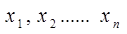
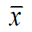
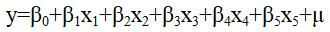
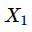
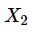

# 第16届市调大赛本科模拟题

> 共 85 题

## 第1题 · 单选题

> `Q16-BK-001` ｜ 02 数据收集 / 定性调查 ｜ 答案 **B**

**题目**：将市场调查划分为定性调查研究和定量调查研究的分类标志是（）。

**选项**：

- A. 调查研究的内容
- B. 调查研究的方法
- C. 调查研究的目的
- D. 调查研究的性质

## 第2题 · 单选题

> `Q16-BK-002` ｜ 01 市场调查概述 / 调查特点 ｜ 答案 **A**

**题目**：调查活动是一个系统工程，包括了从问题定义、计划编制、方案设计、样本抽取、资料收集整理分析到报告撰写全过程。这体现的市场调查特点是（ ）。

**选项**：

- A. 系统性
- B. 目的性
- C. 科学性
- D. 时效性

## 第3题 · 单选题

> `Q16-BK-003` ｜ 07 抽样估计 / 抽样调查 ｜ 答案 **D**

**题目**：对于高职高专毕业生对就业岗位、薪资期望水平进行调查，适宜采用的调查方式是（）。

**选项**：

- A. 市场普查
- B. 重点市场调查
- C. 典型市场调查
- D. 随机市场调查

## 第4题 · 单选题

> `Q16-BK-004` ｜ 04 问卷与量表 / 量表 ｜ 答案 **B**

**题目**：访员对被调查者提供的信息应持有的态度是（）。

**选项**：

- A. 肯定
- B. 中立
- C. 观望
- D. 有自己的意志取向

## 第5题 · 单选题

> `Q16-BK-005` ｜ 01 市场调查概述 / 调查作用 ｜ 答案 **B**

**题目**：下列关于市场调查对企业的市场营销重要性的说法错误的是（ ）。

**选项**：

- A. 市场调查是市场营销的出发点
- B. 产品策略、价格策略、促销策略、流通策略是市场调查活动的先导。
- C. 市场调查有助于企业营销管理目标的实现
- D. 发现营销问题和解决营销问题成功与否，很大程度上依赖于市场调查活动的开展

## 第6题 · 单选题

> `Q16-BK-006` ｜ 02 数据收集 / 焦点小组 ｜ 答案 **C**

**题目**：焦点小组访谈进行的时间一般是（ ）。

**选项**：

- A. 0.5小时以内
- B. 0.5-1.5小时
- C. 1.5-3小时
- D. 3小时以上

## 第7题 · 单选题

> `Q16-BK-007` ｜ 02 数据收集 / 焦点小组 ｜ 答案 **C**

**题目**：焦点小组访谈源于（ ）。

**选项**：

- A. 生物学的社会群体激励
- B. 生物学的社会群体疗法
- C. 精神病医生所用的群体疗法
- D. 精神病医生所用的个人激励

**解析**：焦点小组访谈源于精神病医生所用的群体疗法，后来被引入市场研究，用于小组互动和定性探索。

**易错点**：不要选“生物学的社会群体疗法”；这是常见干扰项。

## 第8题 · 单选题

> `Q16-BK-008` ｜ 02 数据收集 / 数据来源 ｜ 答案 **B**

**题目**：下列不属于信息内部来源的是（ ）。

**选项**：

- A. 企业报表
- B. 统计年鉴
- C. 生产经营计划
- D. 宣传材料

## 第9题 · 单选题

> `Q16-BK-009` ｜ 01 市场调查概述 / 综合 ｜ 答案 **D**

**题目**：下列不属于市场调查准备阶段工作内容的是（ ）。

**选项**：

- A. 确定调查任务
- B. 设计调查方案
- C. 组建调查队伍
- D. 数据录入和整理

## 第10题 · 单选题

> `Q16-BK-010` ｜ 02 数据收集 / 德尔菲法 ｜ 答案 **B**

**题目**：在德尔菲法调查中, 调查机构征询专家意见的方式主要是（ ）。

**选项**：

- A. 面对面讨论
- B. 通信
- C. 电话
- D. 专家会议

## 第11题 · 单选题

> `Q16-BK-011` ｜ 01 市场调查概述 / 应用范围 ｜ 答案 **D**

**题目**：在选择调查方法的组合时，市场研究者需要遵循的原则是（）。

**选项**：

- A. 质量第一
- B. 费用最省
- C. 用户至上
- D. 误差最小

## 第12题 · 单选题

> `Q16-BK-012` ｜ 02 数据收集 / 深层访谈 ｜ 答案 **D**

**题目**：下列对深层访谈特点表述正确的是（ ）。

**选项**：

- A. 一对多的访谈
- B. 间接访谈
- C. 结构式访问
- D. 半结构式访问

## 第13题 · 单选题

> `Q16-BK-013` ｜ 02 数据收集 / 焦点小组 ｜ 答案 **B**

**题目**：我们在选择小组座谈成员时，应该保证参加座谈的成员具有（ ）。

**选项**：

- A. 异质性
- B. 同质性
- C. 专业性
- D. 客观性

## 第14题 · 单选题

> `Q16-BK-014` ｜ 02 数据收集 / 数据收集 ｜ 答案 **A**

**题目**：下列调查中能较好体现收据收集灵活性的方法是（）。

**选项**：

- A. 入户面访
- B. 电话调查
- C. 一般邮寄调查
- D. 固定样本邮寄调查

## 第15题 · 单选题

> `Q16-BK-015` ｜ 02 数据收集 / 数据收集 ｜ 答案 **D**

**题目**：获取敏感信息可能性较高的调查方法是（ ）。

**选项**：

- A. 入户面访
- B. 拦截面访
- C. 计算机辅助面访
- D. 固定样本邮寄调查

## 第16题 · 单选题

> `Q16-BK-016` ｜ 02 数据收集 / 观察法 ｜ 答案 **D**

**题目**：下列属于观察法优点的是（ ）。

**选项**：

- A. 费用比较高
- B. 受限于部分观察对象
- C. 容易受到观察者影响
- D. 客观性和可靠性较高

## 第17题 · 单选题

> `Q16-BK-017` ｜ 02 数据收集 / 数据收集 ｜ 答案 **D**

**题目**：研究消费者行为偏好变化的常用调查方法是（ ）。

**选项**：

- A. 市场实验法
- B. 电话调查
- C. 街头拦截法
- D. 入户面访

## 第18题 · 单选题

> `Q16-BK-018` ｜ 04 问卷与量表 / 问题类型 ｜ 答案 **A**

**题目**：提出问题时不提供任何答案，由被调查者根据实际情况自由填写，此类问题属于（ ）。

**选项**：

- A. 开放式问题
- B. 实质性问题
- C. 指导性问题
- D. 封闭性问题

## 第19题 · 单选题

> `Q16-BK-019` ｜ 05 数据处理与报告 / 缺失值插补 ｜ 答案 **B**

**题目**：被调查者无法联系造成数据缺失，称为（ ）。

**选项**：

- A. 回答误差
- B. 无回答误差
- C. 资料误差
- D. 被调查者误差

## 第20题 · 单选题

> `Q16-BK-020` ｜ 07 抽样估计 / 抽样调查 ｜ 答案 **A**

**题目**：在住户收支与生活状况调查项目中，通过对全国城镇住户和农村住户的抽样调查了解全国和各地区城乡居民收入、消费及其他生活状况。该调查项目中的总体是（ ）。

**选项**：

- A. 全国所有常住住户
- B. 被采集数据的住户
- C. 全国所有住户的收入、消费及其他生活状况
- D. 采集的住户收入、消费及其他生活状况数据

## 第21题 · 单选题

> `Q16-BK-021` ｜ 04 问卷与量表 / 答案设计 ｜ 答案 **D**

**题目**：下列选项中不属于问题答案设计原则的是（ ）。

**选项**：

- A. 穷尽性原则
- B. 互斥性原则
- C. 通俗性原则
- D. 中立性原则

## 第22题 · 单选题

> `Q16-BK-022` ｜ 04 问卷与量表 / 问卷设计 ｜ 答案 **C**

**题目**：一份设计优良的问卷应该是（ ）。

**选项**：

- A. 能方便地收集数据
- B. 应该尽量是封闭式问题
- C. 对被调查者有友好的界面
- D. 应尽量减少调查者的误解

## 第23题 · 单选题

> `Q16-BK-023` ｜ 04 问卷与量表 / 测量 ｜ 答案 **D**

**题目**：测量结果体现出来的某种结论与关于所测属性的理论命题之间的对应程度，是指（ ）。

**选项**：

- A. 量表的内容效度
- B. 量表的准则效度
- C. 量表的效标效度
- D. 量表的结构效度

## 第24题 · 单选题

> `Q16-BK-024` ｜ 04 问卷与量表 / 问卷编码 ｜ 答案 **D**

**题目**：下列关于问卷编码的说法正确的是（ ）。

**选项**：

- A. 封闭式问题必须采用预编码
- B. 封闭式问题必须采用后编码
- C. 开放式问题必须采用预编码
- D. 开放式问题必须采用后编码

## 第25题 · 单选题

> `Q16-BK-025` ｜ 04 问卷与量表 / 测量尺度 ｜ 答案 **D**

**题目**：下列问题中，测度的是等比数据的是（ ）。

**选项**：

- A. 请问您最常使用的洗发水品牌是？
- B. 请问您的最高学历是？
- C. 请您用百分制对学校的满意度进行打分。
- D. 请您的身高是？

## 第26题 · 单选题

> `Q16-BK-026` ｜ 05 数据处理与报告 / 缺失值插补 ｜ 答案 **A**

**题目**：存在插补数据时，估计量的抽样方差通常会（ ）。

**选项**：

- A. 低估
- B. 高估
- C. 与真实值一致
- D. 是一个无偏量

## 第27题 · 单选题

> `Q16-BK-027` ｜ 05 数据处理与报告 / 统计图 ｜ 答案 **D**

**题目**：既能够反映数据分布状况，又能保持数据原始状况的图形是（ ）。

**选项**：

- A. 直方图
- B. 饼图
- C. 累计分布曲线图
- D. 茎叶图

## 第28题 · 单选题

> `Q16-BK-028` ｜ 05 数据处理与报告 / 数据整理 ｜ 答案 **C**

**题目**：数据整理的意义不包括（ ）。

**选项**：

- A. 提高调查数据质量
- B. 为数据分析提供基础
- C. 筛选出有利于研究结论数据
- D. 便于对数据的长期保存和研究

## 第29题 · 单选题

> `Q16-BK-029` ｜ 05 数据处理与报告 / 缺失值插补 ｜ 答案 **C**

**题目**：下列常用于分类变量插值处理的方法是（）。

**选项**：

- A. 回归插补
- B. 均值插补
- C. 判别模型
- D. 比率插补

## 第30题 · 单选题

> `Q16-BK-030` ｜ 05 数据处理与报告 / 缺失值插补 ｜ 答案 **C**

**题目**：采用同一个数据集或同一次调查数据进行插补的方法称为（）

**选项**：

- A. 冷卡插补
- B. 同层插补
- C. 热卡插补
- D. 并行插补

**解析**：热卡插补是在同一个数据集或同一次调查中，为缺失单元寻找相似单元进行插补；冷卡插补使用历史数据或外部数据。

**易错点**：“同一数据集/同一次调查”是热卡的关键词；“同层插补”不是这个定义的名称。

## 第31题 · 单选题

> `Q16-BK-031` ｜ 06 单变量分析 / 集中趋势 ｜ 答案 **C**

**题目**：不能用于描述定序数据集中趋势的统计量是（ ）。

**选项**：

- A. 众数
- B. 中位数
- C. 均值
- D. 四分位数

## 第32题 · 单选题

> `Q16-BK-032` ｜ 04 问卷与量表 / 问卷设计 ｜ 答案 **B**

**题目**：在一次问卷调查中，为了解受访者收入情况，将人均月收入变量分为“1000元以下”、“1000-3000元”、“3000-5000元”、“5000-7000元”和“7000元及以上”五组，若某受访者的月收入水平为3000元，应划归至（ ）。

**选项**：

- A. “1000-3000元”
- B. “3000-5000元”
- C. 由访问员自行决定归入哪一组
- D. 既可以选择“1000-3000元”，也可以选择“3000-5000元”

## 第33题 · 单选题

> `Q16-BK-033` ｜ 06 单变量分析 / 区间估计 ｜ 答案 **A**

**题目**：下列关于区间估计的说法中，正确的是（ ）。

**选项**：

- A. 置信概率越小，相应的置信区间越小
- B. 置信概率越小，相应的置信区间越大
- C. 置信概率越大，相应的置信区间越小
- D. 置信概率的大小不影响置信区间的大小

## 第34题 · 单选题

> `Q16-BK-034` ｜ 06 单变量分析 / 假设检验 ｜ 答案 **B**

**题目**：在假设检验时，若增大样本容量，则犯两类错误的概率会（ ）。

**选项**：

- A. 都增大
- B. 都减小
- C. 都不变
- D. 一类增大，二类减小

**解析**：在固定显著性水平下，增大样本容量通常会使犯第一类错误和第二类错误的概率都减小，检验功效提高。

**易错点**：样本量增大不是只影响第二类错误；两类错误通常都会变小。

## 第35题 · 单选题

> `Q16-BK-035` ｜ 06 单变量分析 / 时间序列 ｜ 答案 **B**

**题目**：若无季节变动，则季节指数应该是（ ）。

**选项**：

- A. 0
- B. 1
- C. 大于1
- D. 小于0

**解析**：季节指数以 100%（或 1）为基准；没有季节变动时，各期季节指数应等于 1。

**易错点**：季节指数不是 0；0 表示该期没有活动。

## 第36题 · 单选题

> `Q16-BK-036` ｜ 06 单变量分析 / 集中趋势 ｜ 答案 **D**

**题目**：某组数据的均值为10，方差为25，则离散系数为（ ）。

**选项**：

- A. 0.4
- B. 2.5
- C. 2
- D. 0.5

**解析**：离散系数 = 标准差 / 均值。方差 25，标准差 5；5/10=0.5。

**易错点**：不要拿方差直接除以均值；先开方。

## 第37题 · 单选题

> `Q16-BK-037` ｜ 06 单变量分析 / 参数估计 ｜ 答案 **A**

**题目**：Maximum Likelihood Estimate，简记为MLE，称之为（）。

**选项**：

- A. 最大似然估计
- B. 点估计
- C. 矩估计
- D. 最小二乘法

## 第38题 · 单选题

> `Q16-BK-038` ｜ 06 单变量分析 / 区间估计 ｜ 答案 **A**

**题目**：当抽样方式与样本容量不变的条件下，置信区间越大则使（ ）。

**选项**：

- A. 可靠性越大
- B. 可靠性越小
- C. 估计的误差越小
- D. 可靠性及估计误差均越小

**解析**：在抽样方式和样本容量不变时，置信区间越宽，对应的置信度（可靠性）越高，但估计精度越低。

**易错点**：区间宽=更可靠但更不精确；不要选“误差越小”。

## 第39题 · 单选题

> `Q16-BK-039` ｜ 07 抽样估计 / 简单随机抽样 ｜ 答案 **C**

**题目**：当设计方案的效率低于简单随机抽样时设计效应的取值区间为（）

**选项**：

- A. 小于1
- B. 等于1
- C. 大于1
- D. 在1和-1之间

## 第40题 · 单选题

> `Q16-BK-040` ｜ 07 抽样估计 / 简单随机抽样 ｜ 答案 **A**

**题目**：简单随机抽样的设计效应为（）。

**选项**：

- A. 等于1
- B. 大于1
- C. 小于1
- D. 等于0

## 第41题 · 单选题

> `Q16-BK-041` ｜ 06 单变量分析 / 区间估计 ｜ 答案 **A**

**题目**：若随机变量，且σ已知，从中随机抽取样本，并经计算得到其均值为,这时由估计μ的置信度为95%的置信区间时，置信区间的宽度（）。

**选项**：

- A. 是确定的
- B. 是随机的
- C. 是人为规定的
- D. 无法确定的

## 第42题 · 单选题

> `Q16-BK-042` ｜ 06 单变量分析 / 集中趋势 ｜ 答案 **C**

**题目**：一般情况下身高服从正态分布，现随机抽取100名儿童，测得数值如下：平均值1.3米，中位数为1.25米，标准差0.13米，则该样本中68名儿童的身高应该是（ ）

**选项**：

- A. 低于1.287米
- B. 高于1.43米
- C. 1.287米至1.313米之间
- D. 1.17米至 1.43米之间

## 第43题 · 单选题

> `Q16-BK-043` ｜ 07 抽样估计 / 抽样方法 ｜ 答案 **D**

**题目**：影响样本单位数的主要因素是：总体标志变异程度；极限误差的大小；抽样方法与组织方式的不同；人力、物力、财力的可能条件；以及（ ）。

**选项**：

- A. 总体单位的分布
- B. 总体单位的个数
- C. 时间期限
- D. 抽样推断的可靠程度

## 第44题 · 单选题

> `Q16-BK-044` ｜ 07 抽样估计 / 标准误 ｜ 答案 **C**

**题目**：在抽样估计中，抽样标准误大小与下列哪个因素无关？（ ）。

**选项**：

- A. 样本容量
- B. 抽样方式和方法
- C. 概率保证程度
- D. 抽样估计量类型

## 第45题 · 单选题

> `Q16-BK-045` ｜ 07 抽样估计 / 抽样设计 ｜ 答案 **D**

**题目**：某大学想抽取学生开展抽样调查，先用随机方法抽取40个班级，再从每个班级中随机抽取10个学生开展问卷调查，搜集相关数据。这种抽样设计方法属于（）。

**选项**：

- A. 简单随机抽样
- B. 整群抽样
- C. 多重抽样
- D. 多阶抽样

**解析**：先随机抽 40 个班级，再从每个班级抽 10 名学生，是分两个阶段抽取抽样单元，属于多阶抽样。

**易错点**：整群抽样是抽中群后调查群内全部单位；这里还继续抽学生。

## 第46题 · 单选题

> `Q16-BK-046` ｜ 07 抽样估计 / 抽样 ｜ 答案 **C**

**题目**：当总体内部差异比较大时，比较适合的抽样组织方式是（ ）。

**选项**：

- A. 简单随机抽样
- B. 整群抽样
- C. 分层抽样
- D. 多阶抽样

**解析**：总体内部差异较大时，分层抽样把总体分成层内同质、层间异质的层，可显著提高估计精度，因此比简单随机抽样更合适。

**易错点**：整群抽样适合群内差异大、群间差异小；与分层抽样的条件正好相反。

## 第47题 · 单选题

> `Q16-BK-047` ｜ 07 抽样估计 / 抽样误差 ｜ 答案 **C**

**题目**：抽样误差是指（）。

**选项**：

- A. 在调查过程中由于观察、测量等差错所引起的误差
- B. 在调查中违反随机原则出现的系统误差
- C. 随机抽样而产生的代表性误差
- D. 人为原因所造成的误差

**解析**：抽样误差是随机抽样产生的代表性误差，即样本统计量与总体参数之间的随机差异。观察、测量差错、人为原因、违反随机原则属于非抽样误差或系统误差。

**易错点**：不要把“抽样误差”理解成所有调查误差；抽样误差只针对概率抽样。

## 第48题 · 单选题

> `Q16-BK-048` ｜ 07 抽样估计 / 样本量 ｜ 答案 **C**

**题目**：在计算样本量时，需要考虑的两个基本因素是（）。

**选项**：

- A. 总体规模大小和抽样方式
- B. 调查经费限制和时间限制
- C. 总体变异度和调查精度要求
- D. 回答率

**解析**：计算样本量时最基本的两个因素是总体变异程度和调查精度要求；总体规模、经费、回答率会影响实际实施，但不是公式中的两个基本决定因素。

**易错点**：总体规模在简单随机抽样样本量公式中通常不直接出现。

## 第49题 · 单选题

> `Q16-BK-049` ｜ 07 抽样估计 / 估计量 ｜ 答案 **A**

**题目**：样本估计值与总体的真实指标值之间的差距是（）。

**选项**：

- A. 调查误差
- B. 抽样精度
- C. 估计差错
- D. 估计精度

**解析**：样本估计值与总体真实指标值之间的差距是调查误差（总误差），它同时包含抽样误差和非抽样误差。

**易错点**：“调查误差”是总概念，不要与“抽样误差”“估计精度”混为一谈。

## 第50题 · 单选题

> `Q16-BK-050` ｜ 07 抽样估计 / 分层抽样 ｜ 答案 **A**

**题目**：在分层抽样时，各层样本量的分配方法一般不考虑（）。

**选项**：

- A. 常数分配
- B. 按比例分配
- C. 最优分配
- D. 奈曼分配

**解析**：分层抽样的常用样本量分配有按比例分配、最优分配和奈曼分配；“常数分配”不是通常考虑的分配方法。

**易错点**：比例、最优、奈曼是三大分配；常数分配是干扰项。

## 第51题 · 单选题

> `Q16-BK-051` ｜ 08 双变量关联分析 / 回归诊断 ｜ 答案 **A**

**题目**：在进行残差分析时，如果正态概率图中有较多的样本点密集地分布在（）线附近，则说明模型满足关于残差的基本假定。

**选项**：

- A. 45°
- B. 90°
- C. 30°
- D. 60°

## 第52题 · 单选题

> `Q16-BK-052` ｜ 08 双变量关联分析 / 双变量分析 ｜ 答案 **D**

**题目**：以下关于两变量关联性分析的描述中，错误的是（）。

**选项**：

- A. 列联分析通过原始数据结构，揭示品质型变量之间以及品质型变量各种状态之间相关关系
- B. 相关分析是研究两个变量之间相关关系密切程度的统计方法
- C. 相关分析的目的仅仅是要确认两个变量间是否具有线性相关关系
- D. 回归分析的目的是通过因变量的给定值来估计或预测自变量的均值

## 第53题 · 单选题

> `Q16-BK-053` ｜ 08 双变量关联分析 / 列联分析 ｜ 答案 **D**

**题目**：下列说法中错误的是（）。

**选项**：

- A. 独立性检验是利用样本资料来检验两个变量的独立性，即样本资料所显示的两个分类变量的相关性在总体中是否存在
- B. 研究两个分类变量之间的关系，可以采用列联分析
- C. 在列联分析中，计算的相关系数越接近于1，相关程度越高
- D. 编制列联表时，如果两个变量之间不存在因果关系，行变量和列变量可以随意指定。如果两个变量之间存在因果关系，一般需要把表示影响原因的自变量作为行变量，列入表的横行；把表示变动结果的因变量作为列变量，列入表的纵列

## 第54题 · 单选题

> `Q16-BK-054` ｜ 08 双变量关联分析 / 相关分析 ｜ 答案 **D**

**题目**：根据样本数据计算得到变量X和Y的样本相关系数r＝0.32，对于总体的变量X和Y的关系可以认为（ ）。

**选项**：

- A. 因r＞0，可以认为X和Y存在正相关关系
- B. X和Y具有因果关系
- C. X和Y具有较强的相关关系
- D. 不能确定X和Y是否相关，因为不知道n的大小

**解析**：样本相关系数 r=0.32 只是样本结果，是否说明总体相关需要做显著性检验，而检验需要样本容量 n。n 未知时不能判断总体是否相关，更不能说因果或强相关。

**易错点**：相关系数绝对值大小要结合检验判断；“相关”也不等于“因果”。

## 第55题 · 单选题

> `Q16-BK-055` ｜ 08 双变量关联分析 / 相关分析 ｜ 答案 **B**

**题目**：以下关于C相关系数说法中，错误的是（ ）。

**选项**：

- A. 适用于多种类型的列联表
- B. 取值范围为[0，+∞）
- C. 行列数不同时，不利于比较
- D. 计算简便

## 第56题 · 单选题

> `Q16-BK-056` ｜ 09 多变量分析（一） / 多元回归 ｜ 答案 **C**

**题目**：多元线性回归模型中，已知多重判定系数为0.8，样本量为100，求调整的多重判定系数值为（ ）。

**选项**：

- A. 0.8426
- B. 0.802
- C. 0.7894
- D. 0.6209

**解析**：调整后的多重判定系数 = 1-(1-R²)(n-1)/(n-k-1)。本题按 k=5 计算：1-0.2×99/94≈0.7894。

**易错点**：调整 R² 会小于原 R²；分母是 n-k-1，不是 n-1。

**待核对**：题干未明示自变量个数，解析按 k=5 反推调整 R²=0.7894；若 k 不同，结果会变化。

## 第57题 · 单选题

> `Q16-BK-057` ｜ 08 双变量关联分析 / 回归分析 ｜ 答案 **D**

**题目**：假设某个多元线性回归模型的多重判定系数为0.9604，能否判断该模型拟合良好？为什么？（ ）

**选项**：

- A. 能，因为该模型多重判定系数足够大
- B. 不能，因为该模型多重判定系数不够大
- C. 不能，因为多重判定系数会随着自变量增加不断趋近于1，只能通过调整的多重判定系数进行判断
- D. 不能，因为只有多重判定系数时信息不足，对该模型的了解度不够，需要结合F检验、t检验等检验以及其他数值结果一起判断

## 第58题 · 单选题

> `Q16-BK-058` ｜ 09 多变量分析（一） / 方差分析 ｜ 答案 **D**

**题目**：下面哪项不在SPSS “Analyze →Compare Means”菜单中。（ ）

**选项**：

- A. Independent-Samples T Test
- B. one-way ANOVA
- C. Paired-Samples T Test
- D. Explore

## 第59题 · 单选题

> `Q16-BK-059` ｜ 10 多变量分析（二） / 聚类分析 ｜ 答案 **A**

**题目**：以下关于K-均值聚类法说法，错误的是（）。

**选项**：

- A. 优于系统聚类法
- B. 是一种快速聚类法
- C. 适用于大样本
- D. 适用于均为连续型的变量

## 第60题 · 多选题

> `Q16-BK-060` ｜ 06 单变量分析 / 统计基础 ｜ 答案 **CE**

**题目**：下列指标中，属于存量指标的是（）。

**选项**：

- A. 资金周转次数
- B. 人均生产总值
- C. 银行存款余额
- D. 固定资产投资额
- E. 资产总额

## 第61题 · 多选题

> `Q16-BK-061` ｜ 02 数据收集 / 文案调查 ｜ 答案 **ABCDE**

**题目**：文案资料评估需要满足的要求有（）。

**选项**：

- A. 广泛性
- B. 准确性
- C. 时效性
- D. 针对性
- E. 连续性

## 第62题 · 多选题

> `Q16-BK-062` ｜ 02 数据收集 / 调查员管理 ｜ 答案 **ABCDE**

**题目**：招聘调查员的素质要求包括（）。

**选项**：

- A. 诚实与认真
- B. 责任心强
- C. 对调查有兴趣和信心
- D. 对调查对象有一定的了解
- E. 健康的体魄

## 第63题 · 多选题

> `Q16-BK-063` ｜ 04 问卷与量表 / 测量尺度 ｜ 答案 **BD**

**题目**：下列属于定序数据的有（ ）。

**选项**：

- A. 性别分组数据
- B. 受教育程度分组数据
- C. 年龄分组数据
- D. 收入分等数据
- E. 婚姻状况分组数据

## 第64题 · 多选题

> `Q16-BK-064` ｜ 02 数据收集 / 定性调查 ｜ 答案 **CD**

**题目**：主持人在定性调查执行前必须要做的充分准备是（ ）。

**选项**：

- A. 与研究对象执行前预先见面
- B. 对最终的研究结果下结论
- C. 对研究对象的深度沉浸
- D. 对讨论大纲内容的熟悉
- E. 预先撰写报告

## 第65题 · 多选题

> `Q16-BK-065` ｜ 04 问卷与量表 / 问卷设计 ｜ 答案 **BCD**

**题目**：下列问卷设计问题可能导致计量误差的有（）。

**选项**：

- A. 缺少调查员信息
- B. 使用了专业行话
- C. 概念模糊
- D. 措辞不当
- E. 问卷排版

**解析**：使用专业行话、概念模糊、措辞不当都会让被调查者理解偏差或不愿如实回答，属于问卷设计导致的计量误差。缺少调查员信息、问卷排版更多属于记录或管理问题。

**易错点**：计量误差关注“回答值偏离真值”；问卷排版本身不直接造成计量误差。

## 第66题 · 多选题

> `Q16-BK-066` ｜ 04 问卷与量表 / 问卷设计 ｜ 答案 **DE**

**题目**：问卷中问题的间接表述方法主要包括（ ）

**选项**：

- A. 简单询问法
- B. 释疑法
- C. 假定法
- D. 转移法
- E. 情景法

## 第67题 · 多选题

> `Q16-BK-067` ｜ 05 数据处理与报告 / 调查报告 ｜ 答案 **AC**

**题目**：书面调查报告的科学性和真实性体现在过程上是（ ）。

**选项**：

- A. 调查设计
- B. 问题界定
- C. 操作过程的实施
- D. 问卷调查
- E. 模型检验

## 第68题 · 多选题

> `Q16-BK-068` ｜ 06 单变量分析 / 概率分布 ｜ 答案 **AD**

**题目**：概率密度曲线（　　）。

**选项**：

- A. 位于X轴的上方
- B. 位于X轴的下方
- C. 与X轴之间的面积为0
- D. 与X轴之间的面积为1
- E. 与X轴之间的面积为无穷大

## 第69题 · 多选题

> `Q16-BK-069` ｜ 07 抽样估计 / 简单随机抽样 ｜ 答案 **ABCD**

**题目**：简单随机抽样一般较适合于以下情形的抽样：（）。

**选项**：

- A. 总体N不是很大
- B. 估计精度要求不高
- C. 有比较完整的抽样框
- D. 总体内部差异不大
- E. 有固定的方向和间隔

## 第70题 · 多选题

> `Q16-BK-070` ｜ 06 单变量分析 / 估计量性质 ｜ 答案 **ABCE**

**题目**：下列说法中正确的有（）

**选项**：

- A. 样本均值是总体均值的无偏估计量
- B. 样本比例是总体比例的无偏估计量
- C. 样本均值是总体均值的一致估计量
- D. 样本标准差是总体标准差的无偏估计量
- E. 样本方差是总体方差的无偏估计量

## 第71题 · 多选题

> `Q16-BK-071` ｜ 08 双变量关联分析 / 回归分析 ｜ 答案 **ACE**

**题目**：设家庭每月教育支出对每月总收入的直线回归方程为ŷ=16+0.2x，以下说法中正确的是（）。

**选项**：

- A. 家庭收入每增加100元，每月教育支出将平均增加20元
- B. 家庭收入每增加100元，每月教育支出将平均减少20元
- C. 每月家庭总收入与每月家庭教育支出按相同方向变动
- D. 每月家庭总收入与每月家庭教育支出按相反方向变动
- E. 当家庭每月总收入为5000元时，每月教育支出平均为1016元。

## 第72题 · 多选题

> `Q16-BK-072` ｜ 09 多变量分析（一） / 非参数检验 ｜ 答案 **ABDE**

**题目**：对于两样本的统计推断问题，下列关于Mood方差检验的说法，正确的是（)。

**选项**：

- A. Mood方差检验的检验统计量基于混合样本中的秩建立
- B. Mood方差检验需要假设两随机样本相互独立
- C. Mood方差检验中需要以混合样本的方差为分界点制作列联表
- D. Mood方差检验需要假设两个随机样本的差异只是体现在尺度上
- E. 在原假设成立时，检验统计量的值不应过大或过小

## 第73题 · 多选题

> `Q16-BK-073` ｜ 09 多变量分析（一） / 非参数检验 ｜ 答案 **BE**

**题目**：两个（相关样本）配对资料的变量值为和，则进行Wilcoxon符号秩检验需要（ ）。

**选项**：

- A. 按照与的差值从小到大编秩
- B. 把与的差的绝对值从小到大编秩
- C. 按照和综合从小到大编秩
- D. 把和综合按绝对值从小到大编秩
- E. 当与的差值为0时，则不参与编秩

## 第74题 · 多选题

> `Q16-BK-074` ｜ 10 多变量分析（二） / 综合评价 ｜ 答案 **ABCDE**

**题目**：构成综合评价的要素主要有（）。

**选项**：

- A. 评价者
- B. 被评价对象
- C. 评价指标
- D. 权重系数
- E. 综合评价模型

## 第75题 · 判断题

> `Q16-BK-075` ｜ 01 市场调查概述 / 综合 ｜ 答案 **B**

**题目**：一手调查和二手调查的综合就是市场调查。

**选项**：

- A. 对
- B. 错

## 第76题 · 判断题

> `Q16-BK-076` ｜ 02 数据收集 / 二手数据 ｜ 答案 **B**

**题目**：综述、年鉴、手册都是一次文献。

**选项**：

- A. 对
- B. 错

## 第77题 · 判断题

> `Q16-BK-077` ｜ 07 抽样估计 / 无回答 ｜ 答案 **A**

**题目**：单元无回答是指被调查单元没有提供任何信息。

**选项**：

- A. 对
- B. 错

## 第78题 · 判断题

> `Q16-BK-078` ｜ 03 调查设计 / 操作定义 ｜ 答案 **A**

**题目**：将抽象的概念转化为可测度变量的过程称为概念的操作化。

**选项**：

- A. 对
- B. 错

## 第79题 · 判断题

> `Q16-BK-079` ｜ 05 数据处理与报告 / 调查报告 ｜ 答案 **A**

**题目**：市场调查书面报告在统计推断中遵循谨慎原则。

**选项**：

- A. 对
- B. 错

## 第80题 · 判断题

> `Q16-BK-080` ｜ 06 单变量分析 / 区间估计 ｜ 答案 **A**

**题目**：其他条件不变，在区间估计中置信度越大则置信区间越宽。（　　）

**选项**：

- A. 对
- B. 错

**解析**：其他条件不变时，置信度越高，临界值越大，置信区间越宽。

**易错点**：置信度和区间宽度同向变化；和估计精度反向变化。

## 第81题 · 判断题

> `Q16-BK-081` ｜ 07 抽样估计 / 多阶段抽样 ｜ 答案 **B**

**题目**：多阶段抽样是指在调查的不同阶段分别采用不同的抽样组织形式。

**选项**：

- A. 对
- B. 错

## 第82题 · 判断题

> `Q16-BK-082` ｜ 07 抽样估计 / 抽样误差 ｜ 答案 **B**

**题目**：在其他条件不变的情况下，抽样单位数越多，抽样误差会越大。

**选项**：

- A. 对
- B. 错

**解析**：其他条件不变时，抽样单位数越多，抽样平均误差越小，而不是越大。

**易错点**：样本量与抽样误差反向变化。

## 第83题 · 判断题

> `Q16-BK-083` ｜ 08 双变量关联分析 / 相关分析 ｜ 答案 **A**

**题目**：Spearman秩相关系数在回归分析中可以用来检验是否存在异方差。

**选项**：

- A. 对
- B. 错

**解析**：Spearman 秩相关系数可以用于检验残差绝对值与拟合值之间的相关性，从而辅助判断异方差。

**易错点**：这是异方差检验的一种辅助方法，不是回归系数的显著性检验。

## 第84题 · 判断题

> `Q16-BK-084` ｜ 09 多变量分析（一） / 多元回归 ｜ 答案 **B**

**题目**：多元线性回归中，若输出结果中方差扩大因子VIF值接近于0，表明该模型存在严重的多重共线性。

**选项**：

- A. 对
- B. 错

**解析**：VIF 越大说明多重共线性越严重；VIF 接近于 0 并不表示严重共线性（实际上 VIF 通常不小于 1）。

**易错点**：VIF 大才是问题，不是小。

## 第85题 · 判断题

> `Q16-BK-085` ｜ 10 多变量分析（二） / 对应分析 ｜ 答案 **A**

**题目**：对应分析不适合小样本数据使用。

**选项**：

- A. 对
- B. 错

**解析**：按题库答案，对应分析不适合小样本数据使用。对应分析基于列联表的行列轮廓，样本过小会导致结果不稳定。

**易错点**：该表述在部分教材中有争议，建议标记为“按题库答案”，考试时以教材为准。

**待核对**：“对应分析不适合小样本”在部分教材中有争议，本题库按原始答案标为 A，建议考试时以本校教材为准。

