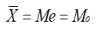
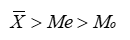
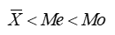
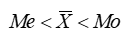

# 第17届市调大赛专科模拟题

> 共 100 题

## 第1题 · 单选题

> `Q17-ZK-001` ｜ Z01 市场调查概述 / 应用范围 ｜ 答案 **B**

**题目**：对新产品开发、测试、现有产品的研发、诊断和改造等内容的调查，属于（ ）。

**选项**：

- A. 目标市场调查
- B. 产品研究调查
- C. 产品实体调查
- D. 消费者调查

## 第2题 · 单选题

> `Q17-ZK-002` ｜ Z01 市场调查概述 / 综合 ｜ 答案 **C**

**题目**：市场调查最重要的原则是（ ）。

**选项**：

- A. 全面性和系统性
- B. 经济性和艺术性
- C. 真实性和准确性
- D. 时效性和科学性

## 第3题 · 单选题

> `Q17-ZK-003` ｜ Z07 抽样调查与估计 / 重点调查 ｜ 答案 **B**

**题目**：重点调查和（）都具有主观选择的特征。

**选项**：

- A. 抽样调查
- B. 典型调查
- C. 普查
- D. 统计报表

## 第4题 · 单选题

> `Q17-ZK-004` ｜ Z01 市场调查概述 / 调查程序 ｜ 答案 **C**

**题目**：下列对统计调查实施过程的描述最不适当的是（  ）。

**选项**：

- A. 将原始数据转成次级数据
- B. 使用图表来描述数据
- C. 为保证无误，建议最后进行普查做验证。
- D. 进行抽样对总体的特征进行推论

## 第5题 · 单选题

> `Q17-ZK-005` ｜ Z01 市场调查概述 / 应用范围 ｜ 答案 **D**

**题目**：通过调查将本企业的现有条件与竞争对手进行对比，从而为制定有效的竞争策略提供依据，这体现了（ ）的重要性。

**选项**：

- A. 广告调查
- B. 销售渠道调查
- C. 商品实体和包装调查
- D. 竞争对手状况调查

## 第6题 · 单选题

> `Q17-ZK-006` ｜ Z01 市场调查概述 / 综合 ｜ 答案 **C**

**题目**：下列对市场调查过程的描述最不适当的是（  ）。

**选项**：

- A. 形成一手数据的过程
- B. 使用图表来描述数据
- C. 为保证无误，建议最后进行普查做验证。
- D. 通过抽样对总体分布特征进行推论

## 第7题 · 单选题

> `Q17-ZK-007` ｜ Z07 抽样调查与估计 / 重点调查 ｜ 答案 **B**

**题目**：为掌握商品销售情况，对占该市商品销售额80%的五个大型销售渠道进行调查，这种调查方式属于（ ）。

**选项**：

- A. 普查
- B. 重点调查
- C. 典型调查
- D. 抽样调查

## 第8题 · 单选题

> `Q17-ZK-008` ｜ Z02 调查方案设计 / 调查方案 ｜ 答案 **A**

**题目**：采用经验判断评价市场调查方案时，以下说法正确的是（ ）。

**选项**：

- A. 可以节约人力、物力
- B. 在较长时间内做出判断
- C. 主客观因素都不会对判断产生影响
- D. 事物变化常常在人民的认识范围之内

## 第9题 · 单选题

> `Q17-ZK-009` ｜ Z07 抽样调查与估计 / 抽样调查 ｜ 答案 **C**

**题目**：为了估计某城市愿意乘坐地铁上下班的人数比例，在搜集数据时最可能采用的方法是（   ）。

**选项**：

- A. 观察法
- B. 二手数据分析法
- C. 概率抽样
- D. 实验法

## 第10题 · 单选题

> `Q17-ZK-010` ｜ Z04 资料采集方法 / 普查 ｜ 答案 **B**

**题目**：工业企业普查中每个工业企业是（ ）。

**选项**：

- A. 调查单位
- B. 既是调查单位又是报告单位
- C. 既不是调查单位又不是报告单位
- D. 报告单位

## 第11题 · 单选题

> `Q17-ZK-011` ｜ Z02 调查方案设计 / 调查目标 ｜ 答案 **C**

**题目**：调查目标的陈述一般放在（ ）中。

**选项**：

- A. 方案的内容部分
- B. 方案的目录
- C. 方案的正文
- D. 方案的附录

## 第12题 · 单选题

> `Q17-ZK-012` ｜ Z01 市场调查概述 / 综合 ｜ 答案 **C**

**题目**：在市场调查中选出代表性的单位是调查单位，这种调查方式是（ ）。

**选项**：

- A. 普查
- B. 抽样调查
- C. 典型调查
- D. 重点调查

## 第13题 · 单选题

> `Q17-ZK-013` ｜ Z02 调查方案设计 / 调查方案 ｜ 答案 **A**

**题目**：市场调查中，明确调查目的是进行调查方案设计的（ ）。

**选项**：

- A. 第一步骤
- B. 第二步骤
- C. 第三步骤
- D. 第四步骤

## 第14题 · 单选题

> `Q17-ZK-014` ｜ Z03 问卷及量表设计 / 量表 ｜ 答案 **C**

**题目**：如果一个量表信度系数在0.8-0.90之间，则该量表（    ）。

**选项**：

- A. 相当可信，可以接受，只需少量调整
- B. 非常可信，基本接受，只需少量调整
- C. 非常可信，完全接受，不需调整
- D. 十分可信，完全接受，不需调整

## 第15题 · 单选题

> `Q17-ZK-015` ｜ Z03 问卷及量表设计 / 问卷设计 ｜ 答案 **B**

**题目**：问卷中设计问题有两种主要形式，开放式和（ ）。

**选项**：

- A. 半开放式
- B. 封闭式
- C. 框图式
- D. 半封闭式

## 第16题 · 单选题

> `Q17-ZK-016` ｜ Z03 问卷及量表设计 / 量表 ｜ 答案 **A**

**题目**：对固定总数量表描述正确的是：（ ）。

**选项**：

- A. 要求应答者根据各个特性的重要程度将一个给定分数（通常是100分或10分）在两个或多个特性间进行分配。
- B. 要求应答者根据偏好对选项进行排序，并依次赋予1、2、3...。
- C. 要求应答者比较若干种产品的消费者品牌偏好，将这些品牌两两配对构建量表
- D. 一般设定7级评分量表，两端由相互对立的形容词组成。要求应答者进行对应地评分

## 第17题 · 单选题

> `Q17-ZK-017` ｜ Z03 问卷及量表设计 / 测量尺度 ｜ 答案 **B**

**题目**：有一项调查是由顾客品尝五种不同品牌的冰淇淋，并以1到5排列其喜好程度，这是哪种测量尺度的例子？（  ）

**选项**：

- A. 定类尺度
- B. 顺序尺度
- C. 等距尺度
- D. 比率尺度

## 第18题 · 单选题

> `Q17-ZK-018` ｜ Z03 问卷及量表设计 / 问卷设计 ｜ 答案 **A**

**题目**：调查问卷中的甄别问题主要是为了（ ）。

**选项**：

- A. 确保被调查者符合要求
- B. 确保调查问卷的完整性
- C. 确保调查问卷的回收率
- D. 确保调查结果准确

## 第19题 · 单选题

> `Q17-ZK-019` ｜ Z03 问卷及量表设计 / 问卷设计 ｜ 答案 **D**

**题目**：关于调查问卷中问题顺序的安排，下面哪个叙述是不正确的（ ）。

**选项**：

- A. 简单易懂的问题放在前面，复杂的问题放在后面
- B. 封闭式问题放在前面，开放式问题放在后面
- C. 敏感性问题放在后面
- D. 能引起被调查者兴趣的问题放在后面

## 第20题 · 单选题

> `Q17-ZK-020` ｜ Z03 问卷及量表设计 / 问卷设计 ｜ 答案 **A**

**题目**：问卷设计应保证调查数据在一定条件下维持稳定性，这是（ ）。

**选项**：

- A. 可靠性原则
- B. 效率原则
- C. 可维护性原则
- D. 功能性原则

## 第21题 · 单选题

> `Q17-ZK-021` ｜ Z03 问卷及量表设计 / 量表 ｜ 答案 **B**

**题目**：使用两个平行量表分别对同一概念进行测量，所得测量结果之间的相关系数，反映了量表的（     ）。

**选项**：

- A. 再测效信度
- B. 复本信度
- C. 分半信度
- D. 内部一致性信度

## 第22题 · 单选题

> `Q17-ZK-022` ｜ Z03 问卷及量表设计 / 问题类型 ｜ 答案 **A**

**题目**：“请您谈谈对本公司长期发展的意见和建议。”这样的问题属于（ ）。

**选项**：

- A. 开放式问题
- B. 封闭式问题
- C. 动机性问题
- D. 事实性问题

## 第23题 · 单选题

> `Q17-ZK-023` ｜ Z08 数据分析方法 / 方差分析 ｜ 答案 **B**

**题目**：对实验数据进行分析的常用方法是（  ）。

**选项**：

- A. 频数分析
- B. 方差分析
- C. 相关分析
- D. 因子分析

## 第24题 · 单选题

> `Q17-ZK-024` ｜ Z04 资料采集方法 / 德尔菲法 ｜ 答案 **B**

**题目**：下列因素中，直接影响德尔菲法成败的最重要因素是（ ）。

**选项**：

- A. 调查表中问题的数量
- B. 专家的选择
- C. 征询的轮次
- D. 征询的时间间隔

## 第25题 · 单选题

> `Q17-ZK-025` ｜ Z04 资料采集方法 / 德尔菲法 ｜ 答案 **A**

**题目**：下列调查项目中适合采用德尔菲法的是（ ）。

**选项**：

- A. 调查超市选址时应该考虑的重要变量
- B. 调查消费者对某产品的认识和购买行为
- C. 调查农村留守儿童的学习情况
- D. 调查房地产公司高层管理者对竞争者的看法

## 第26题 · 单选题

> `Q17-ZK-026` ｜ Z04 资料采集方法 / 德尔菲法 ｜ 答案 **C**

**题目**：德尔菲法的优点不包括（ ）。

**选项**：

- A. 匿名性
- B. 反馈性
- C. 客观性
- D. 量化性

## 第27题 · 单选题

> `Q17-ZK-027` ｜ Z04 资料采集方法 / 调查方法 ｜ 答案 **A**

**题目**：调查企业员工跳槽行为及其原因的合适方法是（   ）。

**选项**：

- A. 深层访谈法
- B. 小组座谈法
- C. 投影技法
- D. 电话调查法

## 第28题 · 单选题

> `Q17-ZK-028` ｜ Z04 资料采集方法 / 文案调查 ｜ 答案 **D**

**题目**：下列选项中，属于文案调查方法优点的是（ ）。

**选项**：

- A. 成本相对较高
- B. 资料比较难找到
- C. 收集资料所用时间相对较长
- D. 收集资料时不受时空限制

## 第29题 · 单选题

> `Q17-ZK-029` ｜ Z04 资料采集方法 / 调查方法 ｜ 答案 **B**

**题目**：在对消费者能源消费研究的调查中，合适的方法是（  ）。

**选项**：

- A. 邮寄调查
- B. 面访调查
- C. 深度访谈法
- D. 小组座谈法

## 第30题 · 单选题

> `Q17-ZK-030` ｜ Z04 资料采集方法 / 二手数据 ｜ 答案 **D**

**题目**：以下不属于二手资料的是（ ）。

**选项**：

- A. 政府网络平台上的统计数据
- B. 企业过去的产品样品数据
- C. 教师传授给学生的研究成果
- D. 消费者填答的本人的消费习惯数据

## 第31题 · 单选题

> `Q17-ZK-031` ｜ Z04 资料采集方法 / 遥感调查 ｜ 答案 **B**

**题目**：通过遥感技术获取农作物种植种类和种植面积估计的调查属于（   ）。

**选项**：

- A. 市场实验法
- B. 观察法
- C. 拍摄法
- D. 物理技术法

## 第32题 · 单选题

> `Q17-ZK-032` ｜ Z04 资料采集方法 / 文案调查 ｜ 答案 **B**

**题目**：文案调查法所收集的资料又叫（   ）。

**选项**：

- A. 一手资料
- B. 二手资料
- C. 调查资料
- D. 直接资料

## 第33题 · 单选题

> `Q17-ZK-033` ｜ Z03 问卷及量表设计 / 排序量表 ｜ 答案 **A**

**题目**：将样本数据从小到大排序，排在尾部的k个离群值采用n-k个样本中的最大值替代的处理方法是（   ）

**选项**：

- A. 缩尾化法
- B. 调整权属
- C. 替代法
- D. 删除法

## 第34题 · 单选题

> `Q17-ZK-034` ｜ Z05 调查实施与报告 / 调查报告 ｜ 答案 **A**

**题目**：下列内容不包含在市场调查报告正文部分的是（   ）。

**选项**：

- A. 参考书目与附录
- B. 调查对象与调查方法
- C. 调查结论和建议
- D. 调查背景说明

## 第35题 · 单选题

> `Q17-ZK-035` ｜ Z05 调查实施与报告 / 调查实施 ｜ 答案 **C**

**题目**：当需要对所有家庭成员都知道的信息进行调查而被调查者不在时的处理方式是（  ）。

**选项**：

- A. 另约回访时间
- B. 放弃
- C. 代理回答
- D. 更换被调查者

## 第36题 · 单选题

> `Q17-ZK-036` ｜ Z03 问卷及量表设计 / 问题设计 ｜ 答案 **D**

**题目**：为了减少在调查中误导被调查者，我们在提问时需要遵循的原则描述不准确的是（  ）。

**选项**：

- A. 按照问卷设计的顺序提问
- B. 使用问卷中的措辞提问
- C. 提问语速慢一些
- D. 可适当增减问卷的问题

## 第37题 · 单选题

> `Q17-ZK-037` ｜ Z05 调查实施与报告 / 统计表 ｜ 答案 **A**

**题目**：统计表的主词是指（ ）。

**选项**：

- A. 所要说明的对象
- B. 说明总体的统计指标
- C. 横行标题
- D. 纵列标题

## 第38题 · 单选题

> `Q17-ZK-038` ｜ Z05 调查实施与报告 / 统计图 ｜ 答案 **D**

**题目**：下列关于定量数据的图形表示方法，不正确的是（ ）。

**选项**：

- A. 直方图横坐标代表变量分组，纵坐标代表各变量值出现的频数
- B. 折线图利用线段的升降来说明数据大小的变动
- C. 散点图可以用来反映两个变量之间的关系
- D. 定量数据的直方图与定性数据的条形图实际上是相同的

## 第39题 · 单选题

> `Q17-ZK-039` ｜ Z05 调查实施与报告 / 调查报告 ｜ 答案 **A**

**题目**：调查报告的主题包含不了或没有提及，但与主题有关必须附加说明的部分称为（ ）。

**选项**：

- A. 附录
- B. 展望
- C. 背景
- D. 引言

## 第40题 · 单选题

> `Q17-ZK-040` ｜ Z04 资料采集方法 / 调查员管理 ｜ 答案 **D**

**题目**：调查员对开放式题进行记录时不正确的做法是（  ）。

**选项**：

- A. 使用被调查者自己的语言
- B. 记录与问答题有关的全部内容
- C. 边记录边重复所记录的答案
- D. 过后补记

## 第41题 · 单选题

> `Q17-ZK-041` ｜ Z05 调查实施与报告 / 调查报告 ｜ 答案 **B**

**题目**：将调查结论写出，然后逐步论证，这种开头形式是（）

**选项**：

- A. 开门见山，揭示主题
- B. 结论先行，逐步论证
- C. 交代情况，逐层分析
- D. 提出问题，引入正题

## 第42题 · 单选题

> `Q17-ZK-042` ｜ Z04 资料采集方法 / 调查员管理 ｜ 答案 **D**

**题目**：调查员在记录被调查者的回答时由于粗心造成的误差属于（  ）。

**选项**：

- A. 抽样误差
- B. 抽样框误差
- C. 有意识误差
- D. 调查员误差

## 第43题 · 单选题

> `Q17-ZK-043` ｜ Z05 调查实施与报告 / 统计表 ｜ 答案 **C**

**题目**：下列不符合统计表编制规范的是（ ）。

**选项**：

- A. 一个表格只说明一个要点
- B. 总标题应清楚、简洁、醒目
- C. 标题可以缩写
- D. 所有计量单位都必须表述清楚

## 第44题 · 单选题

> `Q17-ZK-044` ｜ Z05 调查实施与报告 / 调查实施 ｜ 答案 **B**

**题目**：调查的实施是指（  ）。

**选项**：

- A. 明确调查要解决什么具体问题
- B. 针对调查对象进行信息的收集
- C. 把调查问题转化为具体的解决办法
- D. 确定调查的具体内容

## 第45题 · 单选题

> `Q17-ZK-045` ｜ Z06 描述统计基础 / 集中趋势 ｜ 答案 **B**

**题目**：某学校对新生进行英语水平测试，结果成绩的平均分是80分，标准差是5分，中位数是85分，则新生英语成绩的分布形状是（ ）。

**选项**：

- A. 对称的
- B. 左偏的
- C. 右偏的
- D. 无法判断

## 第46题 · 单选题

> `Q17-ZK-046` ｜ Z06 描述统计基础 / 集中趋势 ｜ 答案 **A**

**题目**：标志变异指标中的平均差越大，用平均数测算数值的代表性（ ）。

**选项**：

- A. 越差
- B. 越好
- C. 不变
- D. 无法确定

## 第47题 · 单选题

> `Q17-ZK-047` ｜ Z06 描述统计基础 / 描述统计 ｜ 答案 **C**

**题目**：以下对于相对次数分布的描述，表述错误的是（  ）。

**选项**：

- A. 相对次数没有负值
- B. 相对次数的最大值为1
- C. 仅适用于描述质性数据
- D. 根据大数法则，随着随机试验次数的增加，事件的相对次数分配会趋于稳定

## 第48题 · 单选题

> `Q17-ZK-048` ｜ Z06 描述统计基础 / 时间序列 ｜ 答案 **C**

**题目**：某地区去年粮食产量的环比增长速度为3%，今年为4%，则近两年该地区粮食产量共增长了（  ）。

**选项**：

- A. 0.01
- B. 0.07
- C. 0.0712
- D. 0.12

## 第49题 · 单选题

> `Q17-ZK-049` ｜ Z06 描述统计基础 / 集中趋势 ｜ 答案 **B**

**题目**：在右偏态分布条件下算术平均数、中位数和众数的关系表现为(  ).

**选项**：

- A. 
- B. 
- C. 
- D. 

## 第50题 · 单选题

> `Q17-ZK-050` ｜ Z06 描述统计基础 / 集中趋势 ｜ 答案 **B**

**题目**：某项关于消费者在超市购物频率的调查资料显示，大多数居民每周上超市购物3次，这一数字是（ ）。

**选项**：

- A. 全距
- B. 众数
- C. 中位数
- D. 平均数

## 第51题 · 单选题

> `Q17-ZK-051` ｜ Z06 描述统计基础 / 统计指数 ｜ 答案 **B**

**题目**：下列相对数中，属于不同时期对比的指标有（ ）。

**选项**：

- A. 结构相对数
- B. 动态相对数
- C. 比较相对数
- D. 强度相对数

## 第52题 · 单选题

> `Q17-ZK-052` ｜ Z06 描述统计基础 / 区间估计 ｜ 答案 **A**

**题目**：在其它条件相同的情况下，95%的置信区间比90%的置信区间（ ）。

**选项**：

- A. 要宽
- B. 要窄
- C. 相同
- D. 不确定

## 第53题 · 单选题

> `Q17-ZK-053` ｜ Z07 抽样调查与估计 / 标准误 ｜ 答案 **C**

**题目**：为了研究儿童的成长发育状况，随机抽取了36名儿童，测得平均身高为120CM，标准差为9，抽样标准误差为1.5，则下列各项中正确的是（ ）。

**选项**：

- A. 抽样标准误差是总体数据的标准差
- B. 抽样标准误差是样本数据的标准差
- C. 抽样标准误差是样本均值的标准差
- D. 抽样标准误差是抽样产生的实际误差

## 第54题 · 单选题

> `Q17-ZK-054` ｜ Z07 抽样调查与估计 / 抽样基础 ｜ 答案 **B**

**题目**：全及总体是我们所要研究的对象，比如要研究某城市职工的生活水平，则该城市的（ ）即构成全及总体。

**选项**：

- A. 全部职工的生活水平
- B. 全部职工
- C. 每一位职工的生活水平
- D. 每一位职工

## 第55题 · 单选题

> `Q17-ZK-055` ｜ Z07 抽样调查与估计 / 抽样基础 ｜ 答案 **B**

**题目**：某商品的100件样品中，测得的优质品为98件，则样本优质品成数为（ ）。

**选项**：

- A. 1
- B. 0.98
- C. 0.02
- D. 无法计算

## 第56题 · 单选题

> `Q17-ZK-056` ｜ Z07 抽样调查与估计 / 抽样基础 ｜ 答案 **A**

**题目**：当依据样本比例估计总体比例时所使用的统计量为（ ）。

**选项**：

- A. z
- B. 
- C. t
- D. F

## 第57题 · 单选题

> `Q17-ZK-057` ｜ Z07 抽样调查与估计 / 抽样基础 ｜ 答案 **C**

**题目**：先将总体各单位按某一标志顺序排序，然后依一定顺序和相等距离或间隔抽取样本单位的抽样技术，我们称之为（ ）。

**选项**：

- A. 整群抽样
- B. 分层抽样
- C. 系统抽样
- D. 任意抽样

## 第58题 · 单选题

> `Q17-ZK-058` ｜ Z06 描述统计基础 / 参数估计 ｜ 答案 **B**

**题目**：点估计的优良性准则包括一致性、有效性和（ ）。

**选项**：

- A. 准确性
- B. 无偏性
- C. 科学性
- D. 真实性

## 第59题 · 单选题

> `Q17-ZK-059` ｜ Z07 抽样调查与估计 / 概率抽样 ｜ 答案 **C**

**题目**：下列关于非概率抽样的叙述，错误的是（ ）。

**选项**：

- A. 非概率抽样抽取样本时不遵照随机原则
- B. 非概率抽样无法知道样本统计量的分布
- C. 非概率抽样估计结果的精确性可以用抽样误差来衡量
- D. 非概率抽样的最大特点是操作简便、时效快、成本低

## 第60题 · 单选题

> `Q17-ZK-060` ｜ Z07 抽样调查与估计 / 抽样方法 ｜ 答案 **B**

**题目**：不同的抽样方法会影响抽样数目的多少，一般来说，随机抽样会比非随机抽样的样本数目（ ）。

**选项**：

- A. 多一些
- B. 少一些
- C. 一样多
- D. 无所谓

## 第61题 · 单选题

> `Q17-ZK-061` ｜ Z06 描述统计基础 / 区间估计 ｜ 答案 **A**

**题目**：在从一个方差已知的总体中采用同样的方法抽取两个随机样本进行总体均值的统计推断，样本容量分别为50和100，则依此建立的95%置信区间宽度（  ）。

**选项**：

- A. 前者大于后者
- B. 前者小于后者
- C. 两者一样大
- D. 无法确定

## 第62题 · 单选题

> `Q17-ZK-062` ｜ Z07 抽样调查与估计 / 抽样 ｜ 答案 **A**

**题目**：随机数表又可以称为（ ）。

**选项**：

- A. 乱数表
- B. 统计表
- C. 分类汇总表
- D. 分组表

## 第63题 · 单选题

> `Q17-ZK-063` ｜ Z07 抽样调查与估计 / 设计效应 ｜ 答案 **C**

**题目**：下面关于设计效应的叙述，错误的是（ ）。

**选项**：

- A. 简单随机抽样的设计效应等于1
- B. 整群抽样的设计效应大于1
- C. 分层抽样的设计效应大于1
- D. 多阶段抽样的设计效应大于1

## 第64题 · 单选题

> `Q17-ZK-064` ｜ Z07 抽样调查与估计 / 抽样 ｜ 答案 **C**

**题目**：总体参数的抽样估计方法有（ ）。

**选项**：

- A. 点估计
- B. 区间估计
- C. 点估计与区间估计
- D. 抽样估计

## 第65题 · 单选题

> `Q17-ZK-065` ｜ Z07 抽样调查与估计 / 抽样调查 ｜ 答案 **C**

**题目**：对某单位职工的文化程度进行抽样调查，得知其中80%的人是高中毕业，抽样平均误差为2%，当概率保证程度为95.45%时（t=2），该单位职工具有高中文化程度的比重是（ ）。

**选项**：

- A. 大于84%
- B. 等于78%
- C. 在76%-84%之间
- D. 在78%-82%之间

## 第66题 · 单选题

> `Q17-ZK-066` ｜ Z06 描述统计基础 / 正态分布 ｜ 答案 **D**

**题目**：关于正态分布，以下陈述正确的是（  ）

**选项**：

- A. 平均数不为负数
- B. 偏态系数为1
- C. 为一个双峰分布
- D. 峰度系数为3

## 第67题 · 单选题

> `Q17-ZK-067` ｜ Z08 数据分析方法 / 回归分析 ｜ 答案 **A**

**题目**：估计标准误差是反映了（ ）。

**选项**：

- A. 平均数代表性的指标
- B. 相关关系的指标
- C. 回归直线的代表性指标
- D. 序时平均数的代表性指标

## 第68题 · 单选题

> `Q17-ZK-068` ｜ Z08 数据分析方法 / 回归分析 ｜ 答案 **A**

**题目**：对具有因果关系的现象进行回归分析时，以下说法正确的是（ ）。

**选项**：

- A. 只能将原因变量作为自变量
- B. 只能将结果变量作为自变量
- C. 原因变量和结果变量均可作自变量
- D. 没有必要区分自变量和因变量

## 第69题 · 单选题

> `Q17-ZK-069` ｜ Z08 数据分析方法 / 列联分析 ｜ 答案 **D**

**题目**：若列联表的行数为5，列数为6，则卡方统计量的自由度为（     ）。

**选项**：

- A. 5
- B. 11
- C. 30
- D. 20

## 第70题 · 单选题

> `Q17-ZK-070` ｜ Z08 数据分析方法 / 时间序列 ｜ 答案 **C**

**题目**：定量预测优点具有（）。

**选项**：

- A. 预测方法简单容易推广
- B. 不需要完整历史资料
- C. 预测结果较准确
- D. 不可与定性预测结合使用

## 第71题 · 单选题

> `Q17-ZK-071` ｜ Z08 数据分析方法 / 相关分析 ｜ 答案 **B**

**题目**：相关系数的取值范围是（ ）。

**选项**：

- A. -1<r<1
- B. -1≤r≤1
- C. 0≤r≤1
- D. ∣r∣≥1

## 第72题 · 单选题

> `Q17-ZK-072` ｜ Z08 数据分析方法 / 相关分析 ｜ 答案 **B**

**题目**：下列关于简单相关系数论述正确的是（ ）。

**选项**：

- A. 可以用来衡量变量间的因果关系
- B. 取值范围为[-1， 1]
- C. 不需要进行显著性检验
- D. 可以表示变量间的曲线关系

## 第73题 · 单选题

> `Q17-ZK-073` ｜ Z08 数据分析方法 / 回归分析 ｜ 答案 **C**

**题目**：估计标准误差是反映了（ ）。

**选项**：

- A. 平均数代表性的指标
- B. 相关关系的指标
- C. 回归直线的代表性指标
- D. 序时平均数的代表性指标

## 第74题 · 单选题

> `Q17-ZK-074` ｜ Z08 数据分析方法 / 相关分析 ｜ 答案 **A**

**题目**：进行相关分析，要求相关的两个变量（ ）。

**选项**：

- A. 都是随机的变量
- B. 一个是随机变量，一个不是随机变量
- C. 随机的和非随机都可以
- D. 都不是随机变量

## 第75题 · 单选题

> `Q17-ZK-075` ｜ Z08 数据分析方法 / 相关分析 ｜ 答案 **C**

**题目**：相关分析是研究（）。

**选项**：

- A. 变量之间的数量关系
- B. 变量之间的变动关系
- C. 变量之间相互关系的密切程度
- D. 变量之间的因果关系

## 第76题 · 单选题

> `Q17-ZK-076` ｜ Z08 数据分析方法 / 回归分析 ｜ 答案 **D**

**题目**：回归系数和相关系数的符号是一致的，其符号均可用来判断变量之间存在以下哪种关系类型（ ）。

**选项**：

- A. 线性相关还是非线性相关
- B. 完全相关还是不完全相关
- C. 单相关还是复相关
- D. 正相关还是负相关

## 第77题 · 判断题

> `Q17-ZK-077` ｜ Z01 市场调查概述 / 综合 ｜ 答案 **B**

**题目**：每一次的市场调查都有多个明确的研究目的。

**选项**：

- A. 对
- B. 错

## 第78题 · 判断题

> `Q17-ZK-078` ｜ Z01 市场调查概述 / 研究类型 ｜ 答案 **A**

**题目**：探索性调查是为了掌握和理解调查者所面临的市场调查问题的特征和与此相联系的各种变量的市场调查。（ ）

**选项**：

- A. 对
- B. 错

## 第79题 · 判断题

> `Q17-ZK-079` ｜ Z02 调查方案设计 / 调查方案 ｜ 答案 **B**

**题目**：市场调查方案可以在市场调查过程中随时制定。（）

**选项**：

- A. 对
- B. 错

## 第80题 · 判断题

> `Q17-ZK-080` ｜ Z07 抽样调查与估计 / 抽样误差 ｜ 答案 **A**

**题目**：只要是进行抽样调查，抽样误差一直都存在。

**选项**：

- A. 对
- B. 错

## 第81题 · 判断题

> `Q17-ZK-081` ｜ Z01 市场调查概述 / 调查内容 ｜ 答案 **B**

**题目**：调查问卷设计前，通过向企业负责人咨询有关调查目的、调查内容等问题；向专业调查人员咨询调查问卷整体设计、问题和答案的设计、方法的选用等问题，即可获取问卷设计所需全部信息。

**选项**：

- A. 对
- B. 错

## 第82题 · 判断题

> `Q17-ZK-082` ｜ Z03 问卷及量表设计 / 问题设计 ｜ 答案 **A**

**题目**：问题的措辞可能会使受访者不愿回答或不愿真实回答，影响回答率。

**选项**：

- A. 对
- B. 错

## 第83题 · 判断题

> `Q17-ZK-083` ｜ Z03 问卷及量表设计 / 问卷设计 ｜ 答案 **A**

**题目**：开放式问卷主要用于定性的探索性研究。

**选项**：

- A. 对
- B. 错

## 第84题 · 判断题

> `Q17-ZK-084` ｜ Z04 资料采集方法 / 访谈调查 ｜ 答案 **A**

**题目**：小组座谈法和深层访谈法都属于非标准式面访。（ ）

**选项**：

- A. 对
- B. 错

## 第85题 · 判断题

> `Q17-ZK-085` ｜ Z04 资料采集方法 / 数据收集 ｜ 答案 **B**

**题目**：标准化访问又称结构化访问，是指调查者按粗略的提纲自由地向被调查者访问，主要应用于非数据收集和定性研究。（  ）

**选项**：

- A. 对
- B. 错

## 第86题 · 判断题

> `Q17-ZK-086` ｜ Z04 资料采集方法 / 访谈调查 ｜ 答案 **B**

**题目**：在个别访谈时，对一些敏感性问题，被访问者难以回答。（ ）

**选项**：

- A. 对
- B. 错

## 第87题 · 判断题

> `Q17-ZK-087` ｜ Z04 资料采集方法 / 调查员管理 ｜ 答案 **A**

**题目**：观察人员在进行观察时，有时难免带入调查员的主观看法和个人的感情色彩，使得观察结果出现偏差。（ ）

**选项**：

- A. 对
- B. 错

## 第88题 · 判断题

> `Q17-ZK-088` ｜ Z05 调查实施与报告 / 调查报告 ｜ 答案 **A**

**题目**：演示报告是书面报告的浓缩版本，应该包含主要观点和重要结论。（ ）

**选项**：

- A. 对
- B. 错

## 第89题 · 判断题

> `Q17-ZK-089` ｜ Z03 问卷及量表设计 / 问卷编码 ｜ 答案 **B**

**题目**：分组编码法是指用数字、文字、符号等表明编码对象的属性对信息资料进行编码。（ ）

**选项**：

- A. 对
- B. 错

## 第90题 · 判断题

> `Q17-ZK-090` ｜ Z05 调查实施与报告 / 调查报告 ｜ 答案 **B**

**题目**：书面调查报告需要将整个调查过程按部就班地完整表达出来。（ ）

**选项**：

- A. 对
- B. 错

## 第91题 · 判断题

> `Q17-ZK-091` ｜ Z05 调查实施与报告 / 调查报告 ｜ 答案 **A**

**题目**：市场调查书面报告一般是通过标题把被调查单位、调查内容等明确而具体地表示出来。（ ）

**选项**：

- A. 对
- B. 错

## 第92题 · 判断题

> `Q17-ZK-092` ｜ Z07 抽样调查与估计 / 估计量 ｜ 答案 **B**

**题目**：估计量和估计值并没有什么区别，二者是同一概念。（　　）

**选项**：

- A. 对
- B. 错

## 第93题 · 判断题

> `Q17-ZK-093` ｜ Z06 描述统计基础 / 集中趋势 ｜ 答案 **B**

**题目**：几何平均数中的各标志值是独立的，即某一标志量的大小不受前一标志量的影响。（ ）

**选项**：

- A. 对
- B. 错

## 第94题 · 判断题

> `Q17-ZK-094` ｜ Z06 描述统计基础 / 集中趋势 ｜ 答案 **A**

**题目**：对于分组变量计算出的均值，是实际均值的近似值。（ ）

**选项**：

- A. 对
- B. 错

## 第95题 · 判断题

> `Q17-ZK-095` ｜ Z07 抽样调查与估计 / 抽样 ｜ 答案 **A**

**题目**：全及指标是一个确定值，抽样指标则随着抽取的样本不同，围绕全及指标左右变动，因此抽样指标和全及指标之间存在一个误差范围。（ ）

**选项**：

- A. 对
- B. 错

## 第96题 · 判断题

> `Q17-ZK-096` ｜ Z07 抽样调查与估计 / 估计量 ｜ 答案 **A**

**题目**：总体比例的估计，是具有某特征的单元总数的估计值除以总体中单元总数的估计值。

**选项**：

- A. 对
- B. 错

## 第97题 · 判断题

> `Q17-ZK-097` ｜ Z07 抽样调查与估计 / 系统抽样 ｜ 答案 **A**

**题目**：系统抽样中当抽样间距正好与总体中变化的某种周期性一致时会形成系统偏差。（ ）

**选项**：

- A. 对
- B. 错

## 第98题 · 判断题

> `Q17-ZK-098` ｜ Z07 抽样调查与估计 / 分层抽样 ｜ 答案 **A**

**题目**：分层抽样法又称为类型抽样法，是从一个可以分成不同子总体（或称为层）的总体中，按规定的比例从不同层中随机抽取样品（个体）的方法。

**选项**：

- A. 对
- B. 错

## 第99题 · 判断题

> `Q17-ZK-099` ｜ Z08 数据分析方法 / 回归分析 ｜ 答案 **A**

**题目**：回归分析是研究因变量对自变量依赖关系的一种统计分析方法。

**选项**：

- A. 对
- B. 错

## 第100题 · 判断题

> `Q17-ZK-100` ｜ Z06 描述统计基础 / 偏态与峰度 ｜ 答案 **B**

**题目**：当各组样本数据呈严重偏态时，也可以作方差分析。

**选项**：

- A. 对
- B. 错

