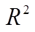
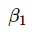
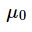
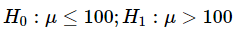
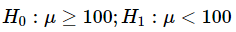
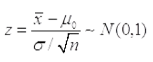
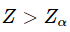
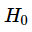

# 第17届市调大赛本科模拟题

> 共 85 题

## 第1题 · 单选题

> `Q17-BK-001` ｜ 01 市场调查概述 / 调查作用 ｜ 答案 **B**

**题目**：在市场经济条件下，企业的活动与市场的关系表现为（ ）。

**选项**：

- A. 与市场可以有联系
- B. 企业受市场的制约和调节
- C. 与市场没有联系
- D. 市场只提供机会

## 第2题 · 单选题

> `Q17-BK-002` ｜ 01 市场调查概述 / 调查程序 ｜ 答案 **D**

**题目**：确定调查对象和调查范围相关内容体现在调查基本程序的环节是（   ）。

**选项**：

- A. 报告调查结果
- B. 拟定调查方案
- C. 实施调查计划
- D. 确定调查问题

**解析**：确定调查对象和调查范围属于调查基本程序中的“确定调查问题/明确调查目的”环节，而不是拟定方案、实施或报告阶段。

**易错点**：“调查对象和范围”听起来像方案，但教材把它归在确定调查问题阶段。

## 第3题 · 单选题

> `Q17-BK-003` ｜ 02 数据收集 / 观察法 ｜ 答案 **D**

**题目**：调查者扮演为普通顾客，在不同的商店和其他的商业机构中，按事先拟定的指示，仔细观察和评估客户服务，最后提出报告，用于对该单位或机构产品及服务质量进行评估的人员。这类调查者常被称为（  ）。

**选项**：

- A. 嘉宾顾客
- B. 商情预报员
- C. 综合管理者
- D. 神秘顾客

## 第4题 · 单选题

> `Q17-BK-004` ｜ 02 数据收集 / 调查员管理 ｜ 答案 **B**

**题目**：调查员采取追问技巧时正确的做法是（   ）。

**选项**：

- A. 使用肯定的语气
- B. 鼓励被调查者放心回答
- C. 反问式提问
- D. 用诱导语句提问

## 第5题 · 单选题

> `Q17-BK-005` ｜ 02 数据收集 / 网络调查 ｜ 答案 **D**

**题目**：下列调查方法中，属于网上调查的是（ ）。

**选项**：

- A. 入户面访调查
- B. 计算机辅助电话调查
- C. 计算机辅助面访调查
- D. 网络调查

## 第6题 · 单选题

> `Q17-BK-006` ｜ 04 问卷与量表 / 测量尺度 ｜ 答案 **B**

**题目**：全球各大都市的气温资料，其测度尺度是（   ）。

**选项**：

- A. 顺序尺度
- B. 比率尺度
- C. 等距尺度
- D. 定类尺度

**待核对**：题库答案将气温资料判为比率尺度（B）。按标准测量理论，摄氏/华氏温度只有相等单位、无绝对零点，应为定距尺度（C）；仅开尔文温度可视为定比。考试以题库答案为准，但需留意教材口径。

## 第7题 · 单选题

> `Q17-BK-007` ｜ 01 市场调查概述 / 综合 ｜ 答案 **A**

**题目**：市场调查在产品投入期的主要作用是（ ）。

**选项**：

- A. 确认需求
- B. 改进产品运营
- C. 规划下一步行动
- D. 让产品起飞、上升

## 第8题 · 单选题

> `Q17-BK-008` ｜ 02 数据收集 / 二手数据 ｜ 答案 **B**

**题目**：与原始资料相比，二手资料的优势在于（ ）。

**选项**：

- A. 含有更多的有效信息
- B. 易于取得，而且成本较低
- C. 可以直接使用而不必作任何处理
- D. 更有利于企业解决当前的营销问题

## 第9题 · 单选题

> `Q17-BK-009` ｜ 01 市场调查概述 / 应用范围 ｜ 答案 **A**

**题目**：如果欲获得产品的渗透水平和渗透深度、产品使用者和购买者的人口统计特征、消费者的使用习惯和购买习惯，则需进行（   ）。

**选项**：

- A. 消费者使用与态度调研
- B. 产品概念测试
- C. 品牌名称定量测试
- D. 包装测试

**解析**：消费者使用与态度研究（U&A）专门覆盖产品渗透水平与渗透深度、使用者/购买者人口统计特征、使用习惯和购买习惯。产品概念测试、品牌名称测试、包装测试只覆盖特定环节。

**易错点**：“渗透水平+使用习惯+购买者特征”是 U&A 的典型组合，不要误选概念测试。

## 第10题 · 单选题

> `Q17-BK-010` ｜ 02 数据收集 / 观察法 ｜ 答案 **A**

**题目**：下列调研项目中，适合采用观察法的是（ ）。

**选项**：

- A. 商场经营环境中商品陈列调查
- B. 广告营销效果调查
- C. 消费者对某类产品的认知调查
- D. 消费者满意度调查

## 第11题 · 单选题

> `Q17-BK-011` ｜ 02 数据收集 / 实验法 ｜ 答案 **A**

**题目**：下列方法中，不属于实验过程中控制外来变量影响的常用方法是（ ）。

**选项**：

- A. 非随机化分组
- B. 匹配分组
- C. 统计控制
- D. 实验设计

## 第12题 · 单选题

> `Q17-BK-012` ｜ 04 问卷与量表 / 问卷设计 ｜ 答案 **C**

**题目**：可以实现问卷问题顺序自动调整和随机安排选项顺序的调查是（  ）。

**选项**：

- A. 面访调查
- B. 邮寄调查
- C. 网上问卷调查
- D. 留置问卷调查

## 第13题 · 单选题

> `Q17-BK-013` ｜ 02 数据收集 / 头脑风暴 ｜ 答案 **A**

**题目**：采用头脑风暴法组织群体决策时，要集中有关专家召开专题会议，主持者以明确的方式向所有参与者阐明问题，说明会议的规则，由专家们（  ）。

**选项**：

- A. 自由提出决策方案
- B. 独立提出决策方案
- C. 随意提出决策方案
- D. 谨慎提出决策方案

## 第14题 · 单选题

> `Q17-BK-014` ｜ 02 数据收集 / 观察法 ｜ 答案 **B**

**题目**：神秘顾客购物法实施中依靠的调查人员是（ ）。

**选项**：

- A. 售货员
- B. 专门训练的神秘顾客
- C. 商场经理
- D. 普通的客户

## 第15题 · 单选题

> `Q17-BK-015` ｜ 02 数据收集 / 电话调查 ｜ 答案 **A**

**题目**：由于电话调查是通过电话进行的，调查者不在现场，因而（ ）判断所获信息的准确性和有效性等。

**选项**：

- A. 很难
- B. 很易
- C. 无法
- D. 可直接

## 第16题 · 单选题

> `Q17-BK-016` ｜ 07 抽样估计 / 普查 ｜ 答案 **A**

**题目**：为某一特定目的而专门组织的一次性全面调查，称为（ ）。

**选项**：

- A. 普查
- B. 抽样调查
- C. 统计报表
- D. 访问调查

**解析**：为某一特定目的专门组织的一次性全面调查称为普查。抽样调查只调查部分单位，统计报表是经常性上报，访问调查是具体采集方式。

**易错点**：“一次性、全面、专门组织”是普查的三个关键词。

## 第17题 · 单选题

> `Q17-BK-017` ｜ 09 多变量分析（一） / 方差分析 ｜ 答案 **B**

**题目**：对实验数据进行分析的常用方法是（  ）。

**选项**：

- A. 频数分析
- B. 方差分析
- C. 相关分析
- D. 因子分析

## 第18题 · 单选题

> `Q17-BK-018` ｜ 03 调查设计 / 调查方案 ｜ 答案 **C**

**题目**：撰写调查方案应该采用的语言形式是（ ）。

**选项**：

- A. 议论性
- B. 说明性
- C. 叙述性
- D. 抒情性

## 第19题 · 单选题

> `Q17-BK-019` ｜ 03 调查设计 / 调查方案 ｜ 答案 **C**

**题目**：一份完整的市场调查方案的除了包括封面、目录、附录外，还包括(   )。

**选项**：

- A. 数据
- B. 问卷
- C. 正文
- D. 抽样

## 第20题 · 单选题

> `Q17-BK-020` ｜ 03 调查设计 / 调查时间 ｜ 答案 **B**

**题目**：市场调查中规定调查工作的开始时间和结束时间称为（    ）。

**选项**：

- A. 调查时间
- B. 调查期限
- C. 工作计划
- D. 工作安排

## 第21题 · 单选题

> `Q17-BK-021` ｜ 04 问卷与量表 / 问卷设计 ｜ 答案 **B**

**题目**：问卷中甄别部分的主要目的是（ ）。

**选项**：

- A. 确保调查结果准确
- B. 确保被调查者符合要求
- C. 确保问卷的完整性
- D. 确保问卷的回收率

## 第22题 · 单选题

> `Q17-BK-022` ｜ 04 问卷与量表 / 问题设计 ｜ 答案 **A**

**题目**：“您认为CPI是否真实地反映了物价水平的综合变动？”这一问句存在的主要问题是（      ）。

**选项**：

- A. 不通俗易懂
- B. 不精练简洁
- C. 不清晰明了
- D. 具有敏感性

## 第23题 · 单选题

> `Q17-BK-023` ｜ 04 问卷与量表 / 量表 ｜ 答案 **B**

**题目**：量表设计出来后，通常（      ）。

**选项**：

- A. 可以直接使用
- B. 要加以质量评价
- C. 不需要修改
- D. 大规模试用

## 第24题 · 单选题

> `Q17-BK-024` ｜ 04 问卷与量表 / 量表 ｜ 答案 **D**

**题目**：语义差别量表中，如果数轴的一端使用的语义词是“服务热情”，则另一端应该是（ ）。

**选项**：

- A. 服务非常热情
- B. 服务不满意
- C. 服务很差
- D. 服务冷淡

## 第25题 · 单选题

> `Q17-BK-025` ｜ 04 问卷与量表 / 问卷设计 ｜ 答案 **D**

**题目**：问卷是获取数据的一种有序的、（ ）的方法。

**选项**：

- A. 定量分析
- B. 数据分析
- C. 趋势分析
- D. 结构化

## 第26题 · 单选题

> `Q17-BK-026` ｜ 04 问卷与量表 / 问卷设计 ｜ 答案 **A**

**题目**：调查截止日期后回收问卷的正确处理方法是（   ）。

**选项**：

- A. 废弃
- B. 录入使用
- C. 退回去
- D. 备用

## 第27题 · 单选题

> `Q17-BK-027` ｜ 05 数据处理与报告 / 调查报告 ｜ 答案 **D**

**题目**：调查报告的公正性是指(  )。

**选项**：

- A. 可适当略去调查实施中出现的严重问题
- B. 根据需要报告调查结果
- C. 可隐藏部分不利的结果
- D. 完整报告调查的结果

## 第28题 · 单选题

> `Q17-BK-028` ｜ 05 数据处理与报告 / 数据整理 ｜ 答案 **A**

**题目**：对数据分类或分组前所做的必要处理，这项工作常称为（   ）。

**选项**：

- A. 预处理
- B. 统计分析
- C. 汇总
- D. 排序

**解析**：对数据分类或分组之前所做的审核、编码、清理等必要处理称为预处理。统计分析和汇总都发生在预处理之后。

**易错点**：“排序”只是整理的一种操作，不能概括分类分组前的全部处理。

## 第29题 · 单选题

> `Q17-BK-029` ｜ 04 问卷与量表 / 问卷编码 ｜ 答案 **A**

**题目**：“1<=5000元，2=5000~8000元，3=8000~10000元，4>=10000元”，这种编码方法属于（ ）。

**选项**：

- A. 顺序编码法
- B. 分组编码法
- C. 信息组码编码法
- D. 表意式文字编码法

## 第30题 · 单选题

> `Q17-BK-030` ｜ 04 问卷与量表 / 问题类型 ｜ 答案 **B**

**题目**：如果需要对开放式问答题进行编码，一般采用的编码方式是（  ）。

**选项**：

- A. 事前编码
- B. 事后编码
- C. 调查实施中编码
- D. 逆序编码

## 第31题 · 单选题

> `Q17-BK-031` ｜ 06 单变量分析 / 离散程度 ｜ 答案 **B**

**题目**：两组数据的均值不等，但标准差相同，则（ ）。

**选项**：

- A. 两组数据的差异程度相同
- B. 均值小的差异程度大
- C. 均值大的差异程度大
- D. 无法判断

**解析**：标准差相同说明两组数据的绝对离散程度相同，但均值不同时，相对离散程度要用变异系数（标准差/均值）比较。均值越小，变异系数越大，相对差异越大。

**易错点**：题目问“差异程度”时要区分绝对离散（标准差）和相对离散（变异系数）。

## 第32题 · 单选题

> `Q17-BK-032` ｜ 06 单变量分析 / 偏态与峰度 ｜ 答案 **B**

**题目**：根据分组数据计算的偏态系数为-0.425，它表示（ ）。

**选项**：

- A. 这组数据的分布是右偏，且偏斜程度不大
- B. 这组数据的分布是左偏，且偏斜程度不大
- C. 这组数据的分布是右偏，且偏斜程度较大
- D. 这组数据的分布是左偏，且偏斜程度较大

## 第33题 · 单选题

> `Q17-BK-033` ｜ 06 单变量分析 / 离散程度 ｜ 答案 **C**

**题目**：检验一个正态总体的方差所使用的分布为（ ）。

**选项**：

- A. 正态分布
- B. t分布
- C. 卡方分布
- D. F分布

**解析**：检验正态总体方差使用 χ² 分布；检验两个总体方差是否相等使用 F 分布。

**易错点**：一个方差用卡方，两个方差比用 F。

## 第34题 · 单选题

> `Q17-BK-034` ｜ 06 单变量分析 / 离散程度 ｜ 答案 **C**

**题目**：均值为40，变异系数为0.4，则标准差是（     ）。

**选项**：

- A. 100
- B. 0.01
- C. 16
- D. 4

## 第35题 · 单选题

> `Q17-BK-035` ｜ 06 单变量分析 / 标准分数 ｜ 答案 **D**

**题目**：根据经验法则，服从对称钟形分布的标准分数在[-3，+3]范围内的概率是（     ）。

**选项**：

- A. 0.5
- B. 0.68
- C. 0.95
- D. 0.99

**解析**：经验法则：对称钟形分布中，±1σ 约 68%，±2σ 约 95%，±3σ 约 99.7%，所以 [-3,+3] 约为 0.99。

**易错点**：不要记成 0.95；0.95 对应 ±2σ。

## 第36题 · 单选题

> `Q17-BK-036` ｜ 06 单变量分析 / 集中趋势 ｜ 答案 **B**

**题目**：某组数据的四分之一分位数是45，中位数是85，四分之三分位数是105，则该组数据的分布是（ ）。

**选项**：

- A. 对称的
- B. 左偏的
- C. 右偏的
- D. 无法判断

**解析**：Q1=45，中位数=85，Q3=105。下半部分跨度 40，上半部分跨度 20，左侧尾部更长，因此分布左偏。

**易错点**：中位数到 Q1 的距离大于到 Q3 的距离，是左偏。

## 第37题 · 单选题

> `Q17-BK-037` ｜ 07 抽样估计 / 样本量 ｜ 答案 **B**

**题目**：如果总体目标参数是总体比例，且对于总体比例的大小一无所知，此时为确保达到调查要求的精度，在计算样本量时，可将总体比例的取值设定为（    ）。

**选项**：

- A. 0
- B. 0.5
- C. 0.25
- D. 1

**解析**：总体比例未知时，取 p=0.5 使 p(1-p) 最大，从而得到最保守（最大）的样本量，确保达到精度要求。

**易错点**：比例取 0.5，对应的方差是 0.25，两个数字不要混。

## 第38题 · 单选题

> `Q17-BK-038` ｜ 07 抽样估计 / 抽样误差 ｜ 答案 **C**

**题目**：以下错误的概念是：在抽样调查中，抽样误差（           ）。

**选项**：

- A. 不可避免要产生的
- B. 是可以事先计算出来的
- C. 是可以通过改进调查方式来消除的
- D. 其大小是可以控制的

## 第39题 · 单选题

> `Q17-BK-039` ｜ 07 抽样估计 / 抽样方法 ｜ 答案 **B**

**题目**：对全校学生开展抽样调查，按学院进行分组来抽选学生，此种抽样方法为（     ）。

**选项**：

- A. 整群抽样
- B. 分层抽样
- C. 多阶抽样
- D. 简单随机抽样

## 第40题 · 单选题

> `Q17-BK-040` ｜ 07 抽样估计 / 系统抽样 ｜ 答案 **D**

**题目**：连续生产的电子管厂，产品质量检验是这样安排的，在一天中，每隔半小时抽取一次产品进行检验，这是（ ）。

**选项**：

- A. 分层抽样
- B. 简单随机抽样
- C. 整群抽样
- D. 系统抽样

**解析**：在一天中每隔固定时间抽取一次产品，属于系统抽样（等距抽样）。

**易错点**：“每隔半小时”体现固定间隔，不是分层、整群或简单随机。

## 第41题 · 单选题

> `Q17-BK-041` ｜ 06 单变量分析 / 离散程度 ｜ 答案 **D**

**题目**：要检验两正态总体的方差是否相等，需要用（ ）。

**选项**：

- A. Z检验
- B. t检验
- C.  检验
- D. F检验

**解析**：检验两个正态总体方差是否相等，使用 F 检验（方差比）。

**易错点**：均值比较用 t/Z；方差比较用 F。

## 第42题 · 单选题

> `Q17-BK-042` ｜ 07 抽样估计 / 抽样基础 ｜ 答案 **B**

**题目**：从25000名学生中抽取700名学生组成一个样本，则25000名学生的名册称为（  ）。

**选项**：

- A. 地址框
- B. 名录框
- C. 概念框
- D. 地址单位框

**解析**：25000 名学生的名册是抽样所用的名录框。

**易错点**：地址框用于地域抽样；名录框用于人员/单位名单。

## 第43题 · 单选题

> `Q17-BK-043` ｜ 07 抽样估计 / 估计量 ｜ 答案 **A**

**题目**：样本估计量的概率分布称为（      ）。

**选项**：

- A. 抽样分布
- B. 总体分布
- C. 样本分布
- D. 统计分布

**解析**：样本估计量的概率分布称为抽样分布；总体分布描述总体，样本分布描述样本观测值。

**易错点**：抽样分布的对象是“估计量”，不是单个样本观测值。

## 第44题 · 单选题

> `Q17-BK-044` ｜ 06 单变量分析 / 区间估计 ｜ 答案 **D**

**题目**：在一个学校里随机抽取50名学生调查午餐的消费额。现得到在90%的置信度下学生午餐的平均消费区间是(3.45元， 4.15元).下列说法正确的是（   ）

**选项**：

- A. 这个学校90%的学生午餐消费额在(3.45元， 4.15元)
- B. 这个学校90%的学生午餐平均消费额在(3.45元， 4.15元)
- C. 随机样本的90%学生午餐消费额在(3.45元， 4.15元)
- D. 样本量为50的所有可能样本中的90%学生午餐平均消费额在(3.45元， 4.15元)

## 第45题 · 单选题

> `Q17-BK-045` ｜ 07 抽样估计 / 抽样调查 ｜ 答案 **D**

**题目**：下面的哪一种情况适用于抽样调查方法进行调查（ ）。

**选项**：

- A. 总体规模小
- B. 研究对象特征的差异性大
- C. 抽样误差的成本大
- D. 非抽样误差的成本大

**解析**：当非抽样误差的成本很大时，抽样调查比全面调查更合适，因为全面调查涉及的单位多，非抽样误差更难控制。总体规模小、差异大、抽样误差成本大时，抽样调查未必合适。

**易错点**：不要只记“抽样调查省钱”；要看抽样误差与非抽样误差的成本比较。

## 第46题 · 单选题

> `Q17-BK-046` ｜ 07 抽样估计 / 抽样设计 ｜ 答案 **C**

**题目**：某学校审计部门想抽查财务报账单，根据报账单时间先后顺序，每100份报账单抽出一份进行详细审计检查。这种抽样设计方法属于（    ）。

**选项**：

- A. 分层抽样
- B. 整群抽样
- C. 系统抽样
- D. 简单随机抽样

## 第47题 · 单选题

> `Q17-BK-047` ｜ 07 抽样估计 / 配额抽样 ｜ 答案 **A**

**题目**：使用配额抽样的优势在于（      ）。

**选项**：

- A. 降低非随机抽样所产生的偏差
- B. 降低抽样费用
- C. 提高抽样效果
- D. 提高数据准确性

## 第48题 · 单选题

> `Q17-BK-048` ｜ 07 抽样估计 / 抽样框 ｜ 答案 **C**

**题目**：某市想通过抽样调查推断该市公务员群体 “四风”建设的实施效果，在构建抽样框开展抽样时，下列哪种方法是既方便又较为准确的（    ）。

**选项**：

- A. 要求市组织部构建一份所有公务员的名单，从中直接抽取公务员
- B. 先构建该市的地域抽样框抽取住户，筛选出职业为公务员的群体
- C. 先构建该市所有部门的清单，抽取一部分部门然后再抽公务员
- D. 在上班时间站在政府大院门口，采用等距抽样方式抽取来上班的公务员开展调查

## 第49题 · 单选题

> `Q17-BK-049` ｜ 07 抽样估计 / 估计量 ｜ 答案 **A**

**题目**：样本估计值与总体的真实指标值之间的差距是（      ）。

**选项**：

- A. 调查误差
- B. 抽样精度
- C. 估计差错
- D. 估计精度

**解析**：样本估计值与总体真实指标值之间的差距是调查误差（总误差），它同时包含抽样误差和非抽样误差。

**易错点**：“调查误差”是总概念，不要与“抽样误差”“估计精度”混为一谈。

## 第50题 · 单选题

> `Q17-BK-050` ｜ 07 抽样估计 / 抽样方法 ｜ 答案 **D**

**题目**：某调查项目将调查问卷的链接放在某网站主页上，采用有奖答问卷的形式收集数据，这种抽样方法是（     ）。

**选项**：

- A. 配额抽样
- B. 判断抽样
- C. 整群抽样
- D. 自愿抽样

**解析**：把问卷链接放在网站主页、以有奖形式吸引访问者自愿填答，属于自愿抽样（非概率抽样）。配额、判断、整群抽样都不符合“自愿上网填答”的特征。

**易错点**：“自愿”是关键词；有奖并不改变自愿抽样的性质。

## 第51题 · 单选题

> `Q17-BK-051` ｜ 08 双变量关联分析 / 列联分析 ｜ 答案 **B**

**题目**：以下关于列联分析的说法，错误的是（  ）。

**选项**：

- A. 列联表用于检验变量之间是否有关联
- B. 列联表可以检验变量之间是否具有因果关系
- C. 使用卡方分布进行独立性检验时，一般要求样本量足够大（n>50）
- D. 列联表中相关系数越接近于1，相关程度越高

## 第52题 · 单选题

> `Q17-BK-052` ｜ 08 双变量关联分析 / 回归分析 ｜ 答案 **A**

**题目**：对具有因果关系的现象进行回归分析时，以下说法正确的是（ ）。

**选项**：

- A. 只能将原因变量作为自变量
- B. 只能将结果变量作为自变量
- C. 原因变量和结果变量均可作自变量
- D. 没有必要区分自变量和因变量

## 第53题 · 单选题

> `Q17-BK-053` ｜ 08 双变量关联分析 / 回归分析 ｜ 答案 **B**

**题目**：如果y关于x的回归方程为ŷ＝3－2x，  ＝0.81，则x与y之间的相关系数是（  ）。

**选项**：

- A. 0.9
- B. -0.9
- C. 0.8
- D. -0.8

**解析**：回归方程为 ŷ=3-2x，斜率 -2 表示负相关；R²=0.81，所以 |r|=0.9，结合负斜率得 r=-0.9。

**易错点**：R² 开方只给绝对值，符号必须由回归系数决定。

## 第54题 · 单选题

> `Q17-BK-054` ｜ 08 双变量关联分析 / 一元回归 ｜ 答案 **B**

**题目**：在一元线性回归中，检验  ：  =0，下面结论正确的是（  ）。

**选项**：

- A. 相关系数检验、t检验、F检验三种方法不等价
- B. 相关系数检验、t检验、F检验三种方法是等价的
- C. 相关系数检验法只能用t统计量检验，不能用F统计量检验
- D. F检验只能用F统计量检验，而不能用t统计量检验

**解析**：一元线性回归中，对回归系数 β=0 的检验，相关系数检验、t 检验和 F 检验三种方法是等价的。

**易错点**：等价的前提是一元线性回归；多元回归中 t 检验和 F 检验含义不同。

## 第55题 · 单选题

> `Q17-BK-055` ｜ 08 双变量关联分析 / 回归分析 ｜ 答案 **C**

**题目**：残差分析中，下列不能用来分析回归方程模型假定是否正确的方法是（  ）。

**选项**：

- A. 残差图
- B. 标准化残差图
- C. 拟合散点图
- D. 正态概率图

## 第56题 · 单选题

> `Q17-BK-056` ｜ 09 多变量分析（一） / 多元回归 ｜ 答案 **C**

**题目**：关于多元线性回归分析应满足的基本假定，以下说法错误的是（  ）。

**选项**：

- A. 随机误差项零均值
- B. 随机误差项服从正态分布
- C. 随机误差项异方差
- D. 自变量彼此间无多重共线性

## 第57题 · 单选题

> `Q17-BK-057` ｜ 09 多变量分析（一） / 多元回归 ｜ 答案 **D**

**题目**：多元回归模型中，关于相关性及相关系数的说法正确的是（ ）。

**选项**：

- A. 因变量和各个自变量之间的相关关系只受到对应的一个变量的影响
- B. 简单相关系数能足够真实的反映因变量与自变量之间的相关性
- C. 偏相关系数不能够真实的反映因变量与自变量之间的相关性
- D. 偏相关系数是在消除其他变量影响下计算得到的两个变量间的相关系数

## 第58题 · 单选题

> `Q17-BK-058` ｜ 10 多变量分析（二） / 聚类分析 ｜ 答案 **A**

**题目**：聚类分析中，对聚类过程及结果的可能性影响最大的是（  ）。

**选项**：

- A. 变量组合的差异
- B. 聚类方法的不同
- C. 测度方法的不同
- D. 标准化方法的不同

## 第59题 · 单选题

> `Q17-BK-059` ｜ 10 多变量分析（二） / 聚类分析 ｜ 答案 **B**

**题目**：在聚类过程中需要对数据进行标准化处理的是（  ）。

**选项**：

- A. K均值聚类
- B. 系统聚类
- C. 二阶聚类
- D. 以上都不对

## 第60题 · 多选题

> `Q17-BK-060` ｜ 01 市场调查概述 / 应用范围 ｜ 答案 **ABCD**

**题目**：下列属于广告研究内容的是（   ）。

**选项**：

- A. 广告主题调查
- B. 广告媒体调查
- C. 广告投放监测
- D. 广告接受效果调查
- E. 消费者形态研究

**解析**：广告研究通常包括广告主题调查、广告媒体调查、广告投放监测和广告接受效果调查。消费者形态研究属于消费者研究或市场细分，不是广告研究内容。

**易错点**：“消费者形态”容易混入，但它不是广告研究四类内容之一。

## 第61题 · 多选题

> `Q17-BK-061` ｜ 05 数据处理与报告 / 数据整理 ｜ 答案 **BC**

**题目**：一般而言，连续跟踪调查所获得数据类型有（  ）。

**选项**：

- A. 截面数据
- B. 面板数据
- C. 综列数据
- D. 时间序列数据
- E. 数值型数据

## 第62题 · 多选题

> `Q17-BK-062` ｜ 02 数据收集 / 调查员管理 ｜ 答案 **ABCDE**

**题目**：数据收集过程中调查员的主要任务包括（  ）。

**选项**：

- A. 明确分配的调查任务
- B. 进行有效访问和正确提问
- C. 正确的追问技巧
- D. 客观真实地记录被调查者的回答
- E. 愉快地结束访问

## 第63题 · 多选题

> `Q17-BK-063` ｜ 02 数据收集 / 普查 ｜ 答案 **ADE**

**题目**：人口普查中的分类数据的有（   ）。

**选项**：

- A. 性别分组数据
- B. 受教育程度分组数据
- C. 年龄分组数据
- D. 行业就业数据
- E. 婚姻状况分组数据

## 第64题 · 多选题

> `Q17-BK-064` ｜ 01 市场调查概述 / 综合 ｜ 答案 **ABC**

**题目**：市场调查中被调查者个案信息正确使用的含义是指（  ）。

**选项**：

- A. 个人信息不被披露
- B. 对个案信息进行处理后得到的是汇总或平均信息
- C. 个人特征信息不能用于其他目的
- D. 个人信息可以披露
- E. 个案信息不参与数据分析

## 第65题 · 多选题

> `Q17-BK-065` ｜ 04 问卷与量表 / 问卷设计 ｜ 答案 **BCD**

**题目**：下列问卷设计问题可能导致计量误差的有（  ）。

**选项**：

- A. 缺少调查员信息
- B. 使用了专业行话
- C. 概念模糊
- D. 措辞不当
- E. 问卷排版

**解析**：使用专业行话、概念模糊、措辞不当都会让被调查者理解偏差或不愿如实回答，属于问卷设计导致的计量误差。缺少调查员信息、问卷排版更多属于记录或管理问题。

**易错点**：计量误差关注“回答值偏离真值”；问卷排版本身不直接造成计量误差。

## 第66题 · 多选题

> `Q17-BK-066` ｜ 04 问卷与量表 / 量表 ｜ 答案 **CD**

**题目**：从量表的计量层次看，测量被调查者的年龄时，可采用的量表有（      ）

**选项**：

- A. 定类量表
- B. 定距量表
- C. 定序量表
- D. 定比量表
- E. 数值型量表

## 第67题 · 多选题

> `Q17-BK-067` ｜ 01 市场调查概述 / 综合 ｜ 答案 **BCDE**

**题目**：关于市场调查现场指导手册的表述正确的是（  ）。

**选项**：

- A. 由调查员自己编写
- B. 包含标准的访问程序
- C. 确保调查的一致性
- D. 由调查项目领导小组设计
- E. 包括单元名录编制方法

## 第68题 · 多选题

> `Q17-BK-068` ｜ 07 抽样估计 / 抽样估计 ｜ 答案 **ACDE**

**题目**：假定某电子元件使用寿命的分布是正态分布，根据历史记录得知该分布的参数为：平均使用寿命  为100小时，标准差σ为 10小时。现在随机抽取100个该类型的电子元件，测得平均寿命为102小时，给定显著性水平α＝0.05，判断该电子元件的使用寿命是否有明显的提高，下列说法正确的有（　　）。

**选项**：

- A. 提出假设 
- B. 提出假设 
- C. 检验统计量及其概率分布为 
- D. 如果   ，则称x与  的差异是显著的，这时拒绝 
- E. 检验结果认为该类型的电子元件的使用寿命确实有显著提高

**解析**：题目要判断寿命是否“明显提高”，应做右侧检验：H0: μ≤100，H1: μ>100。σ 已知，用 Z 统计量，z=(102-100)/(10/√100)=2>1.645，拒绝 H0，认为寿命显著提高。

**易错点**：“提高”是单侧右侧检验，不是双侧；临界值用 1.645，不是 1.96。

## 第69题 · 多选题

> `Q17-BK-069` ｜ 07 抽样估计 / 简单随机抽样 ｜ 答案 **ABC**

**题目**：下列抽样方法获取的样本量一般不高于简单随机抽样的是（  ）。

**选项**：

- A. 分层抽样
- B. 系统抽样
- C. PPS抽样
- D. 整群抽样
- E. 多阶段抽样

## 第70题 · 多选题

> `Q17-BK-070` ｜ 07 抽样估计 / 样本量 ｜ 答案 **ABC**

**题目**：在估计总体均值的情况下确定必要样本容量，如果总体方差未知需要进行估计时，可以采取的估计方法有（  ）。

**选项**：

- A. 根据历史上的类似调查进行估计
- B. 进行一次小规模的预调查进行估计
- C. 将样本比例取为0.5
- D. 根据专家意见确定
- E. 无法确定

## 第71题 · 多选题

> `Q17-BK-071` ｜ 08 双变量关联分析 / 一元回归 ｜ 答案 **ACD**

**题目**：一元线性回归中，可以说明回归模型的假设合理的残差图特征有（）。

**选项**：

- A. 残差落在一水平直线附近
- B. 残差落在一倾斜直线附近
- C. 残差的正态概率图大致落在一条直线附近
- D. 残差关于一水平直线大致对称
- E. 随自变量增大，残差的绝对值也增大

## 第72题 · 多选题

> `Q17-BK-072` ｜ 07 抽样估计 / 样本量 ｜ 答案 **BCDE**

**题目**：若采用方差分析法推断某个因素对所考察的指标有无显著影响，该因素有k个水平，样本容量为n，则下列表述中正确的有（　　）。

**选项**：

- A. 检验统计量＝组间平方和/组内平方和
- B. 检验统计量＝组间均方差/组内均方差
- C. 组间均方差＝组间平方和/（k－1）
- D. 组内均方差＝组内平方和/（n－k）
- E. 检验统计量的分布为F（k－1，n－k）

**解析**：方差分析检验统计量 F=MSA/MSE，其中 MSA=SSA/(k-1)，MSE=SSE/(n-k)，服从 F(k-1,n-k)。

**易错点**：不是组间平方和/组内平方和，而是均方之比。

## 第73题 · 多选题

> `Q17-BK-073` ｜ 08 双变量关联分析 / 相关分析 ｜ 答案 **ABDE**

**题目**：以下关于相关分析和回归分析的表述中，正确的是（     ）。

**选项**：

- A. 相关分析研究变量之间的依存关系
- B. 回归分析研究变量之间的因果关系
- C. 相关分析需要明确自变量和因变量
- D. 相关分析和回归分析在分析目的与分析方法方面有明显区别
- E. 回归分析根据回归模型对总体进行推断及预测

## 第74题 · 多选题

> `Q17-BK-074` ｜ 10 多变量分析（二） / 因子分析 ｜ 答案 **CD**

**题目**：可以直接参与因子分析的数据类型包括（     ）。

**选项**：

- A. 定类数据
- B. 定序数据
- C. 定距数据
- D. 定比数据
- E. 定期数据

## 第75题 · 判断题

> `Q17-BK-075` ｜ 01 市场调查概述 / 研究类型 ｜ 答案 **B**

**题目**：趋势分析法适用于探索性和预测性调查。

**选项**：

- A. 对
- B. 错

## 第76题 · 判断题

> `Q17-BK-076` ｜ 02 数据收集 / 邮寄调查 ｜ 答案 **A**

**题目**：一般情况下，入户面访比邮寄调查在数据收集的灵活性上更具优势。

**选项**：

- A. 对
- B. 错

**解析**：入户面访可以当面追问、展示卡片、观察反应并控制访问过程，因此数据收集的灵活性通常高于邮寄调查。

**易错点**：邮寄调查的优势是低成本、适合敏感问题、时效要求不高，不是灵活性。

## 第77题 · 判断题

> `Q17-BK-077` ｜ 07 抽样估计 / 抽样框 ｜ 答案 **B**

**题目**：抽样框误差不会导致估计的偏差。

**选项**：

- A. 对
- B. 错

**解析**：抽样框误差会导致样本不能代表目标总体，从而产生估计偏差，因此“不会导致偏差”是错误的。

**易错点**：抽样框误差既是非抽样误差，也会造成偏差。

## 第78题 · 判断题

> `Q17-BK-078` ｜ 04 问卷与量表 / 测量 ｜ 答案 **A**

**题目**：测量的对象是所研究对象的特征。

**选项**：

- A. 对
- B. 错

## 第79题 · 判断题

> `Q17-BK-079` ｜ 05 数据处理与报告 / 缺失值插补 ｜ 答案 **A**

**题目**：一般来说，用推理插补得到的插补值是一个推理值，不一定是真值。

**选项**：

- A. 对
- B. 错

## 第80题 · 判断题

> `Q17-BK-080` ｜ 06 单变量分析 / 描述统计 ｜ 答案 **B**

**题目**：频率是指频数与全体观测值个数的比值，不可以用来反映数据的结构。

**选项**：

- A. 对
- B. 错

## 第81题 · 判断题

> `Q17-BK-081` ｜ 07 抽样估计 / 样本量 ｜ 答案 **B**

**题目**：由于甲省人口总量大约是乙省人口总量的10倍，所以在开展人口抽样调查时，为达到同样的估计精度，甲省的样本量也要达到乙省的10倍。

**选项**：

- A. 对
- B. 错

**解析**：样本量主要取决于总体变异程度和精度要求，而不是总体规模。总体扩大 10 倍，不需要把样本量也扩大 10 倍。

**易错点**：大总体不代表要大样本；样本量对总体规模不敏感。

## 第82题 · 判断题

> `Q17-BK-082` ｜ 07 抽样估计 / 抽样框 ｜ 答案 **B**

**题目**：现从学生宿舍楼随机抽取宿舍开展调查，有些宿舍敲门无人回应。由于无法找到相应宿舍里的学生开展调查，因此该调查存在抽样框误差。

**选项**：

- A. 对
- B. 错

**解析**：敲门无人回应属于无回答误差，不是抽样框误差。抽样框误差是名单遗漏、重复、错位等问题。

**易错点**：无回答、计量误差、抽样框误差要分清。

## 第83题 · 判断题

> `Q17-BK-083` ｜ 08 双变量关联分析 / 相关分析 ｜ 答案 **B**

**题目**：相关关系按相关的方向不同，可以分为线性相关和非线性相关。

**选项**：

- A. 对
- B. 错

## 第84题 · 判断题

> `Q17-BK-084` ｜ 09 多变量分析（一） / 方差分析 ｜ 答案 **A**

**题目**：对于多变量方差分析而言，需要满足的假定前提包括：数据来源于随机抽样，样本观察值之间相互独立；各因变量为正态分布且方差相等；各因变量之间为多元正态分布。

**选项**：

- A. 对
- B. 错

**解析**：多变量方差分析要求随机抽样、观测独立、各因变量正态且方差齐性、因变量之间多元正态。

**易错点**：MANOVA 的假定是多元正态+协方差齐性，不要只记一元方差分析的假定。

## 第85题 · 判断题

> `Q17-BK-085` ｜ 10 多变量分析（二） / 正交设计 ｜ 答案 **B**

**题目**：在SPSS软件中，依次选择“Analyze→Orthogonal Design→Generate”可生成正交设计方案。

**选项**：

- A. 对
- B. 错

**解析**：SPSS 中生成正交设计的菜单是 Data→Orthogonal Design→Generate，不在 Analyze 菜单下，因此题干说法错误。

**易错点**：Analyze 菜单主要放统计分析过程；正交设计属于数据准备。

