# 06 单变量分析

> 规模结构比较、集中度、差异性、参数估计、显著性检验 ｜ 共 62 题

## 第28题 · 单选题

> `Q12-BK-028` ｜ 06 单变量分析 / 集中趋势 ｜ 答案 **A**

**题目**：当变量呈现右偏的钟型分布时，下列关于算术平均数、众数、中位数三者关系的表述正确的是（ ）。

**选项**：

- A. 算术平均数最大、中位数居中、众数最小
- B. 算术平均数最小、中位数居中、众数最大
- C. 算术平均数=中位数=众数
- D. 算术平均数最小、众数居中、中位数最大

## 第29题 · 单选题

> `Q12-BK-029` ｜ 06 单变量分析 / 集中趋势 ｜ 答案 **A**

**题目**：当数据中存在极端数值或分布的倾斜程度很大时，以下表述正确的是（ ）。

**选项**：

- A. 选用众数和中位数描述数据集中趋势的准确性要优于平均数
- B. 选用众数和平均数描述数据集中趋势的准确性要优于中位数
- C. 选用平均数和中位数描述数据集中趋势的准确性要优于众数
- D. 选用众数、中位数和平均数描述数据集中趋势的准确性无明显差异

**解析**：均值会受极端值明显影响；中位数和众数对极端值稳健。因此数据存在极端值或分布严重偏斜时，用众数、中位数描述集中趋势更准确。

**易错点**：标准差相同不代表均值代表性相同；偏态分布优先看中位数。

## 第30题 · 单选题

> `Q12-BK-030` ｜ 06 单变量分析 / 集中趋势 ｜ 答案 **C**

**题目**：如果将分布数列中各组变量值都减少1/2 ，各组次数增加1倍，则中位数将（ ）。

**选项**：

- A. 不变
- B. 增加2倍
- C. 减少1/2
- D. 增加1倍

## 第32题 · 单选题

> `Q12-BK-032` ｜ 06 单变量分析 / 集中趋势 ｜ 答案 **C**

**题目**：某老师承担了两个班级学生的统计学课程授课任务。其中，一班有25名学生，期末平均成绩为82；二班有15名学生，期末平均成绩为74。则该老师所讲授两个班级学生统计学课程的总平均成绩为（ ）。

**选项**：

- A. 76
- B. 78
- C. 79
- D. 80

## 第34题 · 单选题

> `Q12-BK-034` ｜ 06 单变量分析 / 集中趋势 ｜ 答案 **C**

**题目**：最常用于反映总体中各单位数量的一般水平的数值有众数、中位数和（ ）。

**选项**：

- A. 标准差
- B. 标准差系数
- C. 平均数
- D. 平均差

## 第35题 · 单选题

> `Q12-BK-035` ｜ 06 单变量分析 / t检验 ｜ 答案 **B**

**题目**：按显著性水平α=0.10做 t 检验，P>0.10，不能认为两总体均值不相等，此时若推断有错，其错误的概率为（ ）。

**选项**：

- A. 大于0.10
- B. β，而β未知
- C. 小于0.10
- D. 1-β，而β未知

## 第38题 · 单选题

> `Q12-BK-038` ｜ 06 单变量分析 / 假设检验 ｜ 答案 **B**

**题目**：检验统计量实质上是（ ）。

**选项**：

- A. 点估计量
- B. 标准化后的点估计量
- C. 总体参数
- D. 样本均值

## 第40题 · 单选题

> `Q12-BK-040` ｜ 06 单变量分析 / 统计基础 ｜ 答案 **C**

**题目**：利用样本统计量估计总体参数所依据的分布是（ ）。

**选项**：

- A. 总体分布
- B. 样本分布
- C. 抽样分布
- D. 正态分布

## 第41题 · 单选题

> `Q12-BK-041` ｜ 06 单变量分析 / 统计基础 ｜ 答案 **A**

**题目**：如果估计量的数学期望等于被估参数，则该统计量被称为被估参数的（ ）。

**选项**：

- A. 无偏估计量
- B. 一致估计量
- C. 有效估计量
- D. 最优估计量

**解析**：估计量的数学期望等于被估参数，称为无偏估计量。

**易错点**：无偏看期望；有效看方差；一致看样本量趋于无穷时的收敛。

## 第42题 · 单选题

> `Q12-BK-042` ｜ 06 单变量分析 / 区间估计 ｜ 答案 **B**

**题目**：若随机变量[[原题图片:/static/images/project/330T-TG-1.png（源文件未嵌入）]]，且σ未知，从中随机抽取样本[[原题图片:/static/images/project/330T-TG-2.png（源文件未嵌入）]]，则由[[原题图片:/static/images/project/330T-TG-3.png（源文件未嵌入）]]估计μ的置信度为95%的置信区间时，置信区间的宽度（ ）。

**选项**：

- A. 是确定的
- B. 是随机的
- C. 是人为规定的
- D. 无法确定的

**待核对**：原 Excel 未嵌入公式图片，题干中的图片路径为平台相对路径，知识库保留原路径但无法显示。

## 第44题 · 单选题

> `Q12-BK-044` ｜ 06 单变量分析 / 离散程度 ｜ 答案 **C**

**题目**：随机变量X服从均值为10标准差为3的正态分布，随机变量Y服从均值为9标准差为4的正态分布.假设X与Y是独立的，则Y-X的分布为

**选项**：

- A. 均值为1标准差为-1的正态分布
- B. 均值为-1标准差为1的正态分布
- C. 均值为-1标准差为5的正态分布
- D. 均值为1标准差为7的正态分布

## 第46题 · 单选题

> `Q12-BK-046` ｜ 06 单变量分析 / 区间估计 ｜ 答案 **A**

**题目**：在从一个方差已知的总体中采用同样的方法抽取两个随机样本进行总体均值的统计推断，样本容量分别为50和100，则依此建立的95%置信区间宽度（ ）。

**选项**：

- A. 前者大于后者
- B. 前者小于后者
- C. 两者一样大
- D. 无法确定

## 第68题 · 多选题

> `Q12-BK-068` ｜ 06 单变量分析 / 描述统计 ｜ 答案 **ABCD**

**题目**：数据的分布特征可以从（ ）方面进行测度和描述。

**选项**：

- A. 集中趋势
- B. 分布的偏态
- C. 分布的峰态
- D. 离散程度
- E. 长期趋势

## 第73题 · 多选题

> `Q12-BK-073` ｜ 06 单变量分析 / t检验 ｜ 答案 **BC**

**题目**：回归分析中，下列关于F检验和t检验的表述不正确的是（ ）。

**选项**：

- A. t检验用于检验相关系数的显著性
- B. t检验用于检验回归方程的显著性
- C. F统计量显著时，表明回归方程中所有回归系数均不为0
- D. F统计量显著时，表明回归方程中至少一个回归系数不为0
- E. 在一元线性回归分析中，两种检验是等价的

## 第19题 · 单选题

> `Q13-BK-019` ｜ 06 单变量分析 / 假设检验 ｜ 答案 **C**

**题目**：在假设检验中，不拒绝零假设意味着（）。

**选项**：

- A. 零假设肯定是正确的
- B. 零假设肯定是错误的
- C. 没有证据证明零假设是错误的
- D. 没有证据证明零假设是正确的

## 第31题 · 单选题

> `Q13-BK-031` ｜ 06 单变量分析 / 离散程度 ｜ 答案 **B**

**题目**：两组数据的均值不等，但标准差相同，则（ ）。

**选项**：

- A. 两组数据的差异程度相同
- B. 均值小的差异程度大
- C. 均值大的差异程度大
- D. 无法判断

**解析**：标准差相同说明两组数据的绝对离散程度相同，但均值不同时，相对离散程度要用变异系数（标准差/均值）比较。均值越小，变异系数越大，相对差异越大。

**易错点**：题目问“差异程度”时要区分绝对离散（标准差）和相对离散（变异系数）。

## 第33题 · 单选题

> `Q13-BK-033` ｜ 06 单变量分析 / 集中趋势 ｜ 答案 **B**

**题目**：在右偏态分布条件下算术平均数、中位数和众数的关系表现为().

**选项**：

- A. 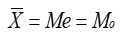
- B. 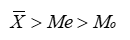
- C. 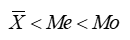
- D. 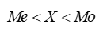

**解析**：右偏（正偏）分布中，极端大值把均值拉向右侧，一般有均值 > 中位数 > 众数。

**易错点**：右偏是“尾巴在右”，不是“众数在右”；记“均值追尾巴”。

## 第35题 · 单选题

> `Q13-BK-035` ｜ 06 单变量分析 / 离散程度 ｜ 答案 **A**

**题目**：在离散程度的测度中，不容易受极端值影响的是（ ）。

**选项**：

- A. 四分位差
- B. 平均差
- C. 标准差
- D. 离散系数

## 第68题 · 多选题

> `Q13-BK-068` ｜ 06 单变量分析 / 概率基础 ｜ 答案 **BD**

**题目**：设A、B为任意两事件，则下列关系成立的有（　　）

**选项**：

- A. 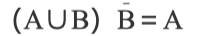
- B. 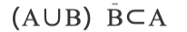
- C. 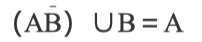
- D. 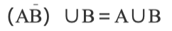
- E. 

## 第80题 · 判断题

> `Q13-BK-080` ｜ 06 单变量分析 / 统计基础 ｜ 答案 **B**

**题目**：用来描述总体的特征的概括性数字度量，称为统计量。（　　）

**选项**：

- A. 对
- B. 错

**解析**：描述总体特征的概括性数字度量称为参数；描述样本特征的才是统计量。

**易错点**：参数对应总体，统计量对应样本，方向不能反。

## 第31题 · 单选题

> `Q14-BK-031` ｜ 06 单变量分析 / 集中趋势 ｜ 答案 **A**

**题目**：当数据中存在极端数值或分布的倾斜程度很大时，以下表述正确的是（ ）。

**选项**：

- A. 选用众数和中位数描述数据集中趋势的准确性要优于平均数
- B. 选用众数和平均数描述数据集中趋势的准确性要优于中位数
- C. 选用平均数和中位数描述数据集中趋势的准确性要优于众数
- D. 选用众数、中位数和平均数描述数据集中趋势的准确性无明显差异

**解析**：均值会受极端值明显影响；中位数和众数对极端值稳健。因此数据存在极端值或分布严重偏斜时，用众数、中位数描述集中趋势更准确。

**易错点**：标准差相同不代表均值代表性相同；偏态分布优先看中位数。

## 第32题 · 单选题

> `Q14-BK-032` ｜ 06 单变量分析 / 离散程度 ｜ 答案 **A**

**题目**：离散程度是指 （） 。

**选项**：

- A. 变量值的变异范围
- B. 变量值的平均水平
- C. 变量值的分布
- D. 变量值的大小

## 第33题 · 单选题

> `Q14-BK-033` ｜ 06 单变量分析 / 离散程度 ｜ 答案 **A**

**题目**：若两组数据的计量单位不同，在比较它们离散程度大小时，应采用（ ）。

**选项**：

- A. 标准差系数
- B. 平均差
- C. 标准差
- D. 全距

## 第34题 · 单选题

> `Q14-BK-034` ｜ 06 单变量分析 / 集中趋势 ｜ 答案 **B**

**题目**：对于某一门课程中80名学生的成绩，有展示四分之一分位数、中位数与四分之三分位数的图形是（ ）。

**选项**：

- A. 直方图
- B. 箱线图
- C. 饼图
- D. 散点图

## 第35题 · 单选题

> `Q14-BK-035` ｜ 06 单变量分析 / 估计量性质 ｜ 答案 **C**

**题目**：样本均值是总体均值的无偏估计的条件是（ ）。

**选项**：

- A. 样本容量必须充分大
- B. 总体必须服从正态分布
- C. 样本必须是随机抽取的
- D. 总体方差必须已知

## 第36题 · 单选题

> `Q14-BK-036` ｜ 06 单变量分析 / 统计指数 ｜ 答案 **C**

**题目**：某种商品销售额增长了5%，商品零售价格增长2%，则商品销售量增长（ ）。

**选项**：

- A. 0.07
- B. 0.1
- C. 0.0294
- D. 0.03

## 第43题 · 单选题

> `Q14-BK-043` ｜ 06 单变量分析 / 集中趋势 ｜ 答案 **B**

**题目**：样本平均数和总体平均数（ ）。

**选项**：

- A. 前者是一个确定值，后者是随机变量
- B. 前者是随机变量，后者是一个确定值
- C. 两者都是随机变量
- D. 两者都是确定值

## 第46题 · 单选题

> `Q14-BK-046` ｜ 06 单变量分析 / 参数估计 ｜ 答案 **D**

**题目**：下列有关参数估计的说法错误的是（ ）。

**选项**：

- A. 参数估计就是利用样本统计量的值来对总体的参数进行估计
- B. 参数估计有点估计和区间估计等形式
- C. 区间估计必须有相应的置信度作为保证
- D. 区间估计的宽度越大说明估计的精确度越高

## 第47题 · 单选题

> `Q14-BK-047` ｜ 06 单变量分析 / 假设检验 ｜ 答案 **C**

**题目**：在假设检验中，第∏类错误是指（）。

**选项**：

- A. 当原假设正确时拒绝原假设
- B. 当备择假设不正确时未拒绝备择假设
- C. 当原假设错误时不拒绝原假设
- D. 当备择假设正确时拒绝备择假设

**解析**：第二类错误是原假设错误时没有拒绝原假设，即“取伪”。

**易错点**：第一类错误是“弃真”，第二类错误是“取伪”。

## 第65题 · 多选题

> `Q14-BK-065` ｜ 06 单变量分析 / 假设检验 ｜ 答案 **ABCD**

**题目**：提出假设的正确做法包括（）。

**选项**：

- A. 明确需要检验的内容
- B. 合理建立零假设与备择假设
- C. 构建一个可解释的调查问题分析框架
- D. 掌握假设检验的分析技术
- E. 利用样本数据进行检验

## 第68题 · 多选题

> `Q14-BK-068` ｜ 06 单变量分析 / 统计推断 ｜ 答案 **BCE**

**题目**：以下关于统计推断的描述中，正确的有（）。

**选项**：

- A. 统计推断是研究如何收集和描述数据的统计方法
- B. 统计推断是研究如何利用样本数据来推断总体特征的统计方法
- C. 统计推断包括参数估计和假设检验等内容
- D. 统计推断的结论是确定的
- E. 统计推断的结论是不确定的

## 第31题 · 单选题

> `Q15-BK-031` ｜ 06 单变量分析 / 离散程度 ｜ 答案 **B**

**题目**：反映均值代表性大小的离散程度的统计量有（ ）。

**选项**：

- A. 异众比
- B. 方差
- C. 级差
- D. 四分位差

## 第32题 · 单选题

> `Q15-BK-032` ｜ 06 单变量分析 / 集中趋势 ｜ 答案 **C**

**题目**：已知某班学生的平均年龄为17.8岁，其中18岁的人数最多，则该分布属于（ ）。

**选项**：

- A. 正态分布
- B. 正偏分布
- C. 左偏分布
- D. 右偏分布

## 第33题 · 单选题

> `Q15-BK-033` ｜ 06 单变量分析 / 集中趋势 ｜ 答案 **D**

**题目**：某班共有30名学生，其某门课程平均分数为75分；其中20位男生的平均分数为70分，那么班上10位女生的平均分数为（）。

**选项**：

- A. 65
- B. 70
- C. 75
- D. 85

## 第34题 · 单选题

> `Q15-BK-034` ｜ 06 单变量分析 / 描述统计 ｜ 答案 **A**

**题目**：下列变量中，既可以采用适用于数值型变量的分析方法，也可以采用适用于顺序变量的分析方法的是（ ）。

**选项**：

- A. 收入
- B. 职业
- C. 性别
- D. 所在地区

## 第35题 · 单选题

> `Q15-BK-035` ｜ 06 单变量分析 / 离散程度 ｜ 答案 **D**

**题目**：某数列变量值平方的平均数等于9，而变量值平均数的平方等于5，则标准差为（ ）。

**选项**：

- A. 1.8
- B. 4
- C. 3
- D. 2

## 第36题 · 单选题

> `Q15-BK-036` ｜ 06 单变量分析 / 参数估计 ｜ 答案 **C**

**题目**：与点估计相比，区间估计的主要优点是（ ）。

**选项**：

- A. 指明了估计的置信度
- B. 有更高的无偏性
- C. 能提供误差的信息
- D. 能直接给出总体参数的估计值

## 第40题 · 单选题

> `Q15-BK-040` ｜ 06 单变量分析 / 概率分布 ｜ 答案 **A**

**题目**：若随机变量，从中随机抽取样本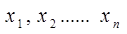，则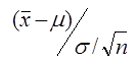服从的分布为（ ）。

**选项**：

- A. 标准正态分布
- B. 近似正态分布
- C. t分布
- D. F分布

## 第68题 · 多选题

> `Q15-BK-068` ｜ 06 单变量分析 / 时间序列 ｜ 答案 **ABC**

**题目**：下列方法中适合对平稳序列进行预测的有（　　）。

**选项**：

- A. 移动平均法
- B. 简单平均法
- C. 指数平滑法
- D. 线性模型法
- E. 非线性模型法

## 第80题 · 判断题

> `Q15-BK-080` ｜ 06 单变量分析 / 时间序列 ｜ 答案 **B**

**题目**：如果时间数列逐期增长量大体相等，则宜拟合二次曲线模型。

**选项**：

- A. 对
- B. 错

## 第31题 · 单选题

> `Q16-BK-031` ｜ 06 单变量分析 / 集中趋势 ｜ 答案 **C**

**题目**：不能用于描述定序数据集中趋势的统计量是（ ）。

**选项**：

- A. 众数
- B. 中位数
- C. 均值
- D. 四分位数

## 第33题 · 单选题

> `Q16-BK-033` ｜ 06 单变量分析 / 区间估计 ｜ 答案 **A**

**题目**：下列关于区间估计的说法中，正确的是（ ）。

**选项**：

- A. 置信概率越小，相应的置信区间越小
- B. 置信概率越小，相应的置信区间越大
- C. 置信概率越大，相应的置信区间越小
- D. 置信概率的大小不影响置信区间的大小

## 第34题 · 单选题

> `Q16-BK-034` ｜ 06 单变量分析 / 假设检验 ｜ 答案 **B**

**题目**：在假设检验时，若增大样本容量，则犯两类错误的概率会（ ）。

**选项**：

- A. 都增大
- B. 都减小
- C. 都不变
- D. 一类增大，二类减小

**解析**：在固定显著性水平下，增大样本容量通常会使犯第一类错误和第二类错误的概率都减小，检验功效提高。

**易错点**：样本量增大不是只影响第二类错误；两类错误通常都会变小。

## 第35题 · 单选题

> `Q16-BK-035` ｜ 06 单变量分析 / 时间序列 ｜ 答案 **B**

**题目**：若无季节变动，则季节指数应该是（ ）。

**选项**：

- A. 0
- B. 1
- C. 大于1
- D. 小于0

**解析**：季节指数以 100%（或 1）为基准；没有季节变动时，各期季节指数应等于 1。

**易错点**：季节指数不是 0；0 表示该期没有活动。

## 第36题 · 单选题

> `Q16-BK-036` ｜ 06 单变量分析 / 集中趋势 ｜ 答案 **D**

**题目**：某组数据的均值为10，方差为25，则离散系数为（ ）。

**选项**：

- A. 0.4
- B. 2.5
- C. 2
- D. 0.5

**解析**：离散系数 = 标准差 / 均值。方差 25，标准差 5；5/10=0.5。

**易错点**：不要拿方差直接除以均值；先开方。

## 第37题 · 单选题

> `Q16-BK-037` ｜ 06 单变量分析 / 参数估计 ｜ 答案 **A**

**题目**：Maximum Likelihood Estimate，简记为MLE，称之为（）。

**选项**：

- A. 最大似然估计
- B. 点估计
- C. 矩估计
- D. 最小二乘法

## 第38题 · 单选题

> `Q16-BK-038` ｜ 06 单变量分析 / 区间估计 ｜ 答案 **A**

**题目**：当抽样方式与样本容量不变的条件下，置信区间越大则使（ ）。

**选项**：

- A. 可靠性越大
- B. 可靠性越小
- C. 估计的误差越小
- D. 可靠性及估计误差均越小

**解析**：在抽样方式和样本容量不变时，置信区间越宽，对应的置信度（可靠性）越高，但估计精度越低。

**易错点**：区间宽=更可靠但更不精确；不要选“误差越小”。

## 第41题 · 单选题

> `Q16-BK-041` ｜ 06 单变量分析 / 区间估计 ｜ 答案 **A**

**题目**：若随机变量，且σ已知，从中随机抽取样本，并经计算得到其均值为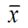,这时由估计μ的置信度为95%的置信区间时，置信区间的宽度（）。

**选项**：

- A. 是确定的
- B. 是随机的
- C. 是人为规定的
- D. 无法确定的

## 第42题 · 单选题

> `Q16-BK-042` ｜ 06 单变量分析 / 集中趋势 ｜ 答案 **C**

**题目**：一般情况下身高服从正态分布，现随机抽取100名儿童，测得数值如下：平均值1.3米，中位数为1.25米，标准差0.13米，则该样本中68名儿童的身高应该是（ ）

**选项**：

- A. 低于1.287米
- B. 高于1.43米
- C. 1.287米至1.313米之间
- D. 1.17米至 1.43米之间

## 第60题 · 多选题

> `Q16-BK-060` ｜ 06 单变量分析 / 统计基础 ｜ 答案 **CE**

**题目**：下列指标中，属于存量指标的是（）。

**选项**：

- A. 资金周转次数
- B. 人均生产总值
- C. 银行存款余额
- D. 固定资产投资额
- E. 资产总额

## 第68题 · 多选题

> `Q16-BK-068` ｜ 06 单变量分析 / 概率分布 ｜ 答案 **AD**

**题目**：概率密度曲线（　　）。

**选项**：

- A. 位于X轴的上方
- B. 位于X轴的下方
- C. 与X轴之间的面积为0
- D. 与X轴之间的面积为1
- E. 与X轴之间的面积为无穷大

## 第70题 · 多选题

> `Q16-BK-070` ｜ 06 单变量分析 / 估计量性质 ｜ 答案 **ABCE**

**题目**：下列说法中正确的有（）

**选项**：

- A. 样本均值是总体均值的无偏估计量
- B. 样本比例是总体比例的无偏估计量
- C. 样本均值是总体均值的一致估计量
- D. 样本标准差是总体标准差的无偏估计量
- E. 样本方差是总体方差的无偏估计量

## 第80题 · 判断题

> `Q16-BK-080` ｜ 06 单变量分析 / 区间估计 ｜ 答案 **A**

**题目**：其他条件不变，在区间估计中置信度越大则置信区间越宽。（　　）

**选项**：

- A. 对
- B. 错

**解析**：其他条件不变时，置信度越高，临界值越大，置信区间越宽。

**易错点**：置信度和区间宽度同向变化；和估计精度反向变化。

## 第31题 · 单选题

> `Q17-BK-031` ｜ 06 单变量分析 / 离散程度 ｜ 答案 **B**

**题目**：两组数据的均值不等，但标准差相同，则（ ）。

**选项**：

- A. 两组数据的差异程度相同
- B. 均值小的差异程度大
- C. 均值大的差异程度大
- D. 无法判断

**解析**：标准差相同说明两组数据的绝对离散程度相同，但均值不同时，相对离散程度要用变异系数（标准差/均值）比较。均值越小，变异系数越大，相对差异越大。

**易错点**：题目问“差异程度”时要区分绝对离散（标准差）和相对离散（变异系数）。

## 第32题 · 单选题

> `Q17-BK-032` ｜ 06 单变量分析 / 偏态与峰度 ｜ 答案 **B**

**题目**：根据分组数据计算的偏态系数为-0.425，它表示（ ）。

**选项**：

- A. 这组数据的分布是右偏，且偏斜程度不大
- B. 这组数据的分布是左偏，且偏斜程度不大
- C. 这组数据的分布是右偏，且偏斜程度较大
- D. 这组数据的分布是左偏，且偏斜程度较大

## 第33题 · 单选题

> `Q17-BK-033` ｜ 06 单变量分析 / 离散程度 ｜ 答案 **C**

**题目**：检验一个正态总体的方差所使用的分布为（ ）。

**选项**：

- A. 正态分布
- B. t分布
- C. 卡方分布
- D. F分布

**解析**：检验正态总体方差使用 χ² 分布；检验两个总体方差是否相等使用 F 分布。

**易错点**：一个方差用卡方，两个方差比用 F。

## 第34题 · 单选题

> `Q17-BK-034` ｜ 06 单变量分析 / 离散程度 ｜ 答案 **C**

**题目**：均值为40，变异系数为0.4，则标准差是（     ）。

**选项**：

- A. 100
- B. 0.01
- C. 16
- D. 4

## 第35题 · 单选题

> `Q17-BK-035` ｜ 06 单变量分析 / 标准分数 ｜ 答案 **D**

**题目**：根据经验法则，服从对称钟形分布的标准分数在[-3，+3]范围内的概率是（     ）。

**选项**：

- A. 0.5
- B. 0.68
- C. 0.95
- D. 0.99

**解析**：经验法则：对称钟形分布中，±1σ 约 68%，±2σ 约 95%，±3σ 约 99.7%，所以 [-3,+3] 约为 0.99。

**易错点**：不要记成 0.95；0.95 对应 ±2σ。

## 第36题 · 单选题

> `Q17-BK-036` ｜ 06 单变量分析 / 集中趋势 ｜ 答案 **B**

**题目**：某组数据的四分之一分位数是45，中位数是85，四分之三分位数是105，则该组数据的分布是（ ）。

**选项**：

- A. 对称的
- B. 左偏的
- C. 右偏的
- D. 无法判断

**解析**：Q1=45，中位数=85，Q3=105。下半部分跨度 40，上半部分跨度 20，左侧尾部更长，因此分布左偏。

**易错点**：中位数到 Q1 的距离大于到 Q3 的距离，是左偏。

## 第41题 · 单选题

> `Q17-BK-041` ｜ 06 单变量分析 / 离散程度 ｜ 答案 **D**

**题目**：要检验两正态总体的方差是否相等，需要用（ ）。

**选项**：

- A. Z检验
- B. t检验
- C.  检验
- D. F检验

**解析**：检验两个正态总体方差是否相等，使用 F 检验（方差比）。

**易错点**：均值比较用 t/Z；方差比较用 F。

## 第44题 · 单选题

> `Q17-BK-044` ｜ 06 单变量分析 / 区间估计 ｜ 答案 **D**

**题目**：在一个学校里随机抽取50名学生调查午餐的消费额。现得到在90%的置信度下学生午餐的平均消费区间是(3.45元， 4.15元).下列说法正确的是（   ）

**选项**：

- A. 这个学校90%的学生午餐消费额在(3.45元， 4.15元)
- B. 这个学校90%的学生午餐平均消费额在(3.45元， 4.15元)
- C. 随机样本的90%学生午餐消费额在(3.45元， 4.15元)
- D. 样本量为50的所有可能样本中的90%学生午餐平均消费额在(3.45元， 4.15元)

## 第80题 · 判断题

> `Q17-BK-080` ｜ 06 单变量分析 / 描述统计 ｜ 答案 **B**

**题目**：频率是指频数与全体观测值个数的比值，不可以用来反映数据的结构。

**选项**：

- A. 对
- B. 错

