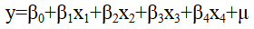
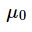
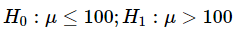
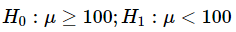
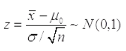
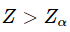
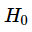

# 07 抽样估计

> 抽样设计、抽样估计 ｜ 共 115 题

## 第14题 · 单选题

> `Q12-BK-014` ｜ 07 抽样估计 / 非抽样误差 ｜ 答案 **C**

**题目**：对调查问题所做的回答记录与真值不同而形成的误差称为（ ）。

**选项**：

- A. 信息误差
- B. 指标误差
- C. 计量误差
- D. 标志误差

**解析**：回答记录与真值不同，说明测量或记录环节产生了偏差，属于计量误差。

**易错点**：计量误差看“回答值与真值之差”，不是抽样误差。

## 第26题 · 单选题

> `Q12-BK-026` ｜ 07 抽样估计 / 样本量 ｜ 答案 **C**

**题目**：当不满意问卷的比例很小、样本量较大、关键变量答案缺失时，则对不满意问卷采取的处理办法是（ ）。

**选项**：

- A. 退回实施现场以获得更好的数据
- B. 按缺失值处理
- C. 整个问卷作废
- D. 满意部分予以保留

## 第36题 · 单选题

> `Q12-BK-036` ｜ 07 抽样估计 / 抽样设计 ｜ 答案 **B**

**题目**：当（ ）时，认为抽样设计A比抽样设计B有效。

**选项**：

- A. 方案A的抽样方差较大
- B. 方案B的抽样方差较大
- C. 方案A的样本均值较小
- D. 方案B的样本均值较小

## 第37题 · 单选题

> `Q12-BK-037` ｜ 07 抽样估计 / 样本量 ｜ 答案 **A**

**题目**：根据计算，初始样本量是400，预计回答率为65%，那么最终确定调查的样本量为（ ）。

**选项**：

- A. 615
- B. 660
- C. 540
- D. 1112

## 第39题 · 单选题

> `Q12-BK-039` ｜ 07 抽样估计 / 简单随机抽样 ｜ 答案 **C**

**题目**：简单随机抽样又称为（ ）。

**选项**：

- A. 抽签抽样
- B. 随机数表抽样
- C. 纯随机抽样
- D. 等距随机抽样

## 第43题 · 单选题

> `Q12-BK-043` ｜ 07 抽样估计 / 抽样基础 ｜ 答案 **B**

**题目**：实际回答率偏低时，有效样本数与精度所需要的样本数之间的关系是（ ）

**选项**：

- A. 前者大于后者
- B. 前者小于后者
- C. 两者相等
- D. 没有关系

## 第45题 · 单选题

> `Q12-BK-045` ｜ 07 抽样估计 / 分层抽样 ｜ 答案 **B**

**题目**：在比例分层抽样分配中，与总体大小成比例分配和与总体大小的平方根成比例分配得到了层估计值的精度（ ）。

**选项**：

- A. 前者高于后者
- B. 后者高于前者
- C. 一样高
- D. 都不高

## 第47题 · 单选题

> `Q12-BK-047` ｜ 07 抽样估计 / 概率抽样 ｜ 答案 **B**

**题目**：在概率抽样中，样本量相同时，设计效应小于1的抽样方法是（ ）。

**选项**：

- A. 简单随机抽样
- B. 分层抽样
- C. 整群抽样
- D. 系统抽样

## 第48题 · 单选题

> `Q12-BK-048` ｜ 07 抽样估计 / 抽样 ｜ 答案 **B**

**题目**：在其他条件不变的情况下，提高抽样估计的置信水平，其区间范围将（ ）。

**选项**：

- A. 保持不变
- B. 随之扩大
- C. 随之缩小
- D. 无法确定

## 第70题 · 多选题

> `Q12-BK-070` ｜ 07 抽样估计 / 简单随机抽样 ｜ 答案 **DE**

**题目**：有放回简单随机抽样情况下，如果将样本量增大到原来的4倍，则以下说法正确的有（ ）。

**选项**：

- A. 样本均值的标准差增大为原来的4倍
- B. 样本均值的标准差增大为原来的2倍
- C. 样本均值的标准差减小原来的四分之一
- D. 样本均值的标准差减小为原来的二分之一
- E. 总体均值置信区间的宽度减小为原来的二分之一

**解析**：有放回简单随机抽样中，样本均值的标准差为 σ/√n。n 变为 4 倍，标准差变为原来的 1/2，置信区间宽度也变为 1/2。

**易错点**：样本量扩大 4 倍，误差只缩小一半，不是四分之一。

## 第71题 · 多选题

> `Q12-BK-071` ｜ 07 抽样估计 / 普查 ｜ 答案 **ABC**

**题目**：与全面调查相比，抽样调查的显著特点是（ ）。

**选项**：

- A. 良好的经济性
- B. 较高的时效性
- C. 较高的准确性
- D. 较低的抽样误差
- E. 较高的非抽样误差

## 第81题 · 判断题

> `Q12-BK-081` ｜ 07 抽样估计 / 系统抽样 ｜ 答案 **A**

**题目**：系统抽样中当抽样间距正好与总体中变化的某种周期性一致时会形成系统偏差。

**选项**：

- A. 对
- B. 错

## 第82题 · 判断题

> `Q12-BK-082` ｜ 07 抽样估计 / 标准误 ｜ 答案 **A**

**题目**：在对同一参数进行估计时，其估计量的抽样标准误或抽样方差愈小，其精确性愈高。

**选项**：

- A. 对
- B. 错

## 第18题 · 单选题

> `Q13-BK-018` ｜ 07 抽样估计 / 无回答 ｜ 答案 **A**

**题目**：无回答的类型是指（）。

**选项**：

- A. 单元无回答与项目无回答
- B. 单指单元无回答
- C. 单指项目无回答
- D. 对象无回答

## 第34题 · 单选题

> `Q13-BK-034` ｜ 07 抽样估计 / 抽样基础 ｜ 答案 **A**

**题目**：下列图形中，更适用于比较研究两个或多个样本或总体的结构性问题的是（ ）。

**选项**：

- A. 环形图
- B. 饼图
- C. 直方图
- D. 茎叶图

## 第36题 · 单选题

> `Q13-BK-036` ｜ 07 抽样估计 / 标准误 ｜ 答案 **C**

**题目**：根据抽样调查资料，某企业工人生产定额平均完成率105%，抽样标准误差为1%，置信度为0.9545（t＝2）时，可以估计该企业生产定额平均完成率（ ）。

**选项**：

- A. 大于107%
- B. 在104%和106%之间
- C. 在103%和107%之间
- D. 小于103%

## 第37题 · 单选题

> `Q13-BK-037` ｜ 07 抽样估计 / 标准误 ｜ 答案 **C**

**题目**：为了研究儿童的成长发育状况，随机抽取了36名儿童，测得平均身高为120CM，标准差为9，抽样标准误差为1.5，则下列各项中正确的是（ ）。

**选项**：

- A. 抽样标准误差是总体数据的标准差
- B. 抽样标准误差是样本数据的标准差
- C. 抽样标准误差是样本均值的标准差
- D. 抽样标准误差是抽样产生的实际误差

## 第38题 · 单选题

> `Q13-BK-038` ｜ 07 抽样估计 / 抽样调查 ｜ 答案 **B**

**题目**：抽样调查的精度是指（ ）

**选项**：

- A. 估计量的抽样误差与待估的参数之比
- B. 估计量的抽样标准误差与待估的参数之比
- C. 估计量的抽样误差与方差之比
- D. 估计量的抽样标准误差与方差之比

## 第39题 · 单选题

> `Q13-BK-039` ｜ 07 抽样估计 / 样本量 ｜ 答案 **A**

**题目**：当抽样方式与样本容量不变的条件下，置信区间越大则使（ ）。

**选项**：

- A. 可靠性越大
- B. 可靠性越小
- C. 估计的误差越小
- D. 可靠性及估计误差均越小

**解析**：在抽样方式和样本容量不变时，置信区间越宽，对应的置信度（可靠性）越高，但估计精度越低。

**易错点**：区间宽=更可靠但更不精确；不要选“误差越小”。

## 第40题 · 单选题

> `Q13-BK-040` ｜ 07 抽样估计 / 抽样方法 ｜ 答案 **A**

**题目**：某校高三年级学生共l000人参加考试，将1000份试卷编好号码后，从中随机抽取30份计算平均成绩，此种抽样方法为（ ）。

**选项**：

- A. 简单随机抽样
- B. 系统随机抽样
- C. 分层抽样
- D. 整群抽样

## 第41题 · 单选题

> `Q13-BK-041` ｜ 07 抽样估计 / 简单随机抽样 ｜ 答案 **B**

**题目**：与简单随机抽样相比，复杂抽样设计的估计值的精确程度（）。

**选项**：

- A. 一定高
- B. 不一定高
- C. 一定低
- D. 不能比

## 第42题 · 单选题

> `Q13-BK-042` ｜ 07 抽样估计 / 抽样调查 ｜ 答案 **D**

**题目**：某社区想对社区内患有高血压的人群进行抽样调查，先抽取一个比较大的样本，从中筛查出高血压人群，然后再从这些人群中抽取一个小的样本进行详细医疗检查。这样的抽样组织形式是（）。

**选项**：

- A. 分层抽样
- B. 整群抽样
- C. 二阶抽样
- D. 二重抽样

**解析**：先抽取一个较大样本筛查出稀有子群，再从中抽取较小样本做详细调查，属于二重抽样。二阶抽样是把同一总体分阶段逐级抽取抽样单元。

**易错点**：二重抽样是“两次抽取、两次筛选”；二阶抽样是“分阶段抽单位”，不要混淆。

## 第43题 · 单选题

> `Q13-BK-043` ｜ 07 抽样估计 / 非抽样误差 ｜ 答案 **C**

**题目**：以下哪项调查会出现计量误差（）。

**选项**：

- A. 根据一份旧名单来抽取部分职工进行民意调查
- B. 随机抽取100名同学进行上网时间调查，仅70名同学进行了回答
- C. 在工业企业抽样调查中，不少企业隐瞒了产值或销售收入资料
- D. 通过对我校校内的学生宿舍进行随机抽样，推断全校学生学习情况

## 第44题 · 单选题

> `Q13-BK-044` ｜ 07 抽样估计 / 抽样框 ｜ 答案 **C**

**题目**：以下哪项调查会出现抽样框误差（）。

**选项**：

- A. 利用了不够准确的辅助信息进行分层
- B. 随机抽取100名同学进行上网时间调查，仅80名同学进行了回答
- C. 根据一份旧名单来抽取部分职工进行民意调查
- D. 在工业企业抽样调查中，不少企业隐瞒了产值或销售收入资料

## 第45题 · 单选题

> `Q13-BK-045` ｜ 07 抽样估计 / 样本量 ｜ 答案 **C**

**题目**：在计算样本量时，需要考虑的两个基本因素是（）。

**选项**：

- A. 总体规模大小和抽样方式
- B. 调查经费限制和时间限制
- C. 总体变异度和调查精度要求
- D. 回答率

**解析**：计算样本量时最基本的两个因素是总体变异程度和调查精度要求；总体规模、经费、回答率会影响实际实施，但不是公式中的两个基本决定因素。

**易错点**：总体规模在简单随机抽样样本量公式中通常不直接出现。

## 第47题 · 单选题

> `Q13-BK-047` ｜ 07 抽样估计 / 辅助变量 ｜ 答案 **D**

**题目**：关于辅助变量信息的描述，正确的是（ ）。

**选项**：

- A. 辅助变量信息只能用于抽样设计环节
- B. 辅助变量信息只能用于抽样估计环节
- C. 辅助变量与调查变量之间要存在因果性关系
- D. 辅助变量与调查变量之间要存在相关性

**解析**：辅助变量需要与研究变量存在相关性，才能在抽样设计和估计中提供信息；不要求二者存在因果关系。辅助变量既可用于设计阶段，也可用于估计阶段。

**易错点**：“相关”不等于“因果”；辅助变量不是只能用于某一个阶段。

## 第48题 · 单选题

> `Q13-BK-048` ｜ 07 抽样估计 / 辅助变量 ｜ 答案 **C**

**题目**：在抽样设计环节，可以利用辅助变量信息进行（）

**选项**：

- A. 比率估计
- B. 回归估计
- C. 分层
- D. 事后分层

**解析**：在抽样设计环节，可以利用辅助变量进行分层，使层内同质、层间异质。比率估计和回归估计属于抽样估计阶段的方法。

**易错点**：题目问“抽样设计环节”，不要选比率估计/回归估计。

## 第49题 · 单选题

> `Q13-BK-049` ｜ 07 抽样估计 / 估计量 ｜ 答案 **A**

**题目**：样本估计量的概率分布称为（）。

**选项**：

- A. 抽样分布
- B. 总体分布
- C. 样本分布
- D. 统计分布

**解析**：样本估计量的概率分布称为抽样分布；总体分布描述总体，样本分布描述样本观测值。

**易错点**：抽样分布的对象是“估计量”，不是单个样本观测值。

## 第50题 · 单选题

> `Q13-BK-050` ｜ 07 抽样估计 / 样本量 ｜ 答案 **B**

**题目**：如果总体目标参数是总体比例，且对于总体比例的大小一无所知，此时为确保达到调查要求的精度，在计算样本量时，可将总体比例的取值设定为（）。

**选项**：

- A. 0
- B. 0.5
- C. 0.25
- D. 1

**解析**：总体比例未知时，取 p=0.5 使 p(1-p) 最大，从而得到最保守（最大）的样本量，确保达到精度要求。

**易错点**：比例取 0.5，对应的方差是 0.25，两个数字不要混。

## 第57题 · 单选题

> `Q13-BK-057` ｜ 07 抽样估计 / 样本量 ｜ 答案 **C**

**题目**：多元线性回归模型中，估计的残差平方和为900，样本容量为50，则随机误差项μ的方差估计量为（）。

**选项**：

- A. 18
- B. 19.57
- C. 20
- D. 20.93

## 第62题 · 多选题

> `Q13-BK-062` ｜ 07 抽样估计 / 调查分类 ｜ 答案 **BCDE**

**题目**：下列说法正确的是（ ）。

**选项**：

- A. 从调查单位中选取少数重点单位进行调查的方法是典型调查
- B. 典型调查的目的是描述和揭示事物的本质和规律
- C. 重点调查的结果不能用于推断总体
- D. 典型调查的结果不能用于推断总体
- E. 普查是为特定目的所专门组织的非经常性全面调查

## 第69题 · 多选题

> `Q13-BK-069` ｜ 07 抽样估计 / 抽样估计 ｜ 答案 **ABCDE**

**题目**：在已知相关信息的条件下，进行分层抽样的区间估计的步骤依次为（）。

**选项**：

- A. 以各层权数进行加权平均计算总平均数
- B. 采用简单算术平均方法，计算各层样本平均数。
- C. 计算层间方差与标准差
- D. 计算各层抽样方差
- E. 根据显著性水平构造估计区间

## 第70题 · 多选题

> `Q13-BK-070` ｜ 07 抽样估计 / 多阶段抽样 ｜ 答案 **ABC**

**题目**：在实际的多阶抽样中，为保证调查的顺利实施，各阶段抽样单元的划分一般可考虑以下一些方法（）。

**选项**：

- A. 按行政区划
- B. 按地理位置归属
- C. 按自然形成的群体
- D. 按居民收入高低划分
- E. 按照总体单元的规模大小

## 第81题 · 判断题

> `Q13-BK-081` ｜ 07 抽样估计 / 滚雪球抽样 ｜ 答案 **A**

**题目**：滚雪球抽样适用于特征稀少的群体的调查。

**选项**：

- A. 对
- B. 错

## 第82题 · 判断题

> `Q13-BK-082` ｜ 07 抽样估计 / 样本量 ｜ 答案 **B**

**题目**：样本量取决于调查估计值所要求的精度。精度越高，样本量越小。

**选项**：

- A. 对
- B. 错

## 第4题 · 单选题

> `Q14-BK-004` ｜ 07 抽样估计 / 重点调查 ｜ 答案 **B**

**题目**：适合对棉花、茶叶等集中产区的农作物生长情况进行调查的方式是（ ）。

**选项**：

- A. 市场普查
- B. 重点市场调查
- C. 典型市场调查
- D. 随机市场调查

## 第7题 · 单选题

> `Q14-BK-007` ｜ 07 抽样估计 / 普查 ｜ 答案 **A**

**题目**：为某一特定目的而专门组织的一次性全面调查，称为（ ）。

**选项**：

- A. 普查
- B. 抽样调查
- C. 统计报表
- D. 访问调查

**解析**：为某一特定目的专门组织的一次性全面调查称为普查。抽样调查只调查部分单位，统计报表是经常性上报，访问调查是具体采集方式。

**易错点**：“一次性、全面、专门组织”是普查的三个关键词。

## 第37题 · 单选题

> `Q14-BK-037` ｜ 07 抽样估计 / 权数 ｜ 答案 **A**

**题目**：设计权数是样本单元入样概率的（）。

**选项**：

- A. 倒数
- B. 平方
- C. 平方根
- D. 相关系数

## 第38题 · 单选题

> `Q14-BK-038` ｜ 07 抽样估计 / 权数 ｜ 答案 **D**

**题目**：所有样本单元的设计权数都相同的抽样设计称为（）。

**选项**：

- A. 等权设计
- B. 加权设计
- C. 自加权设计
- D. 含权设计

## 第39题 · 单选题

> `Q14-BK-039` ｜ 07 抽样估计 / 辅助变量 ｜ 答案 **D**

**题目**：要保证使用辅助信息进行分层的效率以及用于样本分配的精确性，就要求调查变量和所用的辅助变量之间存在（）。

**选项**：

- A. 低度相关
- B. 变异性
- C. 相互独立
- D. 高度相关

## 第40题 · 单选题

> `Q14-BK-040` ｜ 07 抽样估计 / 样本量 ｜ 答案 **A**

**题目**：在其他条件不变的情况下，随着调查总体中所研究指标的实际变异程度的增加，样本量（）。

**选项**：

- A. 必须随之增大
- B. 按比例增加
- C. 按相应的公式计算
- D. 可以保持不变

## 第41题 · 单选题

> `Q14-BK-041` ｜ 07 抽样估计 / 概率抽样 ｜ 答案 **A**

**题目**：在选择概率抽样方法时，目标是使那些最重要的调查指标估计量（）。

**选项**：

- A. 抽样误差最小
- B. 无偏
- C. 与总体真值一致
- D. 容易计算

## 第42题 · 单选题

> `Q14-BK-042` ｜ 07 抽样估计 / 概率抽样 ｜ 答案 **A**

**题目**：福利彩票中奖号码的产生属于（ ）。

**选项**：

- A. 概率抽样
- B. 判断抽样
- C. 随意抽样
- D. 定额抽样

## 第44题 · 单选题

> `Q14-BK-044` ｜ 07 抽样估计 / 抽样 ｜ 答案 **C**

**题目**：当总体内部差异比较大时，比较适合的抽样组织方式是（ ）。

**选项**：

- A. 简单随机抽样
- B. 整群抽样
- C. 分层抽样
- D. 多阶抽样

**解析**：总体内部差异较大时，分层抽样把总体分成层内同质、层间异质的层，可显著提高估计精度，因此比简单随机抽样更合适。

**易错点**：整群抽样适合群内差异大、群间差异小；与分层抽样的条件正好相反。

## 第45题 · 单选题

> `Q14-BK-045` ｜ 07 抽样估计 / 抽样误差 ｜ 答案 **C**

**题目**：抽样误差是指（）。

**选项**：

- A. 在调查过程中由于观察、测量等差错所引起的误差
- B. 在调查中违反随机原则出现的系统误差
- C. 随机抽样而产生的代表性误差
- D. 人为原因所造成的误差

**解析**：抽样误差是随机抽样产生的代表性误差，即样本统计量与总体参数之间的随机差异。观察、测量差错、人为原因、违反随机原则属于非抽样误差或系统误差。

**易错点**：不要把“抽样误差”理解成所有调查误差；抽样误差只针对概率抽样。

## 第48题 · 单选题

> `Q14-BK-048` ｜ 07 抽样估计 / 多阶段抽样 ｜ 答案 **D**

**题目**：以某校为总体的多阶抽样中，第一阶抽样一般是从学校抽学院。下列哪种抽样方案既可行又高效（ ）。

**选项**：

- A. 简单随机抽样
- B. 系统抽样
- C. 二重抽样
- D. 不等概率抽样

## 第49题 · 单选题

> `Q14-BK-049` ｜ 07 抽样估计 / 辅助变量 ｜ 答案 **D**

**题目**：关于辅助变量信息的描述，正确的是（ ）。

**选项**：

- A. 辅助变量信息只能用于抽样设计环节
- B. 辅助变量信息只能用于抽样估计环节
- C. 辅助变量与调查变量之间要存在因果性关系
- D. 辅助变量与调查变量之间要存在相关性

**解析**：辅助变量需要与研究变量存在相关性，才能在抽样设计和估计中提供信息；不要求二者存在因果关系。辅助变量既可用于设计阶段，也可用于估计阶段。

**易错点**：“相关”不等于“因果”；辅助变量不是只能用于某一个阶段。

## 第50题 · 单选题

> `Q14-BK-050` ｜ 07 抽样估计 / 辅助变量 ｜ 答案 **C**

**题目**：在抽样设计环节，可以利用辅助变量信息进行（）

**选项**：

- A. 比率估计
- B. 回归估计
- C. 分层
- D. 事后分层

**解析**：在抽样设计环节，可以利用辅助变量进行分层，使层内同质、层间异质。比率估计和回归估计属于抽样估计阶段的方法。

**易错点**：题目问“抽样设计环节”，不要选比率估计/回归估计。

## 第62题 · 多选题

> `Q14-BK-062` ｜ 07 抽样估计 / 抽样方法 ｜ 答案 **ABCE**

**题目**：下列适合采用抽样方法收集数据的情形有（）。

**选项**：

- A. 居民家计调查
- B. 农产品产量调查
- C. 电视节目收视率调查
- D. 统计基本单位调查
- E. 人口变动调查

## 第64题 · 多选题

> `Q14-BK-064` ｜ 07 抽样估计 / 普查 ｜ 答案 **AE**

**题目**：下列适合采用非全面调查的情形是（ ）。

**选项**：

- A. 预算费用较低
- B. 需要许多小区域的估计
- C. 被调查的总体比较小
- D. 调查总体比例时，总体中具有某种属性的单元很少
- E. 对时效性要求比较高

## 第69题 · 多选题

> `Q14-BK-069` ｜ 07 抽样估计 / 概率抽样 ｜ 答案 **ABE**

**题目**：下列关于几种概率抽样方法设计效应deff的说法中，通常情况下正确的有（）。

**选项**：

- A. 简单随机抽样的deff=1
- B. 分层随机抽样的deff<1
- C. 整群随机抽样的deff<1
- D. 系统随机抽样的deff>1
- E. 多阶段随机抽样的deff>1

## 第70题 · 多选题

> `Q14-BK-070` ｜ 07 抽样估计 / 抽样基础 ｜ 答案 **ACDE**

**题目**：在下列实际调查中，抽样总体和目标总体不一致的是（）。

**选项**：

- A. 通过随机抽取在公园晨练的老人，调查广州市老龄人的身体状况
- B. 我校网络中心通过IP账号列表随机抽取账号，调查我校网络状况
- C. 通过微信投票方式开展调查，评选出中国人最喜爱的篮球明星
- D. 放学时在小学门口利用等距抽样抽取小学生，调查小学生视力状况
- E. 在学校食堂门口发放问卷调查我校本科生学习情况

## 第77题 · 判断题

> `Q14-BK-077` ｜ 07 抽样估计 / 概率抽样 ｜ 答案 **B**

**题目**：无论概率抽样还是非概率抽样都可以计算抽样误差，并能根据需要进行控制。

**选项**：

- A. 对
- B. 错

**解析**：非概率抽样无法计算抽样误差，因为不知道入样概率；抽样误差是概率抽样特有的概念。

**易错点**：非概率抽样可以调查，但不能计算抽样误差。

## 第80题 · 判断题

> `Q14-BK-080` ｜ 07 抽样估计 / 概率抽样 ｜ 答案 **A**

**题目**：抽样调查中只有采用概率抽样方法获取的样本数据才能用来推断总体信息，非概率抽样不能用于推断总体。

**选项**：

- A. 对
- B. 错

**解析**：按教材表述，只有概率抽样才能基于抽样分布对总体进行概率推断；非概率抽样不能用于这种推断。

**易错点**：非概率抽样可用于探索性研究，但不能计算抽样误差和概率推断。

## 第81题 · 判断题

> `Q14-BK-081` ｜ 07 抽样估计 / 无回答 ｜ 答案 **A**

**题目**：无回答调整因子是原样本单元的权数之和与给出回答的单元权数之和的比值。

**选项**：

- A. 对
- B. 错

**解析**：无回答调整因子等于原样本单元的权数之和除以给出回答的单元权数之和，用于把回答样本的权数放大到原样本规模。

**易错点**：分子是原样本权数和，分母是回答单元权数和。

## 第82题 · 判断题

> `Q14-BK-082` ｜ 07 抽样估计 / 比率估计 ｜ 答案 **A**

**题目**：比率估计量可以看成是回归估计量的一种特例。

**选项**：

- A. 对
- B. 错

## 第7题 · 单选题

> `Q15-BK-007` ｜ 07 抽样估计 / 重点调查 ｜ 答案 **D**

**题目**：某市为掌握商品销售情况，对占该市商品销售额80%的五个大商场进行调查，这种调查方式属于（ ）。

**选项**：

- A. 统计报表
- B. 普查
- C. 抽样调查
- D. 重点调查

## 第8题 · 单选题

> `Q15-BK-008` ｜ 07 抽样估计 / 概率抽样 ｜ 答案 **C**

**题目**：下列关于非概率抽样的叙述，错误的是（ ）。

**选项**：

- A. 非概率抽样抽取样本时不遵照随机原则
- B. 非概率抽样无法知道样本统计量的分布
- C. 非概率抽样估计结果的精确性可以用抽样误差来衡量
- D. 非概率抽样的最大特点是操作简便、时效快、成本低

## 第14题 · 单选题

> `Q15-BK-014` ｜ 07 抽样估计 / 抽样基础 ｜ 答案 **B**

**题目**：样本控制较高、速度快、费用中等、保密性较高的调查是（ ）。

**选项**：

- A. 入户面访
- B. 电话调查
- C. 一般邮寄调查
- D. 固定样本邮寄调查

## 第37题 · 单选题

> `Q15-BK-037` ｜ 07 抽样估计 / 抽样 ｜ 答案 **A**

**题目**：当调查总体中各单位之间差异较小，或调查对象不明，难以分组、分类时，适用的抽样技术是（ ）。

**选项**：

- A. 简单随机抽样
- B. 系统抽样
- C. 配额抽样
- D. 分层随机抽样

## 第38题 · 单选题

> `Q15-BK-038` ｜ 07 抽样估计 / 样本量 ｜ 答案 **C**

**题目**：对于二元变量，为确保达到调查要求的精度，在计算样本量时，建议对该指标的总体变异程度的取值设定为（）。

**选项**：

- A. 0
- B. 0.5
- C. 0.25
- D. 1

**解析**：二元变量的方差为 p(1-p)，在 p=0.5 时取最大值 0.25。因此若题目问“总体变异程度（方差）”，应取 0.25；若问“总体比例”，则取 0.5。

**易错点**：比例取 0.5，方差取 0.25；看清题目问的是哪一个。

**待核对**：题干“总体变异程度”与选项 0.25 对应方差；若按总体比例则应选 0.5。答案按方差口径为 C，需结合教材表述。

## 第39题 · 单选题

> `Q15-BK-039` ｜ 07 抽样估计 / 系统抽样 ｜ 答案 **D**

**题目**：连续生产的电子管厂，产品质量检验是这样安排的，在一天中，每隔半小时抽取一次产品进行检验，这是（ ）。

**选项**：

- A. 分层抽样
- B. 简单随机抽样
- C. 整群抽样
- D. 系统抽样

**解析**：在一天中每隔固定时间抽取一次产品，属于系统抽样（等距抽样）。

**易错点**：“每隔半小时”体现固定间隔，不是分层、整群或简单随机。

## 第41题 · 单选题

> `Q15-BK-041` ｜ 07 抽样估计 / 设计效应 ｜ 答案 **B**

**题目**：设计效应小于1时表示（）。

**选项**：

- A. 设计方案的效率低于简单随机抽样
- B. 设计方案的效率高于简单随机抽样
- C. 简单随机抽样的效率与设计方案的效率一样
- D. 设计方案的效率高于分层抽样

**解析**：设计效应 deff = 设计方案的方差 / 简单随机抽样方差。deff<1 表示设计方案效率高于简单随机抽样。

**易错点**：deff 越小越高效；deff>1 才是效率更低。

## 第42题 · 单选题

> `Q15-BK-042` ｜ 07 抽样估计 / 抽样调查 ｜ 答案 **D**

**题目**：下面的哪一种情况适用于抽样调查方法进行调查（ ）。

**选项**：

- A. 总体规模小
- B. 研究对象特征的差异性大
- C. 抽样误差的成本大
- D. 非抽样误差的成本大

**解析**：当非抽样误差的成本很大时，抽样调查比全面调查更合适，因为全面调查涉及的单位多，非抽样误差更难控制。总体规模小、差异大、抽样误差成本大时，抽样调查未必合适。

**易错点**：不要只记“抽样调查省钱”；要看抽样误差与非抽样误差的成本比较。

## 第43题 · 单选题

> `Q15-BK-043` ｜ 07 抽样估计 / 抽样 ｜ 答案 **D**

**题目**：在纯随机重复抽样条件下，如果将样本单位数扩大为原来的4倍，则抽样平均误差（ ）。

**选项**：

- A. 扩大2倍
- B. 扩大4倍
- C. 缩小1倍
- D. 缩小1半

## 第44题 · 单选题

> `Q15-BK-044` ｜ 07 抽样估计 / 概率抽样 ｜ 答案 **D**

**题目**：以下属于随机抽样的是（）。

**选项**：

- A. 通过微信客户端进行线上问卷调查
- B. 一卡车刚刚倒下10吨小麦，堆成圆锥状。从最边沿处取一桶小麦进行淀粉含量调查
- C. 从各班选取10名成绩排名中等的同学进行英语写作能力测试
- D. 在某居民小区，每隔20户抽取一户进行住户调查

## 第45题 · 单选题

> `Q15-BK-045` ｜ 07 抽样估计 / 抽样 ｜ 答案 **C**

**题目**：某银行想知道平均每户活期存款余额和估计其总量，根据存折账号的顺序，每150本存折抽出一本登记其余额。这样的抽样组织形式是（）。

**选项**：

- A. 分层抽样
- B. 整群抽样
- C. 系统抽样
- D. 简单随机抽样

## 第46题 · 单选题

> `Q15-BK-046` ｜ 07 抽样估计 / 抽样调查 ｜ 答案 **D**

**题目**：某社区想对社区内患有高血压的人群进行抽样调查，先抽取一个比较大的样本，从中筛查出高血压人群，然后再从这些人群中抽取一个小的样本进行详细医疗检查。这样的抽样组织形式是（）。

**选项**：

- A. 分层抽样
- B. 整群抽样
- C. 二阶抽样
- D. 二重抽样

**解析**：先抽取一个较大样本筛查出稀有子群，再从中抽取较小样本做详细调查，属于二重抽样。二阶抽样是把同一总体分阶段逐级抽取抽样单元。

**易错点**：二重抽样是“两次抽取、两次筛选”；二阶抽样是“分阶段抽单位”，不要混淆。

## 第47题 · 单选题

> `Q15-BK-047` ｜ 07 抽样估计 / 抽样框 ｜ 答案 **A**

**题目**：在构建某省工业企业抽样框时，有些企业已经破产却没有及时注销，而有些企业还没有来得及去登记注册。此时，推断广东省工业总产值时会（）。

**选项**：

- A. 可能被高估，也可能被低估，要看具体情况
- B. 被低估
- C. 被高估
- D. 不会发生变化

## 第48题 · 单选题

> `Q15-BK-048` ｜ 07 抽样估计 / 抽样误差 ｜ 答案 **C**

**题目**：抽样误差是指（）。

**选项**：

- A. 在调查过程中由于观察、测量等差错所引起的误差
- B. 在调查中违反随机原则出现的系统误差
- C. 随机抽样而产生的代表性误差
- D. 人为原因所造成的误差

**解析**：抽样误差是随机抽样产生的代表性误差，即样本统计量与总体参数之间的随机差异。观察、测量差错、人为原因、违反随机原则属于非抽样误差或系统误差。

**易错点**：不要把“抽样误差”理解成所有调查误差；抽样误差只针对概率抽样。

## 第49题 · 单选题

> `Q15-BK-049` ｜ 07 抽样估计 / 简单随机抽样 ｜ 答案 **A**

**题目**：某抽样设计方案的效率高于简单随机抽样，此时的抽样设计效应应该为（ ）

**选项**：

- A. 小于1
- B. 等于1
- C. 大于1
- D. 大于0

## 第50题 · 单选题

> `Q15-BK-050` ｜ 07 抽样估计 / 抽样方法 ｜ 答案 **D**

**题目**：某调查项目将调查问卷的链接放在某网站主页上，采用有奖答问卷的形式收集数据，这种抽样方法是（ ）。

**选项**：

- A. 配额抽样
- B. 判断抽样
- C. 整群抽样
- D. 自愿抽样

**解析**：把问卷链接放在网站主页、以有奖形式吸引访问者自愿填答，属于自愿抽样（非概率抽样）。配额、判断、整群抽样都不符合“自愿上网填答”的特征。

**易错点**：“自愿”是关键词；有奖并不改变自愿抽样的性质。

## 第59题 · 单选题

> `Q15-BK-059` ｜ 07 抽样估计 / 抽样基础 ｜ 答案 **D**

**题目**：（）是一种将多维空间的研究对象(样本或变量)简化到低维空间进行定位、分析和归类，同时又保留对象间原始关系的数据分析方法。

**选项**：

- A. 因子分析
- B. 主成分分析
- C. 联合分析
- D. 多维标度分析

## 第60题 · 多选题

> `Q15-BK-060` ｜ 07 抽样估计 / 普查 ｜ 答案 **BCD**

**题目**：下面适宜采用非全面调查的有（）。

**选项**：

- A. 二三产业全面发展情况的摸底调查
- B. 某型号日光灯耐用时数检查
- C. 住户收支情况调查
- D. 1%人口调查
- E. 我国人口摸底调查

## 第65题 · 多选题

> `Q15-BK-065` ｜ 07 抽样估计 / 抽样框 ｜ 答案 **ABCE**

**题目**：抽样框误差的表现有（）。

**选项**：

- A. 总体单元有遗漏
- B. 包含非目标总体单元
- C. 总体单元有重复
- D. 总体单元不重不漏
- E. 总体单元不完全

## 第69题 · 多选题

> `Q15-BK-069` ｜ 07 抽样估计 / 抽样误差 ｜ 答案 **ABCDE**

**题目**：下列调查中会出现非抽样误差的有（）。

**选项**：

- A. 在住户抽样调查中发现，某些住户仅填写了支出方面的数据，但没有填写工资收入方面的数据
- B. 为推断某市货运情况，市统计局仅从本地牌照的货车中抽取货车开展抽样调查，没有调查外地牌照货车在某市的货运情况
- C. 在实施不等概率抽样时利用了不够准确的辅助变量确定入样概率
- D. 在工业企业抽样调查中，某些企业为了避税故意将产值数据报小一点
- E. 在实施随机抽样时，所获取的总体单元总数N不准确

## 第70题 · 多选题

> `Q15-BK-070` ｜ 07 抽样估计 / 抽样设计 ｜ 答案 **BCD**

**题目**：关于抽样设计方法的描述中，正确的有（）。

**选项**：

- A. 等距抽样仅在抽取第一个样本单元时采用随机抽取，后续样本单元随之确定，所以等距抽样的样本不满足随机性
- B. 分层抽样精度较高，但要求构建层的抽样框，有时难以满足
- C. 当总体N越大时，实施不等概率抽样就会变得越复杂
- D. 整群抽样虽然精度不高，但是实施非常便利，能够节省调查经费
- E. 多阶抽样的设计效应一般会大于1 ，所以在实际调查中不值得使用

## 第81题 · 判断题

> `Q15-BK-081` ｜ 07 抽样估计 / 整群抽样 ｜ 答案 **B**

**题目**：整群抽样在划分群时，要求群内差异尽可能小，群间差异尽可能大。

**选项**：

- A. 对
- B. 错

**解析**：整群抽样要求群内差异尽可能大、群间差异尽可能小，这样每个群才像总体的缩影；题干说反了。

**易错点**：分层抽样才是层内同质、层间异质；整群抽样相反。

## 第82题 · 判断题

> `Q15-BK-082` ｜ 07 抽样估计 / 抽样框 ｜ 答案 **A**

**题目**：目前，我国还没有构建关于所有住户的名单抽样框信息，因此，在开展住户抽样调查时，只能通过地域框抽取住户。

**选项**：

- A. 对
- B. 错

## 第3题 · 单选题

> `Q16-BK-003` ｜ 07 抽样估计 / 抽样调查 ｜ 答案 **D**

**题目**：对于高职高专毕业生对就业岗位、薪资期望水平进行调查，适宜采用的调查方式是（）。

**选项**：

- A. 市场普查
- B. 重点市场调查
- C. 典型市场调查
- D. 随机市场调查

## 第20题 · 单选题

> `Q16-BK-020` ｜ 07 抽样估计 / 抽样调查 ｜ 答案 **A**

**题目**：在住户收支与生活状况调查项目中，通过对全国城镇住户和农村住户的抽样调查了解全国和各地区城乡居民收入、消费及其他生活状况。该调查项目中的总体是（ ）。

**选项**：

- A. 全国所有常住住户
- B. 被采集数据的住户
- C. 全国所有住户的收入、消费及其他生活状况
- D. 采集的住户收入、消费及其他生活状况数据

## 第39题 · 单选题

> `Q16-BK-039` ｜ 07 抽样估计 / 简单随机抽样 ｜ 答案 **C**

**题目**：当设计方案的效率低于简单随机抽样时设计效应的取值区间为（）

**选项**：

- A. 小于1
- B. 等于1
- C. 大于1
- D. 在1和-1之间

## 第40题 · 单选题

> `Q16-BK-040` ｜ 07 抽样估计 / 简单随机抽样 ｜ 答案 **A**

**题目**：简单随机抽样的设计效应为（）。

**选项**：

- A. 等于1
- B. 大于1
- C. 小于1
- D. 等于0

## 第43题 · 单选题

> `Q16-BK-043` ｜ 07 抽样估计 / 抽样方法 ｜ 答案 **D**

**题目**：影响样本单位数的主要因素是：总体标志变异程度；极限误差的大小；抽样方法与组织方式的不同；人力、物力、财力的可能条件；以及（ ）。

**选项**：

- A. 总体单位的分布
- B. 总体单位的个数
- C. 时间期限
- D. 抽样推断的可靠程度

## 第44题 · 单选题

> `Q16-BK-044` ｜ 07 抽样估计 / 标准误 ｜ 答案 **C**

**题目**：在抽样估计中，抽样标准误大小与下列哪个因素无关？（ ）。

**选项**：

- A. 样本容量
- B. 抽样方式和方法
- C. 概率保证程度
- D. 抽样估计量类型

## 第45题 · 单选题

> `Q16-BK-045` ｜ 07 抽样估计 / 抽样设计 ｜ 答案 **D**

**题目**：某大学想抽取学生开展抽样调查，先用随机方法抽取40个班级，再从每个班级中随机抽取10个学生开展问卷调查，搜集相关数据。这种抽样设计方法属于（）。

**选项**：

- A. 简单随机抽样
- B. 整群抽样
- C. 多重抽样
- D. 多阶抽样

**解析**：先随机抽 40 个班级，再从每个班级抽 10 名学生，是分两个阶段抽取抽样单元，属于多阶抽样。

**易错点**：整群抽样是抽中群后调查群内全部单位；这里还继续抽学生。

## 第46题 · 单选题

> `Q16-BK-046` ｜ 07 抽样估计 / 抽样 ｜ 答案 **C**

**题目**：当总体内部差异比较大时，比较适合的抽样组织方式是（ ）。

**选项**：

- A. 简单随机抽样
- B. 整群抽样
- C. 分层抽样
- D. 多阶抽样

**解析**：总体内部差异较大时，分层抽样把总体分成层内同质、层间异质的层，可显著提高估计精度，因此比简单随机抽样更合适。

**易错点**：整群抽样适合群内差异大、群间差异小；与分层抽样的条件正好相反。

## 第47题 · 单选题

> `Q16-BK-047` ｜ 07 抽样估计 / 抽样误差 ｜ 答案 **C**

**题目**：抽样误差是指（）。

**选项**：

- A. 在调查过程中由于观察、测量等差错所引起的误差
- B. 在调查中违反随机原则出现的系统误差
- C. 随机抽样而产生的代表性误差
- D. 人为原因所造成的误差

**解析**：抽样误差是随机抽样产生的代表性误差，即样本统计量与总体参数之间的随机差异。观察、测量差错、人为原因、违反随机原则属于非抽样误差或系统误差。

**易错点**：不要把“抽样误差”理解成所有调查误差；抽样误差只针对概率抽样。

## 第48题 · 单选题

> `Q16-BK-048` ｜ 07 抽样估计 / 样本量 ｜ 答案 **C**

**题目**：在计算样本量时，需要考虑的两个基本因素是（）。

**选项**：

- A. 总体规模大小和抽样方式
- B. 调查经费限制和时间限制
- C. 总体变异度和调查精度要求
- D. 回答率

**解析**：计算样本量时最基本的两个因素是总体变异程度和调查精度要求；总体规模、经费、回答率会影响实际实施，但不是公式中的两个基本决定因素。

**易错点**：总体规模在简单随机抽样样本量公式中通常不直接出现。

## 第49题 · 单选题

> `Q16-BK-049` ｜ 07 抽样估计 / 估计量 ｜ 答案 **A**

**题目**：样本估计值与总体的真实指标值之间的差距是（）。

**选项**：

- A. 调查误差
- B. 抽样精度
- C. 估计差错
- D. 估计精度

**解析**：样本估计值与总体真实指标值之间的差距是调查误差（总误差），它同时包含抽样误差和非抽样误差。

**易错点**：“调查误差”是总概念，不要与“抽样误差”“估计精度”混为一谈。

## 第50题 · 单选题

> `Q16-BK-050` ｜ 07 抽样估计 / 分层抽样 ｜ 答案 **A**

**题目**：在分层抽样时，各层样本量的分配方法一般不考虑（）。

**选项**：

- A. 常数分配
- B. 按比例分配
- C. 最优分配
- D. 奈曼分配

**解析**：分层抽样的常用样本量分配有按比例分配、最优分配和奈曼分配；“常数分配”不是通常考虑的分配方法。

**易错点**：比例、最优、奈曼是三大分配；常数分配是干扰项。

## 第69题 · 多选题

> `Q16-BK-069` ｜ 07 抽样估计 / 简单随机抽样 ｜ 答案 **ABCD**

**题目**：简单随机抽样一般较适合于以下情形的抽样：（）。

**选项**：

- A. 总体N不是很大
- B. 估计精度要求不高
- C. 有比较完整的抽样框
- D. 总体内部差异不大
- E. 有固定的方向和间隔

## 第77题 · 判断题

> `Q16-BK-077` ｜ 07 抽样估计 / 无回答 ｜ 答案 **A**

**题目**：单元无回答是指被调查单元没有提供任何信息。

**选项**：

- A. 对
- B. 错

## 第81题 · 判断题

> `Q16-BK-081` ｜ 07 抽样估计 / 多阶段抽样 ｜ 答案 **B**

**题目**：多阶段抽样是指在调查的不同阶段分别采用不同的抽样组织形式。

**选项**：

- A. 对
- B. 错

## 第82题 · 判断题

> `Q16-BK-082` ｜ 07 抽样估计 / 抽样误差 ｜ 答案 **B**

**题目**：在其他条件不变的情况下，抽样单位数越多，抽样误差会越大。

**选项**：

- A. 对
- B. 错

**解析**：其他条件不变时，抽样单位数越多，抽样平均误差越小，而不是越大。

**易错点**：样本量与抽样误差反向变化。

## 第16题 · 单选题

> `Q17-BK-016` ｜ 07 抽样估计 / 普查 ｜ 答案 **A**

**题目**：为某一特定目的而专门组织的一次性全面调查，称为（ ）。

**选项**：

- A. 普查
- B. 抽样调查
- C. 统计报表
- D. 访问调查

**解析**：为某一特定目的专门组织的一次性全面调查称为普查。抽样调查只调查部分单位，统计报表是经常性上报，访问调查是具体采集方式。

**易错点**：“一次性、全面、专门组织”是普查的三个关键词。

## 第37题 · 单选题

> `Q17-BK-037` ｜ 07 抽样估计 / 样本量 ｜ 答案 **B**

**题目**：如果总体目标参数是总体比例，且对于总体比例的大小一无所知，此时为确保达到调查要求的精度，在计算样本量时，可将总体比例的取值设定为（    ）。

**选项**：

- A. 0
- B. 0.5
- C. 0.25
- D. 1

**解析**：总体比例未知时，取 p=0.5 使 p(1-p) 最大，从而得到最保守（最大）的样本量，确保达到精度要求。

**易错点**：比例取 0.5，对应的方差是 0.25，两个数字不要混。

## 第38题 · 单选题

> `Q17-BK-038` ｜ 07 抽样估计 / 抽样误差 ｜ 答案 **C**

**题目**：以下错误的概念是：在抽样调查中，抽样误差（           ）。

**选项**：

- A. 不可避免要产生的
- B. 是可以事先计算出来的
- C. 是可以通过改进调查方式来消除的
- D. 其大小是可以控制的

## 第39题 · 单选题

> `Q17-BK-039` ｜ 07 抽样估计 / 抽样方法 ｜ 答案 **B**

**题目**：对全校学生开展抽样调查，按学院进行分组来抽选学生，此种抽样方法为（     ）。

**选项**：

- A. 整群抽样
- B. 分层抽样
- C. 多阶抽样
- D. 简单随机抽样

## 第40题 · 单选题

> `Q17-BK-040` ｜ 07 抽样估计 / 系统抽样 ｜ 答案 **D**

**题目**：连续生产的电子管厂，产品质量检验是这样安排的，在一天中，每隔半小时抽取一次产品进行检验，这是（ ）。

**选项**：

- A. 分层抽样
- B. 简单随机抽样
- C. 整群抽样
- D. 系统抽样

**解析**：在一天中每隔固定时间抽取一次产品，属于系统抽样（等距抽样）。

**易错点**：“每隔半小时”体现固定间隔，不是分层、整群或简单随机。

## 第42题 · 单选题

> `Q17-BK-042` ｜ 07 抽样估计 / 抽样基础 ｜ 答案 **B**

**题目**：从25000名学生中抽取700名学生组成一个样本，则25000名学生的名册称为（  ）。

**选项**：

- A. 地址框
- B. 名录框
- C. 概念框
- D. 地址单位框

**解析**：25000 名学生的名册是抽样所用的名录框。

**易错点**：地址框用于地域抽样；名录框用于人员/单位名单。

## 第43题 · 单选题

> `Q17-BK-043` ｜ 07 抽样估计 / 估计量 ｜ 答案 **A**

**题目**：样本估计量的概率分布称为（      ）。

**选项**：

- A. 抽样分布
- B. 总体分布
- C. 样本分布
- D. 统计分布

**解析**：样本估计量的概率分布称为抽样分布；总体分布描述总体，样本分布描述样本观测值。

**易错点**：抽样分布的对象是“估计量”，不是单个样本观测值。

## 第45题 · 单选题

> `Q17-BK-045` ｜ 07 抽样估计 / 抽样调查 ｜ 答案 **D**

**题目**：下面的哪一种情况适用于抽样调查方法进行调查（ ）。

**选项**：

- A. 总体规模小
- B. 研究对象特征的差异性大
- C. 抽样误差的成本大
- D. 非抽样误差的成本大

**解析**：当非抽样误差的成本很大时，抽样调查比全面调查更合适，因为全面调查涉及的单位多，非抽样误差更难控制。总体规模小、差异大、抽样误差成本大时，抽样调查未必合适。

**易错点**：不要只记“抽样调查省钱”；要看抽样误差与非抽样误差的成本比较。

## 第46题 · 单选题

> `Q17-BK-046` ｜ 07 抽样估计 / 抽样设计 ｜ 答案 **C**

**题目**：某学校审计部门想抽查财务报账单，根据报账单时间先后顺序，每100份报账单抽出一份进行详细审计检查。这种抽样设计方法属于（    ）。

**选项**：

- A. 分层抽样
- B. 整群抽样
- C. 系统抽样
- D. 简单随机抽样

## 第47题 · 单选题

> `Q17-BK-047` ｜ 07 抽样估计 / 配额抽样 ｜ 答案 **A**

**题目**：使用配额抽样的优势在于（      ）。

**选项**：

- A. 降低非随机抽样所产生的偏差
- B. 降低抽样费用
- C. 提高抽样效果
- D. 提高数据准确性

## 第48题 · 单选题

> `Q17-BK-048` ｜ 07 抽样估计 / 抽样框 ｜ 答案 **C**

**题目**：某市想通过抽样调查推断该市公务员群体 “四风”建设的实施效果，在构建抽样框开展抽样时，下列哪种方法是既方便又较为准确的（    ）。

**选项**：

- A. 要求市组织部构建一份所有公务员的名单，从中直接抽取公务员
- B. 先构建该市的地域抽样框抽取住户，筛选出职业为公务员的群体
- C. 先构建该市所有部门的清单，抽取一部分部门然后再抽公务员
- D. 在上班时间站在政府大院门口，采用等距抽样方式抽取来上班的公务员开展调查

## 第49题 · 单选题

> `Q17-BK-049` ｜ 07 抽样估计 / 估计量 ｜ 答案 **A**

**题目**：样本估计值与总体的真实指标值之间的差距是（      ）。

**选项**：

- A. 调查误差
- B. 抽样精度
- C. 估计差错
- D. 估计精度

**解析**：样本估计值与总体真实指标值之间的差距是调查误差（总误差），它同时包含抽样误差和非抽样误差。

**易错点**：“调查误差”是总概念，不要与“抽样误差”“估计精度”混为一谈。

## 第50题 · 单选题

> `Q17-BK-050` ｜ 07 抽样估计 / 抽样方法 ｜ 答案 **D**

**题目**：某调查项目将调查问卷的链接放在某网站主页上，采用有奖答问卷的形式收集数据，这种抽样方法是（     ）。

**选项**：

- A. 配额抽样
- B. 判断抽样
- C. 整群抽样
- D. 自愿抽样

**解析**：把问卷链接放在网站主页、以有奖形式吸引访问者自愿填答，属于自愿抽样（非概率抽样）。配额、判断、整群抽样都不符合“自愿上网填答”的特征。

**易错点**：“自愿”是关键词；有奖并不改变自愿抽样的性质。

## 第68题 · 多选题

> `Q17-BK-068` ｜ 07 抽样估计 / 抽样估计 ｜ 答案 **ACDE**

**题目**：假定某电子元件使用寿命的分布是正态分布，根据历史记录得知该分布的参数为：平均使用寿命  为100小时，标准差σ为 10小时。现在随机抽取100个该类型的电子元件，测得平均寿命为102小时，给定显著性水平α＝0.05，判断该电子元件的使用寿命是否有明显的提高，下列说法正确的有（　　）。

**选项**：

- A. 提出假设 
- B. 提出假设 
- C. 检验统计量及其概率分布为 
- D. 如果   ，则称x与  的差异是显著的，这时拒绝 
- E. 检验结果认为该类型的电子元件的使用寿命确实有显著提高

**解析**：题目要判断寿命是否“明显提高”，应做右侧检验：H0: μ≤100，H1: μ>100。σ 已知，用 Z 统计量，z=(102-100)/(10/√100)=2>1.645，拒绝 H0，认为寿命显著提高。

**易错点**：“提高”是单侧右侧检验，不是双侧；临界值用 1.645，不是 1.96。

## 第69题 · 多选题

> `Q17-BK-069` ｜ 07 抽样估计 / 简单随机抽样 ｜ 答案 **ABC**

**题目**：下列抽样方法获取的样本量一般不高于简单随机抽样的是（  ）。

**选项**：

- A. 分层抽样
- B. 系统抽样
- C. PPS抽样
- D. 整群抽样
- E. 多阶段抽样

## 第70题 · 多选题

> `Q17-BK-070` ｜ 07 抽样估计 / 样本量 ｜ 答案 **ABC**

**题目**：在估计总体均值的情况下确定必要样本容量，如果总体方差未知需要进行估计时，可以采取的估计方法有（  ）。

**选项**：

- A. 根据历史上的类似调查进行估计
- B. 进行一次小规模的预调查进行估计
- C. 将样本比例取为0.5
- D. 根据专家意见确定
- E. 无法确定

## 第72题 · 多选题

> `Q17-BK-072` ｜ 07 抽样估计 / 样本量 ｜ 答案 **BCDE**

**题目**：若采用方差分析法推断某个因素对所考察的指标有无显著影响，该因素有k个水平，样本容量为n，则下列表述中正确的有（　　）。

**选项**：

- A. 检验统计量＝组间平方和/组内平方和
- B. 检验统计量＝组间均方差/组内均方差
- C. 组间均方差＝组间平方和/（k－1）
- D. 组内均方差＝组内平方和/（n－k）
- E. 检验统计量的分布为F（k－1，n－k）

**解析**：方差分析检验统计量 F=MSA/MSE，其中 MSA=SSA/(k-1)，MSE=SSE/(n-k)，服从 F(k-1,n-k)。

**易错点**：不是组间平方和/组内平方和，而是均方之比。

## 第77题 · 判断题

> `Q17-BK-077` ｜ 07 抽样估计 / 抽样框 ｜ 答案 **B**

**题目**：抽样框误差不会导致估计的偏差。

**选项**：

- A. 对
- B. 错

**解析**：抽样框误差会导致样本不能代表目标总体，从而产生估计偏差，因此“不会导致偏差”是错误的。

**易错点**：抽样框误差既是非抽样误差，也会造成偏差。

## 第81题 · 判断题

> `Q17-BK-081` ｜ 07 抽样估计 / 样本量 ｜ 答案 **B**

**题目**：由于甲省人口总量大约是乙省人口总量的10倍，所以在开展人口抽样调查时，为达到同样的估计精度，甲省的样本量也要达到乙省的10倍。

**选项**：

- A. 对
- B. 错

**解析**：样本量主要取决于总体变异程度和精度要求，而不是总体规模。总体扩大 10 倍，不需要把样本量也扩大 10 倍。

**易错点**：大总体不代表要大样本；样本量对总体规模不敏感。

## 第82题 · 判断题

> `Q17-BK-082` ｜ 07 抽样估计 / 抽样框 ｜ 答案 **B**

**题目**：现从学生宿舍楼随机抽取宿舍开展调查，有些宿舍敲门无人回应。由于无法找到相应宿舍里的学生开展调查，因此该调查存在抽样框误差。

**选项**：

- A. 对
- B. 错

**解析**：敲门无人回应属于无回答误差，不是抽样框误差。抽样框误差是名单遗漏、重复、错位等问题。

**易错点**：无回答、计量误差、抽样框误差要分清。

