# 08 双变量关联分析

> 列联分析、相关分析、回归分析 ｜ 共 50 题

## 第49题 · 单选题

> `Q12-BK-049` ｜ 08 双变量关联分析 / 列联分析 ｜ 答案 **B**

**题目**：基于列联表，两变量的独立性检验和两样本的一致性检验均采用（ ）。

**选项**：

- A. F检验
- B. [[原题图片:/static/images/project/389T-DA-B.png（源文件未嵌入）]]检验
- C. t检验
- D. Z检验

**待核对**：原 Excel 未嵌入列联表图片，题干中的图片路径为平台相对路径，知识库保留原路径但无法显示。

## 第50题 · 单选题

> `Q12-BK-050` ｜ 08 双变量关联分析 / 回归分析 ｜ 答案 **B**

**题目**：若直线回归方程y=a+bx中的回归系数b为负数，则说明（ ）。

**选项**：

- A. r为0
- B. r为负数
- C. r为正数
- D. r为任意数

## 第51题 · 单选题

> `Q12-BK-051` ｜ 08 双变量关联分析 / 相关分析 ｜ 答案 **A**

**题目**：现象之间的相互关系可以归纳为两种类型，即（ ）。

**选项**：

- A. 相关关系和函数关系
- B. 相关关系和因果关系
- C. 相关关系和随机关系
- D. 函数关系和因果关系

## 第52题 · 单选题

> `Q12-BK-052` ｜ 08 双变量关联分析 / 回归分析 ｜ 答案 **A**

**题目**：已知某商品供应量y（件）和商品价格x（元）的一元线性回归方程为ŷ=63+152x，该方程表明商品价格每提高1元时，供应量平均（ ）。

**选项**：

- A. 增加152件
- B. 减小152件
- C. 增加63件
- D. 减小63件

## 第53题 · 单选题

> `Q12-BK-053` ｜ 08 双变量关联分析 / 相关分析 ｜ 答案 **A**

**题目**：以下关于相关分析和回归分析的说法，正确的是（ ）。

**选项**：

- A. 进行相关分析时不需事先确定自变量和因变量，但进行回归分析时需要
- B. 进行回归分析时不需事先确定自变量和因变量，但进行相关分析时需要
- C. 进行回归分析和相关分析时都不需事先确定自变量和因变量
- D. 进行回归分析和相关分析时都需事先确定自变量和因变量

## 第54题 · 单选题

> `Q12-BK-054` ｜ 08 双变量关联分析 / 回归分析 ｜ 答案 **B**

**题目**：由某商品广告费用（万元）与销售收入（万元）的有关数据建立的一元线性回归方程为ŷ=-10.25+6.88x，根据回归方程进行推算，则以下叙述正确的是（ ）。

**选项**：

- A. 若广告费用为8万元，商品销售收入为55.04万元
- B. 若广告费用为8万元，商品销售收入为44.79万元
- C. 若商品销售收入为8万元，广告费用为44.79万元
- D. 若商品销售收入为44.79万元，广告费用为8万元

## 第55题 · 单选题

> `Q12-BK-055` ｜ 08 双变量关联分析 / 列联分析 ｜ 答案 **B**

**题目**：在列联表中，对两个分类变量进行 χ2 检验后，若拒绝原假设，则以下表述正确的是（ ）。

**选项**：

- A. 两个变量线性相关
- B. 两个变量存在相关性
- C. 两个变量无线性相关
- D. 两个变量相互独立

## 第69题 · 多选题

> `Q12-BK-069` ｜ 08 双变量关联分析 / 回归分析 ｜ 答案 **ABDE**

**题目**：下列有关估计标准误差的陈述。正确的有（ ）。

**选项**：

- A. 说明回归方程代表性大小的指标
- B. 与标准差的计算原理相同
- C. 估计标准误差越小，表明观测值离回归直线越远
- D. 估计标准误差越大，表明回归直线的代表性越小
- E. 当估计标准误差为0时，说明实际值与估计值之间没有差异

## 第72题 · 多选题

> `Q12-BK-072` ｜ 08 双变量关联分析 / 列联分析 ｜ 答案 **BE**

**题目**：关于列联分析的相关系数，下列说法正确的有（ ）。

**选项**：

- A. 对于2×2列联表， 相关系数取值范围为（0, 1）
- B. 若列联表的行数或列数大于2， 相关系数会随之增加，且没有上限
- C. 若 相关系数为正，表示变量间具有正相关关系
- D. V相关系数适用于具有相同行数和列数的大于2×2的列联表
- E. 即使两个变量完全相关，C相关系数也不可能等于1

## 第83题 · 判断题

> `Q12-BK-083` ｜ 08 双变量关联分析 / 列联分析 ｜ 答案 **A**

**题目**：研究两个品质型变量之间的关系，一般采用列联分析。

**选项**：

- A. 对
- B. 错

## 第26题 · 单选题

> `Q13-BK-026` ｜ 08 双变量关联分析 / 相关分析 ｜ 答案 **B**

**题目**：常用的测度变量之间相关关系的直观方法有（ ）。

**选项**：

- A. 直方图法
- B. 散点图法
- C. 折线图法
- D. 饼状图法

## 第51题 · 单选题

> `Q13-BK-051` ｜ 08 双变量关联分析 / 回归分析 ｜ 答案 **A**

**题目**：已知某工厂甲产品产量和生产成本有直线关系，在这条直线上，当产量为1000时，其生产成本为32000元，其中不随产量变化的成本为8000元，则成本总额对产量的回归方程是（ ）。

**选项**：

- A. ŷ=8000+24x
- B. ŷ=6+0.24x
- C. ŷ=24000+6x
- D. ŷ=24+6000x

## 第52题 · 单选题

> `Q13-BK-052` ｜ 08 双变量关联分析 / 回归分析 ｜ 答案 **C**

**题目**：在回归直线方程y=a+bx中，b称为回归系数，其含义不包括以下哪一项（）。

**选项**：

- A. 确定两变量之间因果的数量关系
- B. 确定两变量的相关方向
- C. 确定因变量的实际值与估计值的变异程度
- D. 确定当自变量增加一个单位时，因变量的平均增加量

## 第53题 · 单选题

> `Q13-BK-053` ｜ 08 双变量关联分析 / 回归分析 ｜ 答案 **B**

**题目**：如果y关于x的回归方程为ŷ＝3－2x，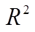＝0.81，则x与y之间的相关系数是（ ）。

**选项**：

- A. 0.9
- B. -0.9
- C. 0.8
- D. -0.8

**解析**：回归方程为 ŷ=3-2x，斜率 -2 表示负相关；R²=0.81，所以 |r|=0.9，结合负斜率得 r=-0.9。

**易错点**：R² 开方只给绝对值，符号必须由回归系数决定。

## 第54题 · 单选题

> `Q13-BK-054` ｜ 08 双变量关联分析 / 列联分析 ｜ 答案 **A**

**题目**：当|φ|＝1时，2×2列联表中的两个变量（ ）。

**选项**：

- A. 完全相关
- B. 相互独立
- C. 存在正相关关系
- D. 存在负相关关系

**解析**：2×2 列联表中 |φ|=1 表示两个变量完全相关，φ 的符号表示相关方向。

**易错点**：φ=0 才是相互独立；|φ|=1 是完全相关。

## 第56题 · 单选题

> `Q13-BK-056` ｜ 08 双变量关联分析 / 回归诊断 ｜ 答案 **D**

**题目**：关于回归模型中的DW统计量，以下说法中错误的是（ ）。

**选项**：

- A. DW值越接近于2，表明相关系数越接近于0
- B. DW值介于0到4之间
- C. 当DW值越接近于4时，表明相关系数越接近于-1
- D. 当DW值越接近于0时，表明相关系数越接近于-1

**解析**：DW 统计量取值 0—4：接近 2 表示无自相关；接近 0 表示正自相关（ρ≈1）；接近 4 表示负自相关（ρ≈-1）。因此“DW 接近 0 表示负相关”是错误的。

**易错点**：DW 接近 0 是正自相关，不是负自相关。

## 第71题 · 多选题

> `Q13-BK-071` ｜ 08 双变量关联分析 / 回归分析 ｜ 答案 **ACE**

**题目**：某研究员通过最小二乘法估计销售收入y与广告投入费用x的线性回归关系，其线性回归模型为：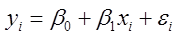，并进行显著性检验，则下列符合误差项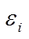假定的是（ ）。

**选项**：

- A. 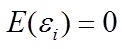
- B. 
- C. 对于不同的x值，的方差相同
- D. 对于不同的x值，的分布不同
- E. 对于不同的x值，之间相互独立

## 第72题 · 多选题

> `Q13-BK-072` ｜ 08 双变量关联分析 / 回归分析 ｜ 答案 **CE**

**题目**：设Y为被解释变量，X为解释变量，用最小二乘法拟合回归方程时，其基本原理是使（ ）。

**选项**：

- A.  最小
- B. 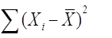最小
- C. 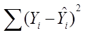最小
- D. 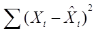最小
- E. 各观测值到回归直线的纵向距离平方和最小

**解析**：最小二乘法的基本原理是使残差平方和最小，也就是各观测值到回归直线的纵向距离平方和最小。

**易错点**：是最小化“纵向距离平方和”，不是横向距离，也不是绝对距离之和。

## 第83题 · 判断题

> `Q13-BK-083` ｜ 08 双变量关联分析 / 列联分析 ｜ 答案 **B**

**题目**：若列联表的行数为3，列数为2，则检验的自由度为6。

**选项**：

- A. 对
- B. 错

**解析**：列联表 χ² 检验的自由度为 (r-1)(c-1)=(3-1)(2-1)=2，不是 6。

**易错点**：不是 r×c，也不是 r+c-2；自由度是 (r-1)(c-1)。

## 第51题 · 单选题

> `Q14-BK-051` ｜ 08 双变量关联分析 / 回归分析 ｜ 答案 **A**

**题目**：下列说法中错误的是（）。

**选项**：

- A. 回归方程的显著性检验的目的是检验回归方程的截距项是否显著为0
- B. 若回归方程在一定的显著性水平下通过了F检验，就可以运用该回归方程进行统计预测
- C. 回归方程的预测包括点估计和区间估计两种
- D. 残差分析是分析模型假定正确与否的基本方法

## 第52题 · 单选题

> `Q14-BK-052` ｜ 08 双变量关联分析 / 相关分析 ｜ 答案 **D**

**题目**：根据样本数据计算得到变量X和Y的样本相关系数r＝0.32，对于总体的变量X和Y的关系可以认为（ ）。

**选项**：

- A. 因r＞0，可以认为X和Y存在正相关关系
- B. X和Y具有因果关系
- C. X和Y具有较强的相关关系
- D. 不能确定X和Y是否相关，因为不知道n的大小

**解析**：样本相关系数 r=0.32 只是样本结果，是否说明总体相关需要做显著性检验，而检验需要样本容量 n。n 未知时不能判断总体是否相关，更不能说因果或强相关。

**易错点**：相关系数绝对值大小要结合检验判断；“相关”也不等于“因果”。

## 第54题 · 单选题

> `Q14-BK-054` ｜ 08 双变量关联分析 / 回归分析 ｜ 答案 **A**

**题目**：在使用样本数据估计回归模型中，如果SSE=100，样本量n=27，则回归模型误差项ε的方差的无偏估计量为（）。

**选项**：

- A. 4
- B. 4.17
- C. 4.25
- D. 5

## 第71题 · 多选题

> `Q14-BK-071` ｜ 08 双变量关联分析 / 回归分析 ｜ 答案 **DE**

**题目**：在一元线性回归分析中，如果估计标准误差为0，则意味着（）。

**选项**：

- A. 回归系数为0
- B. 回归系数为1
- C. 相关系数为0
- D. 相关系数绝对值为1
- E. 解释变量能解释被解释变量的所有变动

## 第72题 · 多选题

> `Q14-BK-072` ｜ 08 双变量关联分析 / 一元回归 ｜ 答案 **AE**

**题目**：在一元线性回归模型中，属于随机变量的是（）。

**选项**：

- A. y
- B. 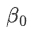
- C. x
- D. 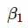
- E. ε

## 第83题 · 判断题

> `Q14-BK-083` ｜ 08 双变量关联分析 / 列联分析 ｜ 答案 **B**

**题目**：列联分析是用于研究两个数值型变量的关系。

**选项**：

- A. 对
- B. 错

## 第51题 · 单选题

> `Q15-BK-051` ｜ 08 双变量关联分析 / 列联分析 ｜ 答案 **D**

**题目**：若列联表的行数为5，列数为6，则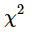统计量的自由度为（ ）。

**选项**：

- A. 5
- B. 11
- C. 30
- D. 20

**解析**：列联表 χ² 检验自由度为 (5-1)(6-1)=4×5=20。

**易错点**：不要算成 5×6=30 或 5+6-1=10。

## 第52题 · 单选题

> `Q15-BK-052` ｜ 08 双变量关联分析 / 回归分析 ｜ 答案 **C**

**题目**：在回归模型中，ε反映的是（ ）。

**选项**：

- A. 由于x的变化引起的y的线性变化部分
- B. 由于y的变化引起的x的线性变化部分
- C. 除x和y的线性关系之外的随机因素对y的影响
- D. 由于x和y的线性关系对y的影响

## 第53题 · 单选题

> `Q15-BK-053` ｜ 08 双变量关联分析 / 回归分析 ｜ 答案 **C**

**题目**：下列说法中错误的是（）。

**选项**：

- A. 回归分析是研究因变量对自变量依赖关系的一种统计分析方法
- B. 一元线性回归是最简单的回归形式，它反映的是因变量与一个自变量之间的回归关系
- C. 进行相关分析时，两个变量都可以是非随机变量
- D. 回归分析可以采用最小二乘法对回归方程的参数进行估计，基本思想是使误差平方和达到最小

## 第54题 · 单选题

> `Q15-BK-054` ｜ 08 双变量关联分析 / 列联分析 ｜ 答案 **D**

**题目**：拟合优度检验中，所用到的分布是（）。

**选项**：

- A. 正态分布
- B. t分布
- C. F分布
- D. 分布

## 第55题 · 单选题

> `Q15-BK-055` ｜ 08 双变量关联分析 / 回归分析 ｜ 答案 **A**

**题目**：在使用样本数据估计回归模型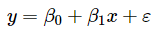中，如果SSE=100，样本量n=27，则回归模型误差项ε的方差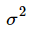的无偏估计量为（）。

**选项**：

- A. 4
- B. 4.17
- C. 4.25
- D. 5

## 第71题 · 多选题

> `Q15-BK-071` ｜ 08 双变量关联分析 / 回归分析 ｜ 答案 **CE**

**题目**：设Y为被解释变量，X为解释变量，用最小二乘法拟合回归方程时，其基本原理是使（ ）。

**选项**：

- A. 最小
- B. 最小
- C. 最小 
- D. 最小
- E. 各观测值到回归直线的纵向距离平方和最小

**解析**：最小二乘法的基本原理是使残差平方和最小，也就是各观测值到回归直线的纵向距离平方和最小。

**易错点**：是最小化“纵向距离平方和”，不是横向距离，也不是绝对距离之和。

## 第72题 · 多选题

> `Q15-BK-072` ｜ 08 双变量关联分析 / 一元回归 ｜ 答案 **ACE**

**题目**：一元线性回归分析中，若（ ），则模型满足关于残差的基本假定。

**选项**：

- A. 残差图中的样本点分布在一条水平带中间
- B. 标准化残差图中大约有95%的标准化残差介于-3和+3之间
- C. 标准化残差分布直方图大体呈现以0为中心的对称钟形分布
- D. 正态概率图中有较多的样本点密集地分布在一条水平带中间
- E. 正态概率图中有较多的样本点密集地分布在45°线附近

## 第73题 · 多选题

> `Q15-BK-073` ｜ 08 双变量关联分析 / 回归分析 ｜ 答案 **AB**

**题目**：打开SPSS软件，依次选择Analyze→ Regression，可进行（）。

**选项**：

- A. 多元线性回归
- B. 二分Logistic回归模型
- C. 因子分析
- D. 对应分析
- E. 多变量方差分析

## 第83题 · 判断题

> `Q15-BK-083` ｜ 08 双变量关联分析 / 列联分析 ｜ 答案 **B**

**题目**：两变量独立性检验的检验目的是检验不同类别的目标变量之间是否存在显著性差异。

**选项**：

- A. 对
- B. 错

## 第51题 · 单选题

> `Q16-BK-051` ｜ 08 双变量关联分析 / 回归诊断 ｜ 答案 **A**

**题目**：在进行残差分析时，如果正态概率图中有较多的样本点密集地分布在（）线附近，则说明模型满足关于残差的基本假定。

**选项**：

- A. 45°
- B. 90°
- C. 30°
- D. 60°

## 第52题 · 单选题

> `Q16-BK-052` ｜ 08 双变量关联分析 / 双变量分析 ｜ 答案 **D**

**题目**：以下关于两变量关联性分析的描述中，错误的是（）。

**选项**：

- A. 列联分析通过原始数据结构，揭示品质型变量之间以及品质型变量各种状态之间相关关系
- B. 相关分析是研究两个变量之间相关关系密切程度的统计方法
- C. 相关分析的目的仅仅是要确认两个变量间是否具有线性相关关系
- D. 回归分析的目的是通过因变量的给定值来估计或预测自变量的均值

## 第53题 · 单选题

> `Q16-BK-053` ｜ 08 双变量关联分析 / 列联分析 ｜ 答案 **D**

**题目**：下列说法中错误的是（）。

**选项**：

- A. 独立性检验是利用样本资料来检验两个变量的独立性，即样本资料所显示的两个分类变量的相关性在总体中是否存在
- B. 研究两个分类变量之间的关系，可以采用列联分析
- C. 在列联分析中，计算的相关系数越接近于1，相关程度越高
- D. 编制列联表时，如果两个变量之间不存在因果关系，行变量和列变量可以随意指定。如果两个变量之间存在因果关系，一般需要把表示影响原因的自变量作为行变量，列入表的横行；把表示变动结果的因变量作为列变量，列入表的纵列

## 第54题 · 单选题

> `Q16-BK-054` ｜ 08 双变量关联分析 / 相关分析 ｜ 答案 **D**

**题目**：根据样本数据计算得到变量X和Y的样本相关系数r＝0.32，对于总体的变量X和Y的关系可以认为（ ）。

**选项**：

- A. 因r＞0，可以认为X和Y存在正相关关系
- B. X和Y具有因果关系
- C. X和Y具有较强的相关关系
- D. 不能确定X和Y是否相关，因为不知道n的大小

**解析**：样本相关系数 r=0.32 只是样本结果，是否说明总体相关需要做显著性检验，而检验需要样本容量 n。n 未知时不能判断总体是否相关，更不能说因果或强相关。

**易错点**：相关系数绝对值大小要结合检验判断；“相关”也不等于“因果”。

## 第55题 · 单选题

> `Q16-BK-055` ｜ 08 双变量关联分析 / 相关分析 ｜ 答案 **B**

**题目**：以下关于C相关系数说法中，错误的是（ ）。

**选项**：

- A. 适用于多种类型的列联表
- B. 取值范围为[0，+∞）
- C. 行列数不同时，不利于比较
- D. 计算简便

## 第57题 · 单选题

> `Q16-BK-057` ｜ 08 双变量关联分析 / 回归分析 ｜ 答案 **D**

**题目**：假设某个多元线性回归模型的多重判定系数为0.9604，能否判断该模型拟合良好？为什么？（ ）

**选项**：

- A. 能，因为该模型多重判定系数足够大
- B. 不能，因为该模型多重判定系数不够大
- C. 不能，因为多重判定系数会随着自变量增加不断趋近于1，只能通过调整的多重判定系数进行判断
- D. 不能，因为只有多重判定系数时信息不足，对该模型的了解度不够，需要结合F检验、t检验等检验以及其他数值结果一起判断

## 第71题 · 多选题

> `Q16-BK-071` ｜ 08 双变量关联分析 / 回归分析 ｜ 答案 **ACE**

**题目**：设家庭每月教育支出对每月总收入的直线回归方程为ŷ=16+0.2x，以下说法中正确的是（）。

**选项**：

- A. 家庭收入每增加100元，每月教育支出将平均增加20元
- B. 家庭收入每增加100元，每月教育支出将平均减少20元
- C. 每月家庭总收入与每月家庭教育支出按相同方向变动
- D. 每月家庭总收入与每月家庭教育支出按相反方向变动
- E. 当家庭每月总收入为5000元时，每月教育支出平均为1016元。

## 第83题 · 判断题

> `Q16-BK-083` ｜ 08 双变量关联分析 / 相关分析 ｜ 答案 **A**

**题目**：Spearman秩相关系数在回归分析中可以用来检验是否存在异方差。

**选项**：

- A. 对
- B. 错

**解析**：Spearman 秩相关系数可以用于检验残差绝对值与拟合值之间的相关性，从而辅助判断异方差。

**易错点**：这是异方差检验的一种辅助方法，不是回归系数的显著性检验。

## 第51题 · 单选题

> `Q17-BK-051` ｜ 08 双变量关联分析 / 列联分析 ｜ 答案 **B**

**题目**：以下关于列联分析的说法，错误的是（  ）。

**选项**：

- A. 列联表用于检验变量之间是否有关联
- B. 列联表可以检验变量之间是否具有因果关系
- C. 使用卡方分布进行独立性检验时，一般要求样本量足够大（n>50）
- D. 列联表中相关系数越接近于1，相关程度越高

## 第52题 · 单选题

> `Q17-BK-052` ｜ 08 双变量关联分析 / 回归分析 ｜ 答案 **A**

**题目**：对具有因果关系的现象进行回归分析时，以下说法正确的是（ ）。

**选项**：

- A. 只能将原因变量作为自变量
- B. 只能将结果变量作为自变量
- C. 原因变量和结果变量均可作自变量
- D. 没有必要区分自变量和因变量

## 第53题 · 单选题

> `Q17-BK-053` ｜ 08 双变量关联分析 / 回归分析 ｜ 答案 **B**

**题目**：如果y关于x的回归方程为ŷ＝3－2x，  ＝0.81，则x与y之间的相关系数是（  ）。

**选项**：

- A. 0.9
- B. -0.9
- C. 0.8
- D. -0.8

**解析**：回归方程为 ŷ=3-2x，斜率 -2 表示负相关；R²=0.81，所以 |r|=0.9，结合负斜率得 r=-0.9。

**易错点**：R² 开方只给绝对值，符号必须由回归系数决定。

## 第54题 · 单选题

> `Q17-BK-054` ｜ 08 双变量关联分析 / 一元回归 ｜ 答案 **B**

**题目**：在一元线性回归中，检验 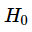 ：  =0，下面结论正确的是（  ）。

**选项**：

- A. 相关系数检验、t检验、F检验三种方法不等价
- B. 相关系数检验、t检验、F检验三种方法是等价的
- C. 相关系数检验法只能用t统计量检验，不能用F统计量检验
- D. F检验只能用F统计量检验，而不能用t统计量检验

**解析**：一元线性回归中，对回归系数 β=0 的检验，相关系数检验、t 检验和 F 检验三种方法是等价的。

**易错点**：等价的前提是一元线性回归；多元回归中 t 检验和 F 检验含义不同。

## 第55题 · 单选题

> `Q17-BK-055` ｜ 08 双变量关联分析 / 回归分析 ｜ 答案 **C**

**题目**：残差分析中，下列不能用来分析回归方程模型假定是否正确的方法是（  ）。

**选项**：

- A. 残差图
- B. 标准化残差图
- C. 拟合散点图
- D. 正态概率图

## 第71题 · 多选题

> `Q17-BK-071` ｜ 08 双变量关联分析 / 一元回归 ｜ 答案 **ACD**

**题目**：一元线性回归中，可以说明回归模型的假设合理的残差图特征有（）。

**选项**：

- A. 残差落在一水平直线附近
- B. 残差落在一倾斜直线附近
- C. 残差的正态概率图大致落在一条直线附近
- D. 残差关于一水平直线大致对称
- E. 随自变量增大，残差的绝对值也增大

## 第73题 · 多选题

> `Q17-BK-073` ｜ 08 双变量关联分析 / 相关分析 ｜ 答案 **ABDE**

**题目**：以下关于相关分析和回归分析的表述中，正确的是（     ）。

**选项**：

- A. 相关分析研究变量之间的依存关系
- B. 回归分析研究变量之间的因果关系
- C. 相关分析需要明确自变量和因变量
- D. 相关分析和回归分析在分析目的与分析方法方面有明显区别
- E. 回归分析根据回归模型对总体进行推断及预测

## 第83题 · 判断题

> `Q17-BK-083` ｜ 08 双变量关联分析 / 相关分析 ｜ 答案 **B**

**题目**：相关关系按相关的方向不同，可以分为线性相关和非线性相关。

**选项**：

- A. 对
- B. 错

