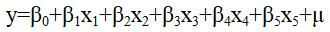
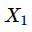
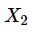

# 09 多变量分析（一）

> 多变量方差分析、多元回归、Logistic 模型 ｜ 共 27 题

## 第56题 · 单选题

> `Q12-BK-056` ｜ 09 多变量分析（一） / 方差分析 ｜ 答案 **B**

**题目**：在方差分析中，对于因素的每一水平，其观测值来自（ ）。

**选项**：

- A. 正态分布的配额抽样样本
- B. 正态分布的简单随机样本
- C. 任意分布的配额抽样样本
- D. 任意分布的简单随机样本

## 第57题 · 单选题

> `Q12-BK-057` ｜ 09 多变量分析（一） / 方差分析 ｜ 答案 **A**

**题目**：在方差分析中，总离差平方和反映的是（ ）。

**选项**：

- A. 全部观察值之间的差异程度
- B. 由控制变量变化所引起的观察值之间的差异程度
- C. 由随机波动所引起的观察值之间的差异程度
- D. 各组离差平方的总和

## 第58题 · 单选题

> `Q12-BK-058` ｜ 09 多变量分析（一） / 判别分析 ｜ 答案 **C**

**题目**：进行判别分析时要求分组变量必须是（ ）。

**选项**：

- A. 定序变量
- B. 定比变量
- C. 定类变量
- D. 定距变量

## 第84题 · 判断题

> `Q12-BK-084` ｜ 09 多变量分析（一） / Logistic回归 ｜ 答案 **B**

**题目**：在Logistic回归中，优势比率为事件不发生与发生的概率比。

**选项**：

- A. 对
- B. 错

**解析**：Logistic 回归中优势比（odds ratio）是事件发生概率与不发生概率之比，即 p/(1-p)，不是不发生与发生之比。

**易错点**：“发生/不发生”与“不发生/发生”互为倒数，方向不能反。

## 第55题 · 单选题

> `Q13-BK-055` ｜ 09 多变量分析（一） / 方差分析 ｜ 答案 **C**

**题目**：用方差分析对多个总体的参数进行检验时，统计量MSA/MSE服从的分布是（　　）。

**选项**：

- A. 分布
- B. 正态分布
- C. F分布
- D. t分布

**解析**：方差分析中检验统计量 MSA/MSE 服从 F 分布，自由度为 (k-1, n-k)。

**易错点**：不要选 t 分布；t 检验用于两组均值，方差分析用于多组均值。

## 第73题 · 多选题

> `Q13-BK-073` ｜ 09 多变量分析（一） / 多变量方差分析 ｜ 答案 **BCE**

**题目**：以下对Wilks Λ统计量的理解中，正确的是（ ）。

**选项**：

- A. 其值介于0到4之间
- B. 其值介于0到1之间
- C. 它可以用于多变量方差分析的显著性检验
- D. 其值越小，表明控制变量对观测变量的影响越显著
- E. 其值越大，表明控制变量对观测变量的影响越显著

**待核对**：题库答案 BCE 中，E“Wilks Λ 值越大越显著”与标准口径相反：Wilks Λ 取值 0—1，通常越小越显著。B、C 无争议；考试以本校教材为准。

## 第84题 · 判断题

> `Q13-BK-084` ｜ 09 多变量分析（一） / 多变量概述 ｜ 答案 **A**

**题目**：多元统计分析研究的是多个随机变量及其相互关系的统计总体。

**选项**：

- A. 对
- B. 错

## 第53题 · 单选题

> `Q14-BK-053` ｜ 09 多变量分析（一） / 方差分析 ｜ 答案 **D**

**题目**：单因素方差分析的备择假设是（ ）。

**选项**：

- A. 两组均数相同
- B. 多组均数全相同
- C. 两组均数不相同
- D. 多组均数不全相同

**解析**：单因素方差分析的备择假设是多个总体的均值不全相同，而不是两两都不相同。

**易错点**：“不全相同”只要有一个不同即可，不等于“全不相同”。

## 第55题 · 单选题

> `Q14-BK-055` ｜ 09 多变量分析（一） / 方差分析 ｜ 答案 **C**

**题目**：用方差分析对多个总体的参数进行检验时，统计量MSA/MSE服从的分布是（　　）。

**选项**：

- A. 分布
- B. 正态分布
- C. F分布
- D. t分布

**解析**：方差分析中检验统计量 MSA/MSE 服从 F 分布，自由度为 (k-1, n-k)。

**易错点**：不要选 t 分布；t 检验用于两组均值，方差分析用于多组均值。

## 第56题 · 单选题

> `Q14-BK-056` ｜ 09 多变量分析（一） / 方差分析 ｜ 答案 **C**

**题目**：在单因素多变量方差分析中，已知组内平方和的自由度为12，组间平方和的自由度为5，总平方和的自由度为（）。

**选项**：

- A. 60
- B. 59
- C. 17
- D. 16

## 第57题 · 单选题

> `Q14-BK-057` ｜ 09 多变量分析（一） / 方差分析 ｜ 答案 **D**

**题目**：单因素方差分析中，所涉及的两个变量（）。

**选项**：

- A. 都为数值型变量
- B. 都为分类型变量
- C. 分别是数值型自变量与分类型因变量
- D. 分别是分类型自变量与数值型因变量

## 第58题 · 单选题

> `Q14-BK-058` ｜ 09 多变量分析（一） / 判别分析 ｜ 答案 **C**

**题目**：判别分析方法经常与以下哪类多元分析方法联合使用（ ）。

**选项**：

- A. 因子分析
- B. 主成分分析
- C. 聚类分析
- D. 典型相关分析

## 第59题 · 单选题

> `Q14-BK-059` ｜ 09 多变量分析（一） / 结构方程 ｜ 答案 **A**

**题目**：结构方程模型主要用来处理（）。

**选项**：

- A. 潜在变量
- B. 可观测变量
- C. 代理变量
- D. 因变量

## 第73题 · 多选题

> `Q14-BK-073` ｜ 09 多变量分析（一） / 多变量方差分析 ｜ 答案 **BE**

**题目**：下列关于WilksΛ统计量与Wald统计量的说法中，正确的是（ ）。

**选项**：

- A. Wilks统计量可以用于单因素多变量方差分析的显著性检验，Wald统计量则用于一般线性回归的显著性检验
- B. Wilks统计量可以用于单因素多变量方差分析的显著性检验，Wald统计量则用于Logistic模型的显著性检验
- C. Wilks统计量可以用于一般线性回归模型的显著性检验，Wald统计量则用于线性回归的显著性检验
- D. 单个解释变量的Wald统计量服从正态分布
- E. Wilks统计量服从威尔克斯分布

## 第84题 · 判断题

> `Q14-BK-084` ｜ 09 多变量分析（一） / 多元回归 ｜ 答案 **B**

**题目**：多元线性回归模型中，多重判定系数同时考虑了样本量个数和自变量个数。

**选项**：

- A. 对
- B. 错

## 第57题 · 单选题

> `Q15-BK-057` ｜ 09 多变量分析（一） / Logistic回归 ｜ 答案 **B**

**题目**：Logistic回归模型中的Score检验结果能判断（ ）。

**选项**：

- A. 自变量间是否存在高度相关性
- B. 将自变量纳入Logistic模型并进行回归是否有意义
- C. Logistic模型中的某个自变量的回归系数是否显著
- D. 使用哪种方法估计Logistic模型的参数

## 第58题 · 单选题

> `Q15-BK-058` ｜ 09 多变量分析（一） / 判别分析 ｜ 答案 **A**

**题目**：Fisher判别法的建立思想基础为（ ）。

**选项**：

- A. 方差分析
- B. 假设检验
- C. 最小误判准则
- D. 距离最短

## 第84题 · 判断题

> `Q15-BK-084` ｜ 09 多变量分析（一） / 方差分析 ｜ 答案 **B**

**题目**：在方差分析中，组间方差可以反映样本数据与其各组均值间的差异。

**选项**：

- A. 对
- B. 错

**解析**：组间方差反映各组均值之间的差异，组内方差才反映样本观测值与其组均值之间的差异。

**易错点**：“组间”看均值差异，“组内”看个体差异。

## 第56题 · 单选题

> `Q16-BK-056` ｜ 09 多变量分析（一） / 多元回归 ｜ 答案 **C**

**题目**：多元线性回归模型中，已知多重判定系数为0.8，样本量为100，求调整的多重判定系数值为（ ）。

**选项**：

- A. 0.8426
- B. 0.802
- C. 0.7894
- D. 0.6209

**解析**：调整后的多重判定系数 = 1-(1-R²)(n-1)/(n-k-1)。本题按 k=5 计算：1-0.2×99/94≈0.7894。

**易错点**：调整 R² 会小于原 R²；分母是 n-k-1，不是 n-1。

**待核对**：题干未明示自变量个数，解析按 k=5 反推调整 R²=0.7894；若 k 不同，结果会变化。

## 第58题 · 单选题

> `Q16-BK-058` ｜ 09 多变量分析（一） / 方差分析 ｜ 答案 **D**

**题目**：下面哪项不在SPSS “Analyze →Compare Means”菜单中。（ ）

**选项**：

- A. Independent-Samples T Test
- B. one-way ANOVA
- C. Paired-Samples T Test
- D. Explore

## 第72题 · 多选题

> `Q16-BK-072` ｜ 09 多变量分析（一） / 非参数检验 ｜ 答案 **ABDE**

**题目**：对于两样本的统计推断问题，下列关于Mood方差检验的说法，正确的是（)。

**选项**：

- A. Mood方差检验的检验统计量基于混合样本中的秩建立
- B. Mood方差检验需要假设两随机样本相互独立
- C. Mood方差检验中需要以混合样本的方差为分界点制作列联表
- D. Mood方差检验需要假设两个随机样本的差异只是体现在尺度上
- E. 在原假设成立时，检验统计量的值不应过大或过小

## 第73题 · 多选题

> `Q16-BK-073` ｜ 09 多变量分析（一） / 非参数检验 ｜ 答案 **BE**

**题目**：两个（相关样本）配对资料的变量值为和，则进行Wilcoxon符号秩检验需要（ ）。

**选项**：

- A. 按照与的差值从小到大编秩
- B. 把与的差的绝对值从小到大编秩
- C. 按照和综合从小到大编秩
- D. 把和综合按绝对值从小到大编秩
- E. 当与的差值为0时，则不参与编秩

## 第84题 · 判断题

> `Q16-BK-084` ｜ 09 多变量分析（一） / 多元回归 ｜ 答案 **B**

**题目**：多元线性回归中，若输出结果中方差扩大因子VIF值接近于0，表明该模型存在严重的多重共线性。

**选项**：

- A. 对
- B. 错

**解析**：VIF 越大说明多重共线性越严重；VIF 接近于 0 并不表示严重共线性（实际上 VIF 通常不小于 1）。

**易错点**：VIF 大才是问题，不是小。

## 第17题 · 单选题

> `Q17-BK-017` ｜ 09 多变量分析（一） / 方差分析 ｜ 答案 **B**

**题目**：对实验数据进行分析的常用方法是（  ）。

**选项**：

- A. 频数分析
- B. 方差分析
- C. 相关分析
- D. 因子分析

## 第56题 · 单选题

> `Q17-BK-056` ｜ 09 多变量分析（一） / 多元回归 ｜ 答案 **C**

**题目**：关于多元线性回归分析应满足的基本假定，以下说法错误的是（  ）。

**选项**：

- A. 随机误差项零均值
- B. 随机误差项服从正态分布
- C. 随机误差项异方差
- D. 自变量彼此间无多重共线性

## 第57题 · 单选题

> `Q17-BK-057` ｜ 09 多变量分析（一） / 多元回归 ｜ 答案 **D**

**题目**：多元回归模型中，关于相关性及相关系数的说法正确的是（ ）。

**选项**：

- A. 因变量和各个自变量之间的相关关系只受到对应的一个变量的影响
- B. 简单相关系数能足够真实的反映因变量与自变量之间的相关性
- C. 偏相关系数不能够真实的反映因变量与自变量之间的相关性
- D. 偏相关系数是在消除其他变量影响下计算得到的两个变量间的相关系数

## 第84题 · 判断题

> `Q17-BK-084` ｜ 09 多变量分析（一） / 方差分析 ｜ 答案 **A**

**题目**：对于多变量方差分析而言，需要满足的假定前提包括：数据来源于随机抽样，样本观察值之间相互独立；各因变量为正态分布且方差相等；各因变量之间为多元正态分布。

**选项**：

- A. 对
- B. 错

**解析**：多变量方差分析要求随机抽样、观测独立、各因变量正态且方差齐性、因变量之间多元正态。

**易错点**：MANOVA 的假定是多元正态+协方差齐性，不要只记一元方差分析的假定。

