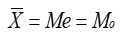
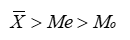
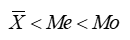
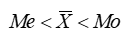

# Z06 描述统计基础

> 统计学基础、规模结构比较、集中度、差异性 ｜ 共 14 题

## 第45题 · 单选题

> `Q17-ZK-045` ｜ Z06 描述统计基础 / 集中趋势 ｜ 答案 **B**

**题目**：某学校对新生进行英语水平测试，结果成绩的平均分是80分，标准差是5分，中位数是85分，则新生英语成绩的分布形状是（ ）。

**选项**：

- A. 对称的
- B. 左偏的
- C. 右偏的
- D. 无法判断

## 第46题 · 单选题

> `Q17-ZK-046` ｜ Z06 描述统计基础 / 集中趋势 ｜ 答案 **A**

**题目**：标志变异指标中的平均差越大，用平均数测算数值的代表性（ ）。

**选项**：

- A. 越差
- B. 越好
- C. 不变
- D. 无法确定

## 第47题 · 单选题

> `Q17-ZK-047` ｜ Z06 描述统计基础 / 描述统计 ｜ 答案 **C**

**题目**：以下对于相对次数分布的描述，表述错误的是（  ）。

**选项**：

- A. 相对次数没有负值
- B. 相对次数的最大值为1
- C. 仅适用于描述质性数据
- D. 根据大数法则，随着随机试验次数的增加，事件的相对次数分配会趋于稳定

## 第48题 · 单选题

> `Q17-ZK-048` ｜ Z06 描述统计基础 / 时间序列 ｜ 答案 **C**

**题目**：某地区去年粮食产量的环比增长速度为3%，今年为4%，则近两年该地区粮食产量共增长了（  ）。

**选项**：

- A. 0.01
- B. 0.07
- C. 0.0712
- D. 0.12

## 第49题 · 单选题

> `Q17-ZK-049` ｜ Z06 描述统计基础 / 集中趋势 ｜ 答案 **B**

**题目**：在右偏态分布条件下算术平均数、中位数和众数的关系表现为(  ).

**选项**：

- A. 
- B. 
- C. 
- D. 

## 第50题 · 单选题

> `Q17-ZK-050` ｜ Z06 描述统计基础 / 集中趋势 ｜ 答案 **B**

**题目**：某项关于消费者在超市购物频率的调查资料显示，大多数居民每周上超市购物3次，这一数字是（ ）。

**选项**：

- A. 全距
- B. 众数
- C. 中位数
- D. 平均数

## 第51题 · 单选题

> `Q17-ZK-051` ｜ Z06 描述统计基础 / 统计指数 ｜ 答案 **B**

**题目**：下列相对数中，属于不同时期对比的指标有（ ）。

**选项**：

- A. 结构相对数
- B. 动态相对数
- C. 比较相对数
- D. 强度相对数

## 第52题 · 单选题

> `Q17-ZK-052` ｜ Z06 描述统计基础 / 区间估计 ｜ 答案 **A**

**题目**：在其它条件相同的情况下，95%的置信区间比90%的置信区间（ ）。

**选项**：

- A. 要宽
- B. 要窄
- C. 相同
- D. 不确定

## 第58题 · 单选题

> `Q17-ZK-058` ｜ Z06 描述统计基础 / 参数估计 ｜ 答案 **B**

**题目**：点估计的优良性准则包括一致性、有效性和（ ）。

**选项**：

- A. 准确性
- B. 无偏性
- C. 科学性
- D. 真实性

## 第61题 · 单选题

> `Q17-ZK-061` ｜ Z06 描述统计基础 / 区间估计 ｜ 答案 **A**

**题目**：在从一个方差已知的总体中采用同样的方法抽取两个随机样本进行总体均值的统计推断，样本容量分别为50和100，则依此建立的95%置信区间宽度（  ）。

**选项**：

- A. 前者大于后者
- B. 前者小于后者
- C. 两者一样大
- D. 无法确定

## 第66题 · 单选题

> `Q17-ZK-066` ｜ Z06 描述统计基础 / 正态分布 ｜ 答案 **D**

**题目**：关于正态分布，以下陈述正确的是（  ）

**选项**：

- A. 平均数不为负数
- B. 偏态系数为1
- C. 为一个双峰分布
- D. 峰度系数为3

## 第93题 · 判断题

> `Q17-ZK-093` ｜ Z06 描述统计基础 / 集中趋势 ｜ 答案 **B**

**题目**：几何平均数中的各标志值是独立的，即某一标志量的大小不受前一标志量的影响。（ ）

**选项**：

- A. 对
- B. 错

## 第94题 · 判断题

> `Q17-ZK-094` ｜ Z06 描述统计基础 / 集中趋势 ｜ 答案 **A**

**题目**：对于分组变量计算出的均值，是实际均值的近似值。（ ）

**选项**：

- A. 对
- B. 错

## 第100题 · 判断题

> `Q17-ZK-100` ｜ Z06 描述统计基础 / 偏态与峰度 ｜ 答案 **B**

**题目**：当各组样本数据呈严重偏态时，也可以作方差分析。

**选项**：

- A. 对
- B. 错

